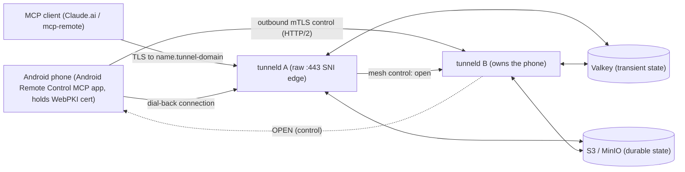

# Android Remote Control MCP — tunnel server (`tunneld`)

`tunneld` is the self-hosted end-to-end-encrypted tunnel server that gives the
[Android Remote Control MCP](https://github.com/danielealbano/android-remote-control-mcp) app a stable public hostname. The phone terminates TLS itself with a
publicly-trusted (WebPKI) certificate for `<name>.<tunnel-domain>`, earned by **attested enrollment**;
tunneld is the internet edge on raw TCP `:443`, peeks each ClientHello, routes on SNI, and splices the
**opaque encrypted byte stream** to a connection the phone dials back to the node where the client
entered — it can NEVER read tunnel traffic. There is no reverse proxy (no Cloudflare, no Traefik).

See [`docs/PROJECT.md`](docs/PROJECT.md) for the operational reference,
[`docs/ARCHITECTURE.md`](docs/ARCHITECTURE.md) for the system map, and
[`docs/PROTOCOL.md`](docs/PROTOCOL.md) for the wire protocol.

## Architecture



The client's TLS lands on any replica (entry node A); A resolves `name → owner` via Valkey and has the
owner (B, or A itself) send the phone an `OPEN`; the phone dials back to A on a fresh connection and A
splices the client to it — no data crosses nodes. The phone terminates TLS — tunneld relays opaque bytes end
to end.

## Deployment quickstart

Run **one replica per host** (this single-host compose runs one). Durable state is any plain-S3 bucket
(MinIO locally); transient state is Valkey.

1. **Generate the internal CA** (once) — the phone earns an identity cert signed by it:
   ```sh
   deploy/scripts/gen-ca.sh deploy/ca      # creates deploy/ca/{ca.pem,ca-key.pem}; compose mounts it at /ca
   ```
2. **Create the operator-owned dirs** (bind-mounted):
   ```sh
   mkdir -p deploy/logs deploy/acme deploy/conn-logs   # acme persists per-account ACME keys + reserved-host certs across restarts
   mkdir -p deploy/banfiles && : > deploy/banfiles/bans.txt   # host-edited manual bans (hot-reloaded within --ban-poll)
   mkdir -p deploy/attest && : > deploy/attest/signers.txt   # add accepted app signer SHA-256 digests, one per line
   ```
3. **Configure**:
   ```sh
   cp deploy/.env.example deploy/.env               # DEPLOY_UID (= id -u), domains, DIALBACK_ADVERTISE (this host's public IP:443), S3 credentials + bucket
   cp deploy/tunneld.env.example deploy/tunneld.env # CA, conn-log dir, signer allowlist, ACME (+ the lego DNS-provider secret), ban file, DB-IP CSV, log sinks
   ```
4. **DNS + ACME**: point `*.<tunnel-domain>`, `<enroll-host>`, and `<control-host>` at this host. tunneld
   issues the phone's public cert (and its own reserved-host certs) via ACME, validated per CA
   (`TUNNELD_ACME_CHALLENGE_LE` / `_GTS` / `_ZEROSSL`; defaults `tls-alpn-01`, `tls-alpn-01`, `http-01`):
   TLS-ALPN-01 is answered on `:443`, HTTP-01 on `:80` (so `:80` must be reachable when a CA uses it). Set
   `TUNNELD_ACME_DNS_PROVIDER` + its credential only for a CA set to `dns-01`. Publish the CAA `issue` records
   for Let's Encrypt / GTS / ZeroSSL as an operator DNS step; if they carry `validationmethods`, allow
   `tls-alpn-01` (LE, GTS) and `http-01` (ZeroSSL).

   GTS (optional): create one Google Cloud Public CA project per GTS account, register each account once with that
   project's single-use EAB (outside tunneld), put its EC private key (PEM, SEC1 or PKCS#8) at
   `<acme-account-dir>/accounts/<id>.key` and list the
   ids in `TUNNELD_ACME_GTS_ACCOUNT`; tunneld only looks the accounts up and never creates them. ZeroSSL is used
   only when both `TUNNELD_ACME_EAB_ZEROSSL_*` values are set; Let's Encrypt unless `TUNNELD_ACME_DIR_LE` is empty.
5. **S3**: for the local MinIO stand-in (the PGSTY Silo build — the official MinIO
   images are no longer published) the compose creates the bucket automatically; `S3_ACCESS_KEY`,
   `S3_SECRET_KEY` and `S3_BUCKET` in `.env` feed both MinIO and tunneld. For a real provider, point
   `TUNNELD_S3_ENDPOINT` in `deploy/docker-compose.yml` (set to the local MinIO, `http://minio:9000`) at its
   endpoint, put its credentials and bucket in those three `.env` values, and **run a pre-go-live read-after-write probe**
   (PUT → GET → overwrite-PUT → GET returns the newest body; a GET of a missing key returns 404
   `NoSuchKey`) — the name-claim protocol relies on it. Also set the two retention rules on that bucket once
   (`tunnel-logs/` 90 days, `rejected-enroll/` 30 days); tunneld's credential needs only read, write and
   delete on the objects plus list on the bucket (see `docs/PROJECT.md` §5). The local MinIO stays without
   rules.
6. **Start**: `docker compose -f deploy/docker-compose.yml up -d`.

**Never publish tunneld's mesh (`:9443`) or internal (`:9090`) ports** — only the raw edge `:443` and the plain listener `:80`
(ACME HTTP-01 and, with `--dialback-https=false`, plain dial-backs) are public.

**Prebuilt image (optional):** the Compose stack builds tunneld locally via `build:`. Multi-arch images
(linux/amd64 + linux/arm64) are published to `ghcr.io/danielealbano/android-remote-control-mcp-tunneld` on `v*` tags
([releases](https://github.com/danielealbano/android-remote-control-mcp-tunneld/releases)) — the image tag is the version
**without** the leading `v` (git tag `v0.6.0` → `ghcr.io/danielealbano/android-remote-control-mcp-tunneld:0.6.0`), and
`latest` is the newest release. Swap the `build:` for
`image: ghcr.io/danielealbano/android-remote-control-mcp-tunneld:0.6.0` to pull instead of build.

## Identity + authentication

Enrollment is **two-phase** and gated by Android hardware key attestation: Phase 1 (`/api/v1/enroll`,
server-TLS) verifies attestation + key binding, assigns a random tunnel name, and signs a bootstrap
identity (mTLS) cert; Phase 2 (`/api/v1/issue`, mTLS) issues the public WebPKI cert for `<name>.<tunnel-domain>`
via server-run ACME (Let's Encrypt → GTS → ZeroSSL). The phone authenticates with its identity cert over
its outbound HTTP/2 control connection; the replica mesh uses distinct mesh-role certs. There is **no
TLS mutual auth on the public side** (the edge relays opaque TLS). Revocation is the ban engine only.

**The tunnel authenticates nothing it relays** — it cannot; the bytes are opaque TLS. The phone's own
app is the sole authenticator, so a tunnelled deployment MUST keep the app's bearer/OAuth enabled.

## Caps (defaults; `--limit-*` / `TUNNELD_LIMIT_*` unless noted)

| Cap | Flag | Default |
|---|---|---|
| Bandwidth (per tunnel, per direction) | `--limit-bandwidth` | `1mbit` |
| Reads/packets per second (per tunnel, per direction) | `--limit-packets` | `100` |
| Traffic / tunnel / 24h window (UTC-aligned, per direction) | `--limit-traffic-day` | `1gb` |
| Traffic / tunnel / 7d window (epoch-aligned, per direction) | `--limit-traffic-week` | `4gb` |
| Concurrent data streams / tunnel | `--limit-concurrent` | `4` |
| New connections / source IP (phone dial-backs count too) | `--limit-conn-rate` | `10`/s |
| Enrollments / source IP | `--limit-enroll-hour` / `--limit-enroll-minute` | `20`/h AND `2`/min |
| Public-cert issuances / tunnel / 7d | `--issue-per-week` | `3` |

Caps are uniform — no per-path exceptions. Operators raise the `--limit-*` values.

## Ban / geo engine

One or more `--ban-file` (hot-reloaded on mtime), entries UNIONed. Line format:

```
# comment
ip 203.0.113.5
cidr 198.51.100.0/24
country XX
tunnel-name abcdef2345
```

`country XX` entries are expanded at reload from a DB-IP Country Lite CSV (`--dbip-country-lite-csv`)
into a longest-prefix-match table (one lookup per connection); a missing CSV skips only the country
entries. **Country codes in this repo are placeholders (`XX`, `YY`) only.** The ban check is the FIRST
check on every ingress edge (public `:443`, the plain `:80` listener — ACME HTTP-01 and, with `--dialback-https=false`, plain dial-backs — `/api/v1/enroll`, `/api/v1/control`), keyed on the trusted client IP — including CA validation connections, so an IP/country ban can fail HTTP-01 / TLS-ALPN-01 issuance.

**Revocation** (there is no CRL — bans are the only revocation): revoke a tunnel (`tunnel-name`) or a source
(`ip` / `cidr` / `country`) by editing `deploy/banfiles/bans.txt` on the host (bind-mounted read-only at
`/banfiles-manual/bans.txt`); each node hot-reloads it within `--ban-poll`. A banned source can no longer open
connections (the edge closes them before TLS; connections it already has are not cut). A banned tunnel is
refused at the control plane, and the node holding its control connection closes it, which ends its splices on
every node.

## Observability

The internal listener (never published) serves `GET /metrics` (Prometheus; no per-tunnel labels),
`GET /healthz` (200 if Valkey reachable else 503), `GET /api/v1/admin/tunnels/list?cursor=&count=` (a
paginated tunnel-name list) + `POST /api/v1/admin/tunnels/stats` (per-tunnel node/bytes/conc/bw/day/week
for the requested names), `GET /api/v1/admin/nodes` (the node registry), and the per-tunnel actions
`POST /api/v1/admin/tunnels/{name}/reissue` (force a renewal) and
`POST /api/v1/admin/tunnels/{name}/terminate` (every node evicts its in-flight public splices and the owner
closes the phone control connection — ephemeral, the phone reconnects); reissue is routed to the owner node and
terminate is sent to every node over the mesh.
`deploy/prometheus/` (scrape config + alert rules) and `deploy/grafana/provisioning/` (datasource +
dashboards) are the configs for an operator-run Prometheus + Grafana; the compose stack does not run them.

## Development

The Go version is pinned in `go.mod`; the `Makefile` is the command surface:

- `make build` builds `bin/tunneld`; `make lint` runs golangci-lint for every build-tag set, shellcheck and the
  compose config check.
- `make test-unit` runs the unit tests with the race detector.
- `make test-integration` and `make test-e2e` run the real server against Valkey, MinIO and a test ACME CA in
  containers, so they need Docker; the e2e device tests skip unless one Android device is attached over adb.
- `make test-staging` validates against Let's Encrypt and GTS staging and skips without `TUNNELD_STAGING_SSH_KEY`.
- `make test-scripts`, `make mermaid-check` and `make third-party-licenses` cover the shell scripts, the Mermaid
  charts and the third-party license bundle.

The full list is in [`docs/PROJECT.md`](docs/PROJECT.md) §7, and the contribution guidelines are in
[`CONTRIBUTING.md`](CONTRIBUTING.md).

## License

Copyright 2026 Daniele Salvatore Albano

tunneld is free software: you can redistribute it and/or modify it under the terms of the GNU Affero
General Public License as published by the Free Software Foundation, either version 3 of the License, or
(at your option) any later version. It is distributed WITHOUT ANY WARRANTY; without even the implied
warranty of MERCHANTABILITY or FITNESS FOR A PARTICULAR PURPOSE. See [`LICENSE.md`](LICENSE.md) for the
full text.

Every release archive and image carries `THIRD_PARTY_LICENSES.txt`: the license and notice files of the
Go toolchain and of every module compiled into the `tunneld` binary, generated at build time by
`make third-party-licenses` (`scripts/third-party-licenses.sh`).

Country data: **DB-IP Country Lite** — © db-ip.com, licensed under
[CC BY 4.0](https://creativecommons.org/licenses/by/4.0/).
