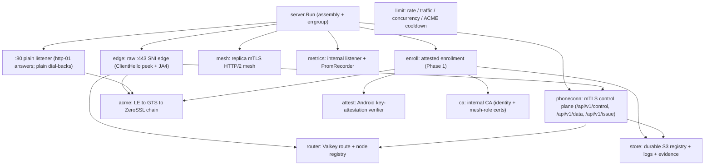
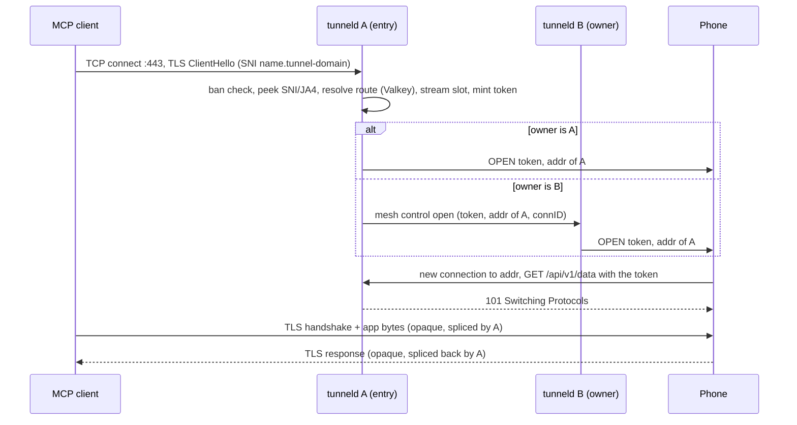

# tunneld — Architecture

This document maps the E2E-encrypted tunnel internals. The operational overview is
[`PROJECT.md`](PROJECT.md); the wire contract is [`PROTOCOL.md`](PROTOCOL.md); the decision record is
[Plan 3](plans/3_e2e_encrypted_tunneling_20260817175922.md), and for the dial-back/data path
[Plan 16](plans/16_entry_node_dial_back_20261014192454.md).

## 1. Process anatomy

`tunneld serve` assembles everything in `server.Run` (constructor DI — no package globals) and runs it
under one `errgroup`. The public edge is a raw TCP `:443` listener; the phone control plane, the replica
mesh, and the internal metrics listener are separate servers. ALL construction completes BEFORE the
`:443`, `:9443` and `:9090` listeners (and, when a CA uses HTTP-01 or `--dialback-https=false`, the plain
`:80` listener) bind: a
socket is never bound while unserved. A valid reserved-host certificate cached on disk is loaded before the
bind (replaced by the Valkey-shared one when that expires later); reserved-host issuance runs AFTER the bind, because HTTP-01 / TLS-ALPN-01 validations are answered by
the node's own listeners. Until a reserved host has a certificate its TLS is refused (degraded) and issuance
is retried every minute; while the control host has none, the node can neither hold phone control
connections nor accept HTTPS dial-backs, so with `--dialback-https` it refuses tunnel connections at once
(`no-route`) — before taking a stream slot or requesting an `OPEN` — and the other nodes are unaffected. The connection-log spool directory is created,
locked and recovered before the bind; uploading its leftover files runs in the background.

### Package map

| Package | Role |
|---|---|
| `internal/server` | assembly (`Run`), SNI-edge + listener wiring, schedulers, graceful shutdown |
| `internal/edge` | raw `:443` SNI edge: ClientHello peek + JA4, reserved-SNI local termination, `acme-tls/1` TLS-ALPN-01 answering, dial-back wait + splice on the entry node, connection policy (idle/min-rate/eviction) |
| `internal/phoneconn` | phone control plane (HTTP/2 + mTLS): `/api/v1/control` stream (OPEN dial-back, PING, RENEW_NUDGE), `/api/v1/data` dial-back upgrade (HTTP/1.1, on `:443` and, in plain mode, `:80`), `/api/v1/issue` cert generation |
| `internal/enroll` | attested enrollment (Phase 1) + issuance (Phase 2 / renewal): nonce, seven-point gate, key binding, write-verify name claim, issuance cap |
| `internal/attest` | Android key-attestation verifier (KeyDescription parse, roots/status refreshers, signer allowlist) |
| `internal/acme` | LE→GTS→ZeroSSL issuance chain (lego; DNS-01 / HTTP-01 / TLS-ALPN-01 per CA, Valkey-shared challenge store + TLS-ALPN-01 challenge certificate, spillover, per-account issuance budgets + wait-until/backoff, budgeted HTTP transport, optional CAs, several GTS accounts looked up by key, self-heal) |
| `internal/ca` | internal CA: identity certs (CN = tunnel name) + short-lived mesh-role certs (SAN = node id) |
| `internal/mesh` | replica↔replica mTLS HTTP/2 control RPCs (renew, terminate, open, evict), per-pair pools |
| `internal/router` | Valkey routing registry (bind/heartbeat/unbind/lookup) + node registry |
| `internal/limit` | rate windows, enroll quota, global stream counter, per-second bandwidth + packet windows, ACME issuance budgets + wait-until |
| `internal/store` | durable S3 name registry (write-verify claim), connection logs, rejected-enroll evidence |
| `internal/ban` | ban/geo LPM engine, DB-IP expansion, file watcher |
| `internal/config` | kong flag surface + `TUNNELD_*` env twins + `Validate()` |
| `internal/wire` | control-frame codec + dial-back constants + the ChunkSize pacing constant |
| `internal/metrics` / `internal/admin` / `internal/caplog` / `internal/observ` | metrics + `/api/v1/admin/tunnels/list` & `/stats` composer + deduped cap logger + the Recorder interface |
| `internal/logging` | `log/slog` fan-out + composite `--log` sinks |
| `internal/tunneltest` | shared test fakes + the testcontainers harness |

## 2. Public connection lifecycle

The entry node accounts bytes (day/week traffic), paces bandwidth against the per-second byte + packet
windows, and enforces the connection policy on both sockets; no data crosses nodes. When the phone's control
connection closes, its node sends `evict` to every node and each ends the splices opened through it (keeping
`ban-evict` / `admin-terminate` when that is the close reason, else `phone-close`); a crashed owner sends
nothing, so such splices end within 10 s after the route expires (`--route-ttl`) or is re-bound, through the
entry node's per-splice route check (every 10 s each splice re-reads its route). The phone terminates TLS with its
WebPKI cert (a hermetic Pebble CA stands in for the integration and e2e tiers; the staging tier uses Let's Encrypt staging + GTS staging) — tunneld never sees plaintext.

**ACME validations.** A ClientHello whose first ALPN protocol is `acme-tls/1` is a TLS-ALPN-01 validation
addressed to tunneld itself, not tunnel traffic: after the ban / conn-rate / `--max-clients` checks the edge
answers it locally with the challenge certificate built from the Valkey challenge store (ECDSA P-256, key
usage `digitalSignature`, critical `id-pe-acmeIdentifier`, one DNS SAN) and never routes or splices it; with
no pending challenge it is closed (`no-route`). When a CA uses HTTP-01, a plain `:80` listener
(`--acme-http-listen`) serves ONLY `GET`/`HEAD /.well-known/acme-challenge/<token>` from the same store — one
request per connection (keep-alives off); any other request is a 404 (`acme-http-miss`) — behind the same check
order (ban → conn-rate → the shared `--max-clients` counter), evaluated off the accept loop. With
`--dialback-https=false` the same listener (bound then even without an HTTP-01 CA) also serves the phones'
plain dial-backs: every request for exactly `/api/v1/data` goes to the phone handler (a non-`GET` gets `405`),
every other request to the ACME handler unchanged.

## 3. Enrollment, issuance, renewal

Enrollment is two-phase (see [`PROTOCOL.md`](PROTOCOL.md) §2): Phase 1 (`/api/v1/enroll`, server-TLS) verifies
attestation + key binding, write-verify-claims a name in S3, and signs a bootstrap identity cert; Phase
2 (`/api/v1/issue`, mTLS) re-verifies attestation, rotates the identity cert, and obtains the public cert for
`<name>.<tunnel-domain>` via the ACME chain. Renewal is the SAME `/api/v1/issue` endpoint, triggered by a
`RENEW_NUDGE{nonce}` on the control stream; the server-run chain applies LE-first migration + spillover.
The name registry record carries the cert metadata; the reserved-host (`--enroll-host`/`--control-host`)
certs are obtained by the server itself (`ObtainSelf`) after the listeners bind (a valid disk cache is served
immediately), retried every minute while missing, and renewed on schedule. Reserved-host issuance is
serialized across replicas by a per-host Valkey lock (`lock:acme-self:{host}`): a replica waits up to 5 min
for it, then gets up to 5 min to issue; an issuance abandoned at that deadline keeps the lock until its
10-min TTL (the background lego order may still hold the challenge); a shutdown releases it; a lock error
issues without it. Reserved-host certs are SHARED through Valkey (`acme:self-cert:{host}`: cert chain + key +
metadata, TTL = time until the cert's NotAfter): the lock holder first takes a shared cert that is valid and
not due for renewal (no ACME order); otherwise it issues and publishes the new cert BEFORE releasing the lock,
so the next lock holder finds it. At startup and at every renewal check a node takes the shared cert only
when it expires later than its own (never a downgrade); every cert a node takes is also written to its disk
cache, which stays the fallback when Valkey is unavailable. The reserved-host private key therefore lives in
Valkey (TTL'd) — Valkey MUST stay private. Every shared-cert read is bounded (5 s), so an unreachable Valkey
delays the startup bind by at most 5 s per reserved host; the disk cache is used instead.

Each CA validates with its own method (`--acme-challenge-le` / `--acme-challenge-gts` /
`--acme-challenge-zerossl`: `dns-01`, `http-01`, `tls-alpn-01` — ZeroSSL has no `tls-alpn-01`; defaults LE +
GTS `tls-alpn-01`, ZeroSSL `http-01`); `--acme-dns-provider` is needed only when a CA uses `dns-01`. The
challenge material lives in Valkey, so any replica answers a validation. The TLS-ALPN-01 certificate is
tunneld's own: lego's built-in one carries key usage `keyEncipherment` only, which BoringSSL validators
(Google Trust Services) reject in TLS 1.3 (RFC 8446 §4.4.2.2). Only ONE TLS-ALPN-01 challenge can be pending
per domain cluster-wide (a validator sends only the SNI); a conflicting or failed challenge-store write is a
LOCAL error: the chain stops with Retry-After 30 s and sets no per-account wait-until. When CAA records carry
`validationmethods`, they must allow each CA's configured method.

**Issuance budgets.** Each enabled CA contributes accounts: Let's Encrypt and ZeroSSL one per node (its key
under `--acme-account-dir`), GTS one per listed existing account. Before an order the chain reserves one slot in
every Valkey token bucket the order draws on (`acme:inflight:{bucket}:{node}`, scored by the attempt's
deadline); only live nodes' reservations count. The LE per-domain bucket is keyed on the name's registered domain
(eTLD+1), and an LE renewal of an LE certificate (phone or reserved host) draws only the per-name bucket.
Success spends the reservation; a created order always spends
its order bucket; an order finalized and then abandoned counts as issued; other failures release. Every ACME
request goes through a per-account HTTP transport around lego that refuses or holds requests while the account
waits out a 429 (a cluster-wide wait-until, never shortened) or lacks request budget, delays the first
certificate poll after finalize to the CA's median wait + 2 s and spaces the rest 2 s apart, and on a 429
resyncs only the bucket the CA named. Each attempt has a deadline (LE 20 s, GTS 40 s, ZeroSSL 90 s); an
abandoned attempt removes its pending TLS-ALPN-01 challenge; a run is capped at 290 s. Any unsuccessful attempt
other than a 429, a permanent CA error or a local error (a transient CA error, the attempt deadline, or a request
tunneld refused or held) puts the account on the exponential backoff. GTS accounts are tried
by remaining order budget. When no account can take the order, the issue answer is `acme_rate_limited` with
`retry_after_seconds` = the earliest free slot + a random 1–10 s. Decision record:
[Plan 17](plans/17_acme_budgets_and_client_resilience_20261015170942.md).

## 4. Unified per-window limit model

Every read charges ONE unified `Charge` against ALL four per-window counters in a single plain pipelined
round-trip (`INCRBY`/`INCR` + `EXPIRE … NX` — **NO Lua**, **NO TxPipeline**): the per-second byte window
`bw:{name}:{dir}:{unix_second}`, the per-second packet (read) window `pkt:{name}:{dir}:{unix_second}`, and
the per-direction day/week traffic windows `traf:{name}:{dir}:day:{unix_day}` /
`traf:{name}:{dir}:week:{unix_week}` (`unix_day = unix_second/86400` UTC-midnight days,
`unix_week = unix_day/7` epoch-aligned 7-day blocks — clock-aligned, so a window's reset is computed from
the clock with no `PTTL` read). The returned action is: **Proceed** (under all caps → forward now);
**Wait** (over a cap whose window resets within `maxPacingWait` = 5 s → wait that long, then forward — the
wait IS the pacing); or **Kill** (over a cap whose window resets beyond 5 s → end the stream). Bandwidth is
the always-`Wait` case (a per-second window resets in ≤ 1 s); day/week are almost always `Kill` (reset
hours/days away) except in the last ≤ 5 s of a window. `Kill` takes precedence over `Wait` (an exhausted far
window can't be waited out). `EXPIRE NX` self-heals a skipped TTL on the next same-window write, so strict
atomicity is unwarranted for these transient windows; a Valkey ERROR yields `Proceed` (fail-open — pacing
never hard-depends on the control plane). Each key's TTL is its window plus a small fixed 1 h margin
(per-second = 3 s, day = 25 h, week = 7 d + 1 h). An exhausted day/week window also refuses NEW streams at
admission (`TrafficExhausted`, read-only). `wire.ChunkSize` = 16384 is the paced-copy read slice, so the
per-second overshoot is bounded by `byteCap + N_concurrent × 16 KiB` / `pktCap + N_concurrent`.

## 5. Valkey state (all transient — every key TTL'd in the same round-trip: SET EX / a SETNX lock / a pipelined EXPIRE NX / a pipelined PEXPIRE / a pipelined EXPIRE GT; NO Lua/WATCH/MULTI-EXEC)

Routing (`tunnel:{name}` → owner/fp/connID + merged byte counters, create/delete serialized by the per-name `lock:{name}`, owner-conditional teardown on `connID`), node registry
(`node:{id}` → JSON `{advertise, hostname, version, started_at, last_heartbeat}`, exposed via `/api/v1/admin/nodes`; plus the
`nodes` id set — TTL 3 × `--route-ttl`, refreshed by every heartbeat, expired ids pruned on read — used to reach
every live node), rate-limit windows, the per-direction day/week traffic windows
(`traf:{name}:{dir}:day/week:{n}`, written via the same pipelined `EXPIRE NX` as the `bw:`/`pkt:` windows),
the global per-tunnel stream cap (`conc:{name}`, a sorted set: one member per live public connection = its
dial-back token, score = its expiry in unix ms; expired members are pruned at admission, `Charge` refreshes
the stream's own member with `ZADD XX` (never resurrecting a released one), release removes it; TTL = 3 ×
`--limit-conn-idle`), the merged per-tunnel byte counters (in `tunnel:{name}`, existence-guarded flush), single-use enrollment nonces, per-account ACME
wait-until/backoff (the wait-until a pipelined `EXPIRE GT` + `SET NX EX`, never shortened), the ACME challenge material (`acme:alpn:{domain}` via `SET NX EX` and `acme:http:{domain}:{token}` via `SET EX`, both 10 min; removed only while they still hold this order's value — GET-compare, then DEL), the reserved-host issuance lock (`lock:acme-self:{host}`, `SET NX EX` 10 min, released the same GET-compare-then-DEL way), and the shared reserved-host cert (`acme:self-cert:{host}`, `SET EX` until the cert's NotAfter; it carries the private key, so Valkey must stay private), the ACME issuance budgets — `acme-budget:{bucket}` (hash `{t, at}`, `HSET` + pipelined `PEXPIRE` = time to refill to full + 1 h), `acme:inflight:{bucket}:{node}` (`ZADD` + pipelined `EXPIRE NX` + `EXPIRE GT` = deadline + 1 min, never shortened) and the per-CA lock `lock:acme-budget:{ca}` (`SETNX`, 2 s TTL). No permanent Valkey state; a stale connection never clobbers a re-bound route.
Connection ids are 8 lowercase
hex chars (4 `crypto/rand` bytes); a bind whose id collides with the current route owner re-rolls the id
and retries (bounded), so the owner-conditional guarantee is deterministic, not probabilistic. Dial-back
tokens are `crypto/rand.Text` (26 base32 chars, 128 bits).

## 6. Durable S3 state

`internal/store` uses plain `GetObject`/`PutObject`/`DeleteObject` only (no conditional writes): the name
registry (`names/<name>`), connection logs (per-node JSONL objects
`tunnel-logs/<yyyy>/<mm>/<dd>/<file-start>-<node-id>.jsonl`, all tunnels mixed; a connection's start and
end may land in different objects), and rejected-enroll evidence
(`rejected-enroll/…`). Name uniqueness is the **write-verify claim**: GET (absent) → PUT a claim nonce
under a hard timeout (SDK retries disabled) → settle wait (strictly > the PUT timeout) → GET-verify the
nonce. Retention (logs 90d, rejected-enroll 30d) is a one-time lifecycle setup on the bucket
(`docs/PROJECT.md` §5); tunneld only gets, puts and deletes objects.

## 7. Ban engine

`internal/ban` parses the union of `--ban-file`s into an atomic-swap longest-prefix-match table over
`netip`; `country XX` entries expand from the DB-IP CSV at reload. `ban.Watch` hot-reloads on mtime and,
on a reload, evicts BOTH the newly-banned tunnel's live phone control connection (`EvictBanned`) AND its
in-flight public splices (`EvictBannedStreams`, `close_reason=ban-evict`) — bans are the only revocation,
so a reload must stop live traffic, not just new admissions. A `--ban-file` or the DB-IP CSV that was
present at the last successful load but VANISHES at runtime is refused: the previous snapshot is kept
(Error-logged, retried), never silently unbanning (a first-deploy absence stays a benign skip). The ban
check is the FIRST handler-level check on every ingress edge; a peer address that does not parse as an IP cannot be ban-checked, so the edge refuses it before the ban gate (fail closed, Debug-logged) — the SNI edge and the `:80` listener close the connection, `/api/v1/enroll` and `/api/v1/control` answer `400 bad_source_ip`. This includes ACME validation connections (TLS-ALPN-01 on `:443`, HTTP-01 on `:80`): an `ip` / `cidr` / `country` ban can drop a CA's validation perspectives and fail issuance (DNS-01 is unaffected).

Ban inputs are loaded **exactly once** at startup (synchronously, before any listener binds); the watcher
then polls and reloads with **build-verify-commit** — it builds the snapshot, re-reads the input
fingerprint, and swaps the new snapshot in ONLY when the read is stable, so a non-atomic writer caught
mid-truncate never becomes the live snapshot. The attestation **signer-digest allowlist** follows the same
vanished-file discipline: a deleted allowlist file keeps the previous digest set (Error-logged), never
silently allowing every signer.

## 8. Observability wiring

`observ.Recorder` is the consumer-site interface (implemented by `metrics.PromRecorder`, faked in tests).
The internal listener serves `/metrics` (custom registry, aggregate families only, plus the Go runtime and
process collectors: open/max file descriptors, RSS, CPU), `/healthz`,
`/api/v1/admin/tunnels/list?cursor=&count=` (a paginated tunnel-name list — ONE SCAN step, no ranking) +
`/api/v1/admin/tunnels/stats` (POST names → per-tunnel node/bytes/conc/bw/day/week, live tunnels only),
`/api/v1/admin/nodes` (the node registry: id → `{advertise, hostname, version, started_at, last_heartbeat}`), and
the per-tunnel actions `POST /api/v1/admin/tunnels/{name}/reissue` (force a RENEW_NUDGE) and
`POST /api/v1/admin/tunnels/{name}/terminate` (a bound route required, 404 otherwise: applied on every node —
each evicts its in-flight public splices, `close_reason=admin-terminate`, and the owner closes the phone
control connection — ephemeral, the phone reconnects). Reissue routes to the owner node over the mesh
`/api/v1/mesh/control` RPC; terminate is sent to every node over it (see PROTOCOL.md §5).

Every labelled counter is exposed at 0 from startup for each known label value (the `observ` lists:
`RejectReasons`, `ACMECAs`, `EnrollResults`, `AttestResults`, `QuotaWindows`, `ByteDirections`; renewals
also `ca="all", result="fail"`). A series that first appeared at 1 would hide its first event from
`rate()`/`increase()`. The Valkey client's main pool is exported as `tunneld_valkey_pool_connections`,
`_idle_connections`, `_max_connections`, `_waits_total` and `_timeouts_total` (a timeout is a command that
gave up waiting for a free connection). `tunneld_acme_budget_ratio{ca,account,budget}` reads the budget buckets
at scrape time (2 s timeout; an error drops only that family, Warn ≤ 1/min).

### Registered rejection reasons (`tunneld_rejections_total{reason}`)

The label set is EXACTLY `observ.RejectReasons` (pre-registered; `PromRecorder.Reject` refuses any
other string, so labels cannot be invented at call sites). The writers:

| Reason(s) | Writer |
|---|---|
| `ban` | edge accept, HTTP-01 accept guard, enroll handler, phone control handler (each ban gate) |
| `no-route` | edge accept/dispatch, edge TLS-ALPN-01 interception (no pending challenge), bridge (a failed dial-back open, or a node that cannot accept HTTPS dial-backs yet) |
| `handshake-timeout` | edge accept/dispatch |
| `conn-rate`, `max-clients` | edge accept/dispatch, HTTP-01 accept guard |
| `quota-day`, `quota-week` | bridge admission (one per NEW stream refused on an exhausted window) |
| `stream-cap` | bridge (global per-tunnel stream counter refusal) |
| `attest-*`, `csr-mismatch`, `enroll-limit`, `issuance-cap`, `acme-failed` | enroll/issuance service |
| `acme-http-miss` | HTTP-01 handler (an unmatched `:80` request; not in `NoRouteSpike`, covered by `HighRejectionRate`) |

Distinct signals, no double-counting: `QuotaExhausted(tunnel, window)` fires when an IN-FLIGHT stream
hits the window (its LOG is caplog-deduped), and forced closures of existing connections (`min-rate`,
`evicted`, `idle-timeout`, `quota-exhausted`, `cert-expired`, `ban-evict`, `admin-terminate`, …) are recorded via
`PublicConnClose(reason)` / `PhoneConnClose(reason)` — never via `Reject`.
`tunneld_enrollments_total{result}` carries the enrollment outcome;
`tunneld_attest_verify_total{result}` the attestation verdicts; and
`tunneld_acme_renew_total{ca,result}` the tunnel-cert renewal outcomes (`ca="all"` on a failure, since
every CA in the chain declined). `tunneld_acme_cooldown_total{ca}` counts account wait-until activations and
`tunneld_acme_rate_limited_total{ca}` the CAs' 429 answers.

Cap-hit logs are deduped via `internal/caplog` (first hit per `(tunnel, reason)` immediately, then ≤1
summary/min) for every reason EXCEPT `no-route`: a `no-route` rejection's tunnel value is
attacker-controlled (raw SNI / unrouted name), so it is metric + Debug-line only — it never keys the
dedup map nor emits a WARN, making log-flooding via that path impossible.

Connection logs are SPOOLED locally and uploaded per node (`store.ConnLogSpool`): enqueue is O(1) and never
blocks an admission, splice, or teardown path — events go to a 5000-event channel and ONE writer goroutine
appends each as a JSON line to the active file in `--conn-log-dir` (`<file-start>-<node-id>.jsonl.part`,
`<file-start>` = the UTC nanosecond the file was opened, created exclusively — an existing name advances by
1 ns). A failed or short append is truncated back (or the file is rotated out), so a partial line never sits
mid-file. The file is fsynced and renamed to `.jsonl` at the end of its clock-aligned 5-minute window, at
16 MiB, and at shutdown (a file left empty by failed appends is removed instead, never uploaded). A separate uploader goroutine uploads ready files oldest-first to
`tunnel-logs/<yyyy>/<mm>/<dd>/<file-start>-<node-id>.jsonl` (the key comes from the file name, so a
re-upload overwrites) and deletes each only after its upload succeeds — each upload gets a deadline of 30 s
plus the file size at 128 KiB/s (not the S3 client's general 30 s cap); a pass stops at the first S3 failure
(one Warn) and retries every minute, and a locally unreadable file is skipped without blocking newer ones.
At startup the directory is created (0o700) and `flock`ed (a second process fails fast), a crashed run's
`.part` is truncated to its last newline (Warn on dropped bytes) and queued. `tunneld_connlog_dropped_total`
counts events lost to a full channel, a failed append, the 1 GiB spool cap (one Warn per window) or arriving
after shutdown; local I/O errors are logged at most once per minute, and a suppressed count (with the last
op, path and error) is reported once the minute has passed and at shutdown. Shutdown always waits for the
writer: events still queued when `--shutdown-grace` expires are dropped, counted and logged.

Errors the Go HTTP servers report themselves (e.g. a failed TLS handshake) go through slog as well: at Debug on
the internet-facing enroll / control / `:80` servers (attacker-driven, like `no-route`), at Warn on the
WireGuard-only mesh and internal servers.

A `--log` sink that fails to write (disk full, unwritable file) is never silent: the
fan-out handler counts every failed record in `tunneld_log_sink_errors_total` and writes the sink's
first failure — then at most one summary per minute carrying the suppressed count — directly to stderr;
a pending count is still reported once the failures stop (on the next record after the minute) and when
the sinks are closed at shutdown.

## 9. Shutdown

```mermaid
flowchart LR
  cancel["ctx cancel"] --> close["close raw :443 + plain :80 listeners (stop new public conns)"]
  close --> phones["close live phone conns (server-shutdown): teardown unbinds routes + enqueues end events"]
  phones --> drain["Shutdown enroll / control / mesh / internal / acme-http servers"]
  drain --> join["join public handlers (Edge.Wait + HTTP-01 guard Wait): splice + end-event enqueue + slot release returned"]
  join --> group["errgroup unwinds: schedulers + watchers on the drain ctx"]
  group --> queue["rotate + upload the conn-log spool: server-shutdown end events land"]
  queue --> flush["final admin flush + cap-log flush"]
  flush --> dereg["Node explicitly deregistered (TTL = crash backstop)"]
  dereg --> evictjoin["join, then cancel, the splice-eviction broadcasts"]
```

Live public splices are cancelled by the drain context and record `close_reason=server-shutdown`
(`evicted` is reserved for saturation eviction, `ban-evict` for a ban reload, `admin-terminate` for an admin
terminate). The ordering is load-bearing:
the public handlers are joined (`Edge.Wait`) so every end event is ENQUEUED, then the conn-log spool is
rotated and uploaded (what does not upload within `--shutdown-grace` stays on disk for the next start), and
only then the admin/cap-log final flush runs — so no end event or counter delta is lost.

## 10. Configuration

Config is a kong flag surface with `TUNNELD_*` env twins (note `--s3-*` → `TUNNELD_S_3_*`), validated
fail-fast in `Validate()`. Byte sizes are BINARY (`1mb` = 1048576); bitrates are DECIMAL bits
(`1mbit` = 125000 B/s). Full flag list: `tunneld serve --help`. `--conn-log-dir` (required) is the
connection-log spool directory; `Validate()` rejects a path that exists but is not a directory, and startup
creates and locks it. `--redis-url` selects the Valkey client: a URL whose query carries `master_name=` uses the Sentinel failover client (the URL host plus repeated `addr=` are the sentinels; the URL `user:password@` authenticates to the sentinels, `username=` / `password=` to the master; `route_by_latency`, `route_randomly` and `replica_only` are rejected; the go-redis pool options such as `pool_size` and `conn_max_idle_time` pass through — the pool size is a ceiling, connections open on demand and idle ones close after `conn_max_idle_time`), any other URL a single-node client — both forms are parsed by the same function in `Validate()` and at startup. A malformed query (e.g. a bad `%`-escape) is rejected for either form, and a `net/url` / go-redis parse error is emitted with every token that appears in the URL (raw, percent-decoded or Go-quoted) AND every delimiter character (space, quote, `:`, `,`, brackets, parentheses) that occurs in the URL replaced by `[redacted]`, adjacent replacements merged into one — so no part of a credential, not even its punctuation, can reach the log, at the cost of also hiding non-secret URL parts and some message punctuation; tunneld's own Sentinel-option errors are emitted verbatim. The ACME validation flags are `--acme-challenge-le` / `--acme-challenge-gts` (`dns-01` | `http-01` | `tls-alpn-01`, default `tls-alpn-01`), `--acme-challenge-zerossl` (`dns-01` | `http-01`, default `http-01`) and `--acme-http-listen` (default `:80`, bound only when a CA uses `http-01` or `--dialback-https=false`). The
dial-back flags are `--dialback-advertise` (required: this node's own public `host:port` the phones dial back to
— its `:443` edge, or its plain listener when `--dialback-https=false` — never the round-robin hostname),
`--dialback-https` (default `true`) and `--dialback-mtls` (default `true`; requires `--dialback-https`; the
control-host TLS then requires a client certificate, otherwise it only verifies one when given).
