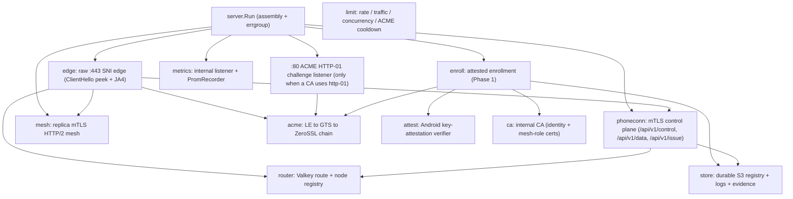
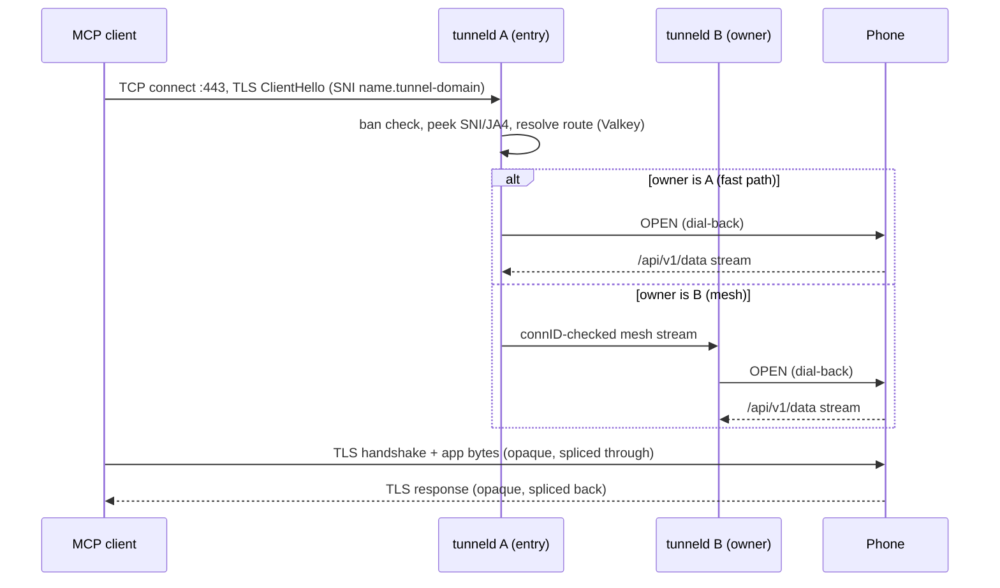

# tunneld — Architecture

This document maps the E2E-encrypted tunnel internals. The operational overview is
[`PROJECT.md`](PROJECT.md); the wire contract is [`PROTOCOL.md`](PROTOCOL.md); the decision record is
[Plan 3](plans/3_e2e_encrypted_tunneling_20260817175922.md).

## 1. Process anatomy

`tunneld serve` assembles everything in `server.Run` (constructor DI — no package globals) and runs it
under one `errgroup`. The public edge is a raw TCP `:443` listener; the phone control plane, the replica
mesh, and the internal metrics listener are separate servers. ALL construction completes BEFORE the
`:443`, `:9443` and `:9090` listeners (and, when a CA uses HTTP-01, the `:80` challenge listener) bind: a
socket is never bound while unserved. A valid reserved-host certificate cached on disk is loaded before the
bind (replaced by the Valkey-shared one when that expires later); reserved-host issuance runs AFTER the bind, because HTTP-01 / TLS-ALPN-01 validations are answered by
the node's own listeners. Until a reserved host has a certificate its TLS is refused (degraded; tunnel
splicing is unaffected) and issuance is retried every minute.

### Package map

| Package | Role |
|---|---|
| `internal/server` | assembly (`Run`), SNI-edge + listener wiring, schedulers, graceful shutdown |
| `internal/edge` | raw `:443` SNI edge: ClientHello peek + JA4, reserved-SNI local termination, `acme-tls/1` TLS-ALPN-01 answering, bridge (fast path + mesh), connection policy (idle/min-rate/eviction) |
| `internal/phoneconn` | phone control plane (HTTP/2 + mTLS): `/api/v1/control` stream (OPEN dial-back, PING, RENEW_NUDGE), `/api/v1/data` dial-back, `/api/v1/issue` cert generation |
| `internal/enroll` | attested enrollment (Phase 1) + issuance (Phase 2 / renewal): nonce, seven-point gate, key binding, write-verify name claim, issuance cap |
| `internal/attest` | Android key-attestation verifier (KeyDescription parse, roots/status refreshers, signer allowlist) |
| `internal/acme` | LE→GTS→ZeroSSL issuance chain (lego; DNS-01 / HTTP-01 / TLS-ALPN-01 per CA, Valkey-shared challenge store + TLS-ALPN-01 challenge certificate, spillover, per-CA cooldown/backoff retry-after, self-heal) |
| `internal/ca` | internal CA: identity certs (CN = tunnel name) + short-lived mesh-role certs (SAN = node id) |
| `internal/mesh` | replica↔replica mTLS HTTP/2 mesh: per-pair pools, connID-checked delivery |
| `internal/router` | Valkey routing registry (bind/heartbeat/unbind/lookup) + node registry |
| `internal/limit` | rate windows, enroll quota, global stream counter, per-second bandwidth + packet windows, ACME cooldown |
| `internal/store` | durable S3 name registry (write-verify claim), connection logs, rejected-enroll evidence, lifecycles |
| `internal/ban` | ban/geo LPM engine, DB-IP expansion, file watcher |
| `internal/config` | kong flag surface + `TUNNELD_*` env twins + `Validate()` |
| `internal/wire` | v1 control-frame codec + the ChunkSize pacing constant |
| `internal/metrics` / `internal/admin` / `internal/caplog` / `internal/observ` | metrics + `/api/v1/admin/tunnels/list` & `/stats` composer + deduped cap logger + the Recorder interface |
| `internal/logging` | `log/slog` fan-out + composite `--log` sinks |
| `internal/tunneltest` | shared test fakes + the testcontainers harness |

## 2. Public connection lifecycle

The entry node accounts bytes (day/week traffic), paces bandwidth against the per-second byte + packet
windows, and enforces the connection policy; the owner node (on the mesh path) only relays. The phone terminates TLS with its
WebPKI cert (a hermetic Pebble CA stands in for the integration and e2e tiers; the staging tier uses Let's Encrypt staging + GTS staging) — tunneld never sees plaintext.

**ACME validations.** A ClientHello whose first ALPN protocol is `acme-tls/1` is a TLS-ALPN-01 validation
addressed to tunneld itself, not tunnel traffic: after the ban / conn-rate / `--max-clients` checks the edge
answers it locally with the challenge certificate built from the Valkey challenge store (ECDSA P-256, key
usage `digitalSignature`, critical `id-pe-acmeIdentifier`, one DNS SAN) and never routes or splices it; with
no pending challenge it is closed (`no-route`). When a CA uses HTTP-01, a plain `:80` listener
(`--acme-http-listen`) serves ONLY `GET`/`HEAD /.well-known/acme-challenge/<token>` from the same store — one
request per connection (keep-alives off); any other request is a 404 (`acme-http-miss`) — behind the same check
order (ban → conn-rate → the shared `--max-clients` counter), evaluated off the accept loop.

## 3. Enrollment, issuance, renewal

Enrollment is two-phase (see [`PROTOCOL.md`](PROTOCOL.md) §2): Phase 1 (`/api/v1/enroll`, server-TLS) verifies
attestation + key binding, write-verify-claims a name in S3, and signs a bootstrap identity cert; Phase
2 (`/api/v1/issue`, mTLS) re-verifies attestation, rotates the identity cert, and obtains the public cert for
`<name>.<tunnel-domain>` via the ACME chain. Renewal is the SAME `/api/v1/issue` endpoint, triggered by a
`RENEW_NUDGE{nonce}` on the control stream; the server-run chain applies LE-first migration + spillover.
The name registry record carries the cert metadata; the reserved-host (`--enroll-host`/`--control-host`)
certs are obtained by the server itself (`ObtainSelf`) after the listeners bind (a valid disk cache is served
immediately), retried every minute while missing, and renewed on schedule. Reserved-host issuance is
serialized across replicas by a per-host Valkey lock (`lock:acme-self:{host}`): a replica waits up to 5 min
for it, then gets up to 5 min to issue; an issuance abandoned at that deadline keeps the lock until its
10-min TTL (the background lego order may still hold the challenge); a shutdown releases it; a lock error
issues without it. Reserved-host certs are SHARED through Valkey (`acme:self-cert:{host}`: cert chain + key +
metadata, TTL = time until the cert's NotAfter): the lock holder first takes a shared cert that is valid and
not due for renewal (no ACME order); otherwise it issues and publishes the new cert BEFORE releasing the lock,
so the next lock holder finds it. At startup and at every renewal check a node takes the shared cert only
when it expires later than its own (never a downgrade); every cert a node takes is also written to its disk
cache, which stays the fallback when Valkey is unavailable. The reserved-host private key therefore lives in
Valkey (TTL'd) — Valkey MUST stay private.

Each CA validates with its own method (`--acme-challenge-le` / `--acme-challenge-gts` /
`--acme-challenge-zerossl`: `dns-01`, `http-01`, `tls-alpn-01` — ZeroSSL has no `tls-alpn-01`; defaults LE +
GTS `tls-alpn-01`, ZeroSSL `http-01`); `--acme-dns-provider` is needed only when a CA uses `dns-01`. The
challenge material lives in Valkey, so any replica answers a validation. The TLS-ALPN-01 certificate is
tunneld's own: lego's built-in one carries key usage `keyEncipherment` only, which BoringSSL validators
(Google Trust Services) reject in TLS 1.3 (RFC 8446 §4.4.2.2). Only ONE TLS-ALPN-01 challenge can be pending
per domain cluster-wide (a validator sends only the SNI); a conflicting or failed challenge-store write is a
LOCAL error: the chain stops with Retry-After 30 s and sets no per-CA cooldown. When CAA records carry
`validationmethods`, they must allow each CA's configured method.

## 4. Unified per-window limit model

Every read charges ONE unified `Charge` against ALL four per-window counters in a single plain pipelined
round-trip (`INCRBY`/`INCR` + `EXPIRE … NX` — **NO Lua**, **NO TxPipeline**): the per-second byte window
`bw:{name}:{dir}:{unix_second}`, the per-second packet (read) window `pkt:{name}:{dir}:{unix_second}`, and
the per-direction day/week traffic windows `traf:{name}:{dir}:day:{unix_day}` /
`traf:{name}:{dir}:week:{unix_week}` (`unix_day = unix_second/86400` UTC-midnight days,
`unix_week = unix_day/7` epoch-aligned 7-day blocks — clock-aligned, so a window's reset is computed from
the clock with no `PTTL` read). The returned action is: **Proceed** (under all caps → forward now);
**Wait** (over a cap whose window resets within `maxPacingWait` = 5 s → wait that long, then forward — the
wait IS the pacing); or **Kill** (over a cap whose window resets beyond 5 s → end the stream). Bandwidth is
the always-`Wait` case (a per-second window resets in ≤ 1 s); day/week are almost always `Kill` (reset
hours/days away) except in the last ≤ 5 s of a window. `Kill` takes precedence over `Wait` (an exhausted far
window can't be waited out). `EXPIRE NX` self-heals a skipped TTL on the next same-window write, so strict
atomicity is unwarranted for these transient windows; a Valkey ERROR yields `Proceed` (fail-open — pacing
never hard-depends on the control plane). Each key's TTL is its window plus a small fixed 1 h margin
(per-second = 3 s, day = 25 h, week = 7 d + 1 h). An exhausted day/week window also refuses NEW streams at
admission (`TrafficExhausted`, read-only). `wire.ChunkSize` = 16384 is the paced-copy read slice, so the
per-second overshoot is bounded by `byteCap + N_concurrent × 16 KiB` / `pktCap + N_concurrent`.

## 5. Valkey state (all transient — every key TTL'd in the same round-trip: SET EX / a SETNX lock / a pipelined EXPIRE NX; NO Lua/WATCH/MULTI-EXEC)

Routing (`tunnel:{name}` → owner/fp/connID + merged byte counters, create/delete serialized by the per-name `lock:{name}`, owner-conditional teardown on `connID`), node registry
(`node:{id}` → JSON `{advertise, hostname, version, started_at, last_heartbeat}`, exposed via `/api/v1/admin/nodes`), rate-limit windows, the per-direction day/week traffic windows
(`traf:{name}:{dir}:day/week:{n}`, written via the same pipelined `EXPIRE NX` as the `bw:`/`pkt:` windows),
the global concurrency counter (`conc:{name}`, a lock-guarded `{connID, count}` hash: a fresh connection's
first acquire STRUCTURALLY resets it and a straggler release from a superseded connection is a no-op; TTL =
3 × `--limit-conn-idle`, refreshed by every traffic chunk via the `Charge` pipeline's `PEXPIRE` that no-ops
on a missing key), the merged per-tunnel byte counters (in `tunnel:{name}`, existence-guarded flush), single-use enrollment nonces, per-CA ACME
cooldown/backoff, the ACME challenge material (`acme:alpn:{domain}` via `SET NX EX` and `acme:http:{domain}:{token}` via `SET EX`, both 10 min; removed only while they still hold this order's value — GET-compare, then DEL), the reserved-host issuance lock (`lock:acme-self:{host}`, `SET NX EX` 10 min, released the same GET-compare-then-DEL way), and the shared reserved-host cert (`acme:self-cert:{host}`, `SET EX` until the cert's NotAfter; it carries the private key, so Valkey must stay private). No permanent Valkey state; a stale connection never clobbers a re-bound route.
Connection/stream ids are 8 lowercase
hex chars (4 `crypto/rand` bytes); a bind whose id collides with the current route owner re-rolls the id
and retries (bounded), so the owner-conditional guarantee is deterministic, not probabilistic.

## 6. Durable S3 state

`internal/store` uses plain `GetObject`/`PutObject`/`DeleteObject` only (no conditional writes): the name
registry (`names/<name>`), connection logs (JSONL batches `tunnel-logs/<name>/<yyyy>/<mm>/<dd>/<first-event-ts>-<node-id>.jsonl`;
a connection's start and end may land in different batches), and rejected-enroll evidence
(`rejected-enroll/…`). Name uniqueness is the **write-verify claim**: GET (absent) → PUT a claim nonce
under a hard timeout (SDK retries disabled) → settle wait (strictly > the PUT timeout) → GET-verify the
nonce. Object-lifecycle expiration (logs 90d, rejected-enroll 30d) is applied programmatically at
startup by `EnsureLifecycles`.

## 7. Ban engine

`internal/ban` parses the union of `--ban-file`s into an atomic-swap longest-prefix-match table over
`netip`; `country XX` entries expand from the DB-IP CSV at reload. `ban.Watch` hot-reloads on mtime and,
on a reload, evicts BOTH the newly-banned tunnel's live phone control connection (`EvictBanned`) AND its
in-flight public splices (`EvictBannedStreams`, `close_reason=ban-evict`) — bans are the only revocation,
so a reload must stop live traffic, not just new admissions. A `--ban-file` or the DB-IP CSV that was
present at the last successful load but VANISHES at runtime is refused: the previous snapshot is kept
(Error-logged, retried), never silently unbanning (a first-deploy absence stays a benign skip). The ban
check is the FIRST handler-level check on every ingress edge; a peer address that does not parse as an IP cannot be ban-checked, so the edge refuses it before the ban gate (fail closed, Debug-logged) — the SNI edge and the `:80` listener close the connection, `/api/v1/enroll` and `/api/v1/control` answer `400 bad_source_ip`. This includes ACME validation connections (TLS-ALPN-01 on `:443`, HTTP-01 on `:80`): an `ip` / `cidr` / `country` ban can drop a CA's validation perspectives and fail issuance (DNS-01 is unaffected).

Ban inputs are loaded **exactly once** at startup (synchronously, before any listener binds); the watcher
then polls and reloads with **build-verify-commit** — it builds the snapshot, re-reads the input
fingerprint, and swaps the new snapshot in ONLY when the read is stable, so a non-atomic writer caught
mid-truncate never becomes the live snapshot. The attestation **signer-digest allowlist** follows the same
vanished-file discipline: a deleted allowlist file keeps the previous digest set (Error-logged), never
silently allowing every signer.

## 8. Observability wiring

`observ.Recorder` is the consumer-site interface (implemented by `metrics.PromRecorder`, faked in tests).
The internal listener serves `/metrics` (custom registry, aggregate families only), `/healthz`,
`/api/v1/admin/tunnels/list?cursor=&count=` (a paginated tunnel-name list — ONE SCAN step, no ranking) +
`/api/v1/admin/tunnels/stats` (POST names → per-tunnel node/bytes/conc/bw/day/week, live tunnels only),
`/api/v1/admin/nodes` (the node registry: id → `{advertise, hostname, version, started_at, last_heartbeat}`), and
the per-tunnel actions `POST /api/v1/admin/tunnels/{name}/reissue` (force a RENEW_NUDGE) and
`POST /api/v1/admin/tunnels/{name}/terminate` (close the phone control connection + evict the owner node's
in-flight public splices, `close_reason=admin-terminate` — ephemeral, the phone reconnects). Both route to
the owner node over the mesh `/api/v1/mesh/control` RPC (see PROTOCOL.md §5).

### Registered rejection reasons (`tunneld_rejections_total{reason}`)

The label set is EXACTLY `observ.RejectReasons` (pre-registered; `PromRecorder.Reject` refuses any
other string, so labels cannot be invented at call sites). The writers:

| Reason(s) | Writer |
|---|---|
| `ban` | edge accept, HTTP-01 accept guard, enroll handler, phone control handler (each ban gate) |
| `no-route` | edge accept/dispatch, edge TLS-ALPN-01 interception (no pending challenge) |
| `handshake-timeout` | edge accept/dispatch |
| `conn-rate`, `max-clients` | edge accept/dispatch, HTTP-01 accept guard |
| `quota-day`, `quota-week` | bridge admission (one per NEW stream refused on an exhausted window) |
| `stream-cap` | bridge (global per-tunnel stream counter refusal) |
| `attest-*`, `csr-mismatch`, `enroll-limit`, `issuance-cap`, `acme-failed` | enroll/issuance service |
| `acme-http-miss` | HTTP-01 handler (an unmatched `:80` request; not in `NoRouteSpike`, covered by `HighRejectionRate`) |

Distinct signals, no double-counting: `QuotaExhausted(tunnel, window)` fires when an IN-FLIGHT stream
hits the window (its LOG is caplog-deduped), and forced closures of existing connections (`min-rate`,
`evicted`, `idle-timeout`, `quota-exhausted`, `cert-expired`, `ban-evict`, `admin-terminate`, …) are recorded via
`PublicConnClose(reason)` / `PhoneConnClose(reason)` — never via `Reject`.
`tunneld_enrollments_total{result}` carries the enrollment outcome;
`tunneld_attest_verify_total{result}` the attestation verdicts; and
`tunneld_acme_renew_total{ca,result}` the tunnel-cert renewal outcomes (`ca="all"` on a failure, since
every CA in the chain declined).

Cap-hit logs are deduped via `internal/caplog` (first hit per `(tunnel, reason)` immediately, then ≤1
summary/min) for every reason EXCEPT `no-route`: a `no-route` rejection's tunnel value is
attacker-controlled (raw SNI / unrouted name), so it is metric + Debug-line only — it never keys the
dedup map nor emits a WARN, making log-flooding via that path impossible.

Connection-log writes to S3 are ASYNC and BATCHED (`store.AsyncConnLog`): enqueue is O(1) and never blocks
an admission, splice, or teardown path. Events are grouped per tunnel and UTC day into one JSONL batch
written when it reaches 100 events or 5 minutes after its first event; at most 5000 events are buffered or
in flight per node, and a full buffer drops the newest event (`tunneld_connlog_dropped_total` +1). A fixed
pool of 8 workers writes the batches with exponential retry (5 attempts, 1/2/4/8 s); a batch whose retries
are exhausted is dropped, adds its event count to `tunneld_connlog_dropped_total`, and logs a Warn with the
tunnel, day, node and error. Every pending batch is written (bounded) at shutdown so `server-shutdown` end
events land.

A `--log` sink that fails to write (disk full, unwritable file) is never silent: the
fan-out handler counts every failed record in `tunneld_log_sink_errors_total` and writes the sink's
first failure — then at most one summary per minute carrying the suppressed count — directly to stderr;
a pending count is still reported once the failures stop (on the next record after the minute) and when
the sinks are closed at shutdown.

## 9. Shutdown

```mermaid
flowchart LR
  cancel["ctx cancel"] --> close["close raw :443 + HTTP-01 :80 listeners (stop new public conns)"]
  close --> phones["close live phone conns (server-shutdown): teardown unbinds routes + enqueues end events"]
  phones --> drain["Shutdown enroll / control / mesh / internal / acme-http servers"]
  drain --> join["join public handlers (Edge.Wait + HTTP-01 guard Wait): splice + end-event enqueue + slot release returned"]
  join --> group["errgroup unwinds: schedulers + watchers on the drain ctx"]
  group --> queue["flush pending conn-log batches: server-shutdown end events land"]
  queue --> flush["final admin flush + cap-log flush"]
  flush --> dereg["Node explicitly deregistered (TTL = crash backstop)"]
```

Live public splices are cancelled by the drain context and record `close_reason=server-shutdown`
(`evicted` is reserved for saturation eviction, `ban-evict` for a ban reload, `admin-terminate` for an admin
terminate). The ordering is load-bearing:
the public handlers are joined (`Edge.Wait`) so every end event is ENQUEUED, then every pending conn-log
batch is written, and only then the admin/cap-log final flush runs — so no end event or counter delta is lost.

## 10. Configuration

Config is a kong flag surface with `TUNNELD_*` env twins (note `--s3-*` → `TUNNELD_S_3_*`), validated
fail-fast in `Validate()`. Byte sizes are BINARY (`1mb` = 1048576); bitrates are DECIMAL bits
(`1mbit` = 125000 B/s). Full flag list: `tunneld serve --help`. `--redis-url` selects the Valkey client: a URL whose query carries `master_name=` uses the Sentinel failover client (the URL host plus repeated `addr=` are the sentinels; the URL `user:password@` authenticates to the sentinels, `username=` / `password=` to the master; `route_by_latency`, `route_randomly` and `replica_only` are rejected), any other URL a single-node client — both forms are parsed by the same function in `Validate()` and at startup. The ACME validation flags are `--acme-challenge-le` / `--acme-challenge-gts` (`dns-01` | `http-01` | `tls-alpn-01`, default `tls-alpn-01`), `--acme-challenge-zerossl` (`dns-01` | `http-01`, default `http-01`) and `--acme-http-listen` (default `:80`, bound only when a CA uses `http-01`).
