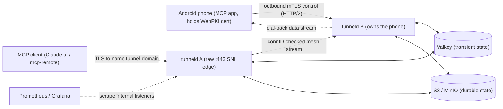

# tunneld — Project Reference

`tunneld` is a self-hosted, abuse-resistant **end-to-end-encrypted tunnel server** that gives the
Android MCP app (`android-remote-control-mcp`) a stable public hostname. The phone needs no inbound
port, no static IP, and no paid tunnel service. External clients (Claude.ai, `mcp-remote`) establish
TLS **directly with the phone**, which holds a publicly-trusted (WebPKI) certificate for its assigned
hostname `<name>.<tunnel-domain>`. tunneld is the internet edge on raw TCP `:443`: it peeks each
ClientHello (SNI/ALPN/version/JA4), routes on SNI, and splices the **opaque encrypted byte stream** to
the phone — it can NEVER read tunnel traffic.

This document is the operational entry point. The system internals live in
[`ARCHITECTURE.md`](ARCHITECTURE.md); the wire contract lives in [`PROTOCOL.md`](PROTOCOL.md); the
deployment quickstart lives in the [README](../README.md); the full decision record is
[Plan 3](plans/3_e2e_encrypted_tunneling_20260817175922.md).

## 1. Topology

One binary (`tunneld serve`) is the internet edge AND the tunnel bridge — there is **no reverse proxy**
(no Cloudflare, no Traefik). Run **one replica per host**; replicas bridge to each other over an
internal mTLS HTTP/2 **mesh** when a public connection lands on a node that is not the phone's owner.
**Valkey** holds transient control state (routing/rate-limit/concurrency — everything TTL'd); a plain
**S3** bucket (any provider; MinIO locally) holds the durable state (name registry, connection logs,
rejected-enrollment evidence).

**Never publish tunneld's mesh (`:9443`) or internal (`:9090`) ports** — only the raw edge `:443` and, when a CA uses HTTP-01, the ACME challenge listener `:80` are
public; the mesh + metrics are reachable on the internal network only. The tunnel relays opaque TLS, so
there is no proxy trust boundary and no `X-Forwarded-For` handling: the client's IP is the peer address
of the raw TCP connection.

## 2. Identity and authentication

- **Two-phase attested enrollment.** Phase 1 (server-TLS `POST /api/v1/enroll` on `--enroll-host`): the phone
  submits an Android hardware key-attestation chain + an identity CSR; tunneld verifies the seven-point
  attestation predicate + key binding, assigns a random tunnel name (base32), and signs a bootstrap
  **identity (mTLS) cert** with its internal CA (CN = the assigned name). Phase 2 (mTLS `POST /api/v1/issue` on
  `--control-host`): the phone — now knowing its name — submits a TLS CSR for `<name>.<tunnel-domain>`;
  tunneld re-verifies attestation, and issues the **public WebPKI cert** via server-run ACME. See
  [`PROTOCOL.md`](PROTOCOL.md) §2.
- **Server-run ACME chain**: Let's Encrypt → Google Trust Services → ZeroSSL, with automatic spillover,
  a per-CA validation method (DNS-01 / HTTP-01 / TLS-ALPN-01; defaults LE + GTS TLS-ALPN-01, ZeroSSL HTTP-01 — answered by tunneld's own listeners from Valkey, so any replica answers), and short-lived certs renewed on a uniform ~4.7-day cadence. The phone holds the TLS private key;
  only CSRs leave it.
- **mTLS with role separation, NO public-side mutual auth.** The phone authenticates to tunneld with its
  identity cert over the outbound HTTP/2 control connection; replica↔replica mesh uses distinct
  **mesh-role** certs (SAN = node id). The public edge does NO client-cert auth (it relays opaque TLS).
- **Revocation is the ban engine ONLY** (no CRL): a `tunnel-name` / `tunnel-fingerprint` ban refuses new
  connections at the control plane, blocks the resolved route at the public edge, and on ban reload evicts
  BOTH the live phone control connection and every in-flight public splice (`close_reason=ban-evict`) —
  live traffic is stopped, not only new admissions.
- **The tunnel authenticates NOTHING it relays** — it cannot (the bytes are opaque TLS). The phone's own
  app is the sole authenticator; a tunnelled deployment MUST keep the app's bearer/OAuth enabled.

## 3. Public surface

The public edge is raw TCP `:443`. It peeks the ClientHello and dispatches by SNI:

| SNI | Behaviour |
|---|---|
| any SNI, first ALPN protocol `acme-tls/1` (checked before the rows below) | ACME TLS-ALPN-01 validation: answered locally with the challenge certificate; no pending challenge → closed (`no-route`); never spliced |
| `<name>.<tunnel-domain>` | resolve the route → splice opaque TLS to the phone (local fast path or mesh) |
| `--enroll-host` | terminate locally: server-TLS enrollment endpoint (Phase 1) |
| `--control-host` | terminate locally: mTLS phone control plane (`/api/v1/control`, `/api/v1/data`, `/api/v1/issue`) |
| anything else / no route | connection closed (`no-route`) |

When a CA uses HTTP-01, a plain `:80` listener (`--acme-http-listen`) serves ONLY `/.well-known/acme-challenge/<token>` for pending challenges (one request per connection; anything else → 404, `acme-http-miss`).

There is no HTTP method/path allowlist on relayed traffic — the phone terminates TLS and enforces its
own routes. Client-supplied `X-Forwarded-*` are irrelevant (opaque relay).

## 4. Abuse containment

### Caps (defaults; `--limit-*` / `TUNNELD_LIMIT_*` unless noted)

| Cap | Flag | Default |
|---|---|---|
| Bandwidth (per tunnel, per direction) | `--limit-bandwidth` | `1mbit` (≥ 16384 B/s) |
| Reads/packets per second (per tunnel, per direction) | `--limit-packets` | `100` |
| Traffic / tunnel / 24h window (UTC-aligned, per direction) | `--limit-traffic-day` | `1gb` |
| Traffic / tunnel / 7d window (epoch-aligned, per direction) | `--limit-traffic-week` | `4gb` |
| Concurrent data streams / tunnel | `--limit-concurrent` | `4` |
| New public TCP connections / source IP | `--limit-conn-rate` | `10`/s |
| Enrollments / source IP | `--limit-enroll-hour` + `--limit-enroll-minute` | `20`/h AND `2`/min |
| Pre-bind control handshakes / node | `--limit-stream-pending` | `64` |
| All inbound connections / node | `--max-clients` | `10000` |
| Successful public-cert issuances / tunnel / 7d | `--issue-per-week` | `3` |
| Connection idle / min-rate / eviction | `--limit-conn-*` | see config |

Caps are uniform by design — no per-path exceptions, no bulk-transfer carve-outs. Operators raise the
`--limit-*` values; they never patch the code.

### Ban / geo engine

One or more `--ban-file` (hot-reloaded on mtime, entries UNIONed): `ip`, `cidr`, `country XX`,
`tunnel-name`, `tunnel-fingerprint`. `country` entries expand at reload from a DB-IP Country Lite CSV
into a longest-prefix-match table (one lookup per connection). The ban check is the FIRST handler-level
check on every ingress edge (public `:443`, the HTTP-01 `:80` listener, `/api/v1/enroll`, `/api/v1/control`), keyed on the trusted client IP — including CA validation connections, so an IP/CIDR/country ban can fail HTTP-01 / TLS-ALPN-01 issuance (DNS-01 is unaffected). A peer address that does not parse as an IP cannot be ban-checked and is refused before the ban gate (fail closed). Country
codes in repo artifacts are placeholders (`XX`/`YY`). The `fetcher` compose service keeps a Spamhaus
DROP-derived ban file and the DB-IP CSV fresh (atomic `mv` handoff).

## 5. State + retention

- **Valkey (transient, TTL'd):** routing entries, node registry, rate-limit windows, concurrency
  counters (`conc:{name}` — a lock-guarded `{connID, count}` hash reset structurally at a fresh
  connection's first acquire; the day/week traffic quotas persist across reconnects), the merged per-tunnel byte counters (in the routing `tunnel:{name}` key), the per-second
  bandwidth (`bw:`) + packet (`pkt:`) windows and the per-direction day/week traffic
  (`traf:{name}:{dir}:day/week:{n}`) windows, single-use enrollment nonces, ACME cooldown/backoff, ACME challenge material (`acme:alpn:` / `acme:http:`, 10 min) the reserved-host issuance lock (`lock:acme-self:`, 10 min) and the shared reserved-host cert (`acme:self-cert:`, until the cert's NotAfter — it holds the private key, so Valkey must stay private). Every
  key gets a TTL in the same round-trip as its write — via `SET EX`, a `SETNX` lock, or a pipelined
  `EXPIRE NX` right after the `INCR` for the self-healing transient `bw:`/`pkt:` per-second AND `traf:`
  day/week windows; NO Lua/WATCH/MULTI-EXEC. No permanent Valkey state.
- **S3 / MinIO (durable):** the name registry (`names/<name>`), connection logs (per-node JSONL objects
  `tunnel-logs/<yyyy>/<mm>/<dd>/<file-start>-<node-id>.jsonl`, all tunnels mixed — every line carries its
  `tunnel`; each node spools events in `--conn-log-dir` and uploads one object per clock-aligned 5-minute
  window, or per 16 MiB, then deletes it locally), and
  rejected-enrollment evidence (`rejected-enroll/…`) — plain `GetObject`/`PutObject`/`DeleteObject` only
  (no conditional writes), so any plain-S3 provider works; name uniqueness comes from a write-verify
  claim protocol, not storage semantics. **PRE-GO-LIVE**, validate a provider with a read-after-write
  probe (PUT → GET → overwrite-PUT → GET returns the newest body; a GET of a missing key returns 404
  `NoSuchKey`).
- **Connection-log spool (local, transient):** `--conn-log-dir` (a persistent volume, locked by one process)
  holds the not-yet-uploaded files; an S3 outage loses nothing below its 1 GiB cap, and leftover files are
  uploaded at the next start.
- **Retention** (a one-time lifecycle setup on the bucket by the operator; tunneld never reads or writes
  bucket configuration, so its S3 credential needs only read, write and delete on the objects plus list on
  the bucket — on AWS-style IAM `s3:GetObject` / `s3:PutObject` / `s3:DeleteObject` on the objects and
  `s3:ListBucket` on the bucket, without which a missing key answers 403 instead of 404): name registry
  **indefinite**, connection logs **90 days** (rule `tunnel-logs-expire`, prefix `tunnel-logs/`),
  rejected-enrollment evidence **30 days** (rule `rejected-enroll-expire`, prefix `rejected-enroll/`), tunnel
  content **never** (it is opaque and never stored). The bundled compose stack (local dev) sets no rules.

## 6. Observability

The internal listener (`--internal-listen`, never published) serves `GET /metrics` (Prometheus,
aggregate families only — NO per-tunnel labels), `GET /healthz` (`200` if Valkey is reachable, else `503` carrying
the Valkey error), `GET /api/v1/admin/tunnels/list?cursor=&count=` (a paginated tunnel-name list — ONE SCAN step,
client-driven, no ranking; a malformed `cursor` or a non-positive/malformed `count` is a `400`) + `POST /api/v1/admin/tunnels/stats` (names → per-tunnel node/bytes/conc/bw/day/week, live tunnels
only), `GET /api/v1/admin/nodes` (the node registry), and the per-tunnel actions `POST /api/v1/admin/tunnels/{name}/reissue` (force a RENEW_NUDGE) and
`POST /api/v1/admin/tunnels/{name}/terminate` (close the phone control connection + evict the owner node's in-flight public splices, `close_reason=admin-terminate` — ephemeral, the phone reconnects), both routed to the owner node
over the mesh `/api/v1/mesh/control` RPC (see `docs/PROTOCOL.md` §5). Cap-hit events are logged deduplicated (first hit per `(tunnel, reason)` immediately,
then ≤1 summary/min) — EXCEPT `no-route`, whose tunnel value is attacker-controlled (raw SNI): it is
metric + Debug-line only, never keying the dedup map, so it cannot flood the logs. Connection logs are
spooled and uploaded per node (JSONL, see §5); `tunneld_connlog_dropped_total` counts every event lost to
a full 5000-event queue, a failed local append, the 1 GiB spool cap, still being queued when
`--shutdown-grace` expires, or arriving after shutdown. Grafana provisioning (`deploy/grafana/`) ships six
dashboards: Health (one red/green tile per check, grouped, with the failing-check count on top and the
`eth0` traffic chart), Nodes overview and Node detail (`node_exporter`, the podman exporter, WireGuard
handshake and ban-list ages), Valkey and Sentinel (the Redis/Valkey exporter), and tunneld overview and detail.
They expect every Prometheus target to carry a `node` label (and `service="valkey"|"sentinel"` on the Valkey
exporter targets), host textfile metrics `wireguard_peer_latest_handshake_timestamp_seconds`,
`wireguard_peer_{receive,transmit}_bytes_total` and `banlist_file_mtime_timestamp_seconds{file}`, and — for
Health — blackbox-exporter jobs `blackbox-enroll` / `blackbox-connect` (TLS probe of each node's public `:443`
for the enroll / control host) and `blackbox-healthz` (each node's internal `/healthz`). `deploy/prometheus/` holds the scrape config and alert rules; the compose stack does not run
Prometheus or Grafana.
Secrets, key material, and tunnel payloads are NEVER logged.

## 7. Operations

- **Deployment quickstart** (CA generation, `.env`, S3, ACME/DNS): [README](../README.md).
- **Connection-log spool**: give every node its own persistent `--conn-log-dir` (two processes on one
  directory are refused at startup); files left after a crash or an S3 outage are uploaded on the next start.
- **Releases**: `v*` tags → goreleaser → linux amd64/arm64 archives + multi-arch image
  `ghcr.io/danielealbano/tunneld`.
- **Standard commands**: the Makefile (`build`, `lint`, `vet`, `govulncheck`, `test-unit`,
  `test-integration`, `test-e2e`, `test-staging`, `test-scripts`, `compose-config`, `mermaid-check`). The integration,
  e2e and staging tiers require Docker (testcontainers: Valkey, MinIO via the PGSTY Silo build, Pebble); the staging tier also reaches Let's Encrypt staging + GTS staging through a reverse SSH tunnel and skips without `TUNNELD_STAGING_SSH_KEY`.
- **Soak test** (manual, against a live deployment): `make soak-app soak-client` (the APK lands in
  `fixtures/soak-app/` with its sha256 and signer digest, like the reference app). The soak app emulates N
  phones on one device — each with its own hardware-attested enrollment, public cert, control connection and
  local HTTPS server answering `POST /op?resp=<bytes>` with `<bytes>` of the pattern `byte(i % 251)`. Allow its
  signing-cert digest, install it, then `adb shell am broadcast -a com.example.soakapp.start -n
  com.example.soakapp/.CommandReceiver -f 0x00000020 --es count 10 --es enrollHost <enroll-host> --es
  controlHost <control-host> --es tunnelDomain <tunnel-domain>` (phones enroll one at a time, `spacingSeconds`
  apart, default 65 s, because each enrollment spends two of the per-IP enroll-rate slots; `--es parallel true`
  enrolls them all at once instead, retrying refusals and network errors, and lists phones that still failed in
  `files/failures.txt`); `files/names.txt` lists the bound names and `files/ready` holds how many are up
  (`files/error` on a failure that stops the run). Then run
  `bin/soak-client --names-file names.txt --domain <tunnel-domain>`: per phone, one operation every
  `--interval` (1 s) with a request averaging `--req-bytes` (1 KiB) and a response averaging `--resp-bytes`
  (5 KiB), each uniformly 0.2–1.8× the average and verified byte by byte, on a reused connection dropped every
  `--reconnect` (5 min), for `--duration` (24 h), the phones' starts (and so their reconnects) spread evenly over
  `--ramp` so a single client IP stays under `--limit-conn-rate`; it writes one CSV row per phone per minute (`--out`) and a
  summary at the end. `adb shell am broadcast -a com.example.soakapp.stop …` stops the app. Each enrollment
  issues a real public cert and claims a name in the registry. For a local stack the app takes `edgePort` (every
  host resolves to `127.0.0.1:<edgePort>`, for `adb reverse`) and `caPath` (a PEM trust anchor in its files dir),
  and the client takes `--ca-file` and `--connect host:port`; the adb-gated `TestE2E_SoakApp` does exactly that:
  3 emulated phones with real attestation enrolling in parallel on one replica, the client entering through a second replica (mesh),
  60 s at 1 op/s with a reconnect every 20 s, zero failed operations required.
- **Attribution**: country data is DB-IP Country Lite — © db-ip.com, CC BY 4.0 (the README carries the
  attribution; it MUST be preserved).

## 8. Non-goals

No database / persistent server-side identity store (the phone holds its cert). No authentication of
relayed traffic (it is opaque TLS; the app authenticates). No per-path cap exceptions or bulk transfers.
No CRL (bans are the only revocation). No cross-replica exact bandwidth accounting (per-second fixed windows; bounded overshoot).
No server-side content storage or caching. No TLS mutual auth on the public side. The Android (Kotlin)
client lives with the app, not here. (Three on-device test apps under `support/` are the only exceptions,
none of them the client: a minimal **attestation test probe** (`support/attest-probe/`) driving the adb-gated
`TestE2E_DeviceAttestation` gate, a complete **reference tunnel client** (`support/tunnel-app/`) — a
faithful Kotlin implementation of the phone side of `docs/PROTOCOL.md` — driving the adb-gated
`TestE2E_ReferenceTunnelApp` gate, and the **soak app** (`support/soak-app/`, see §7) with its Go load client
`support/soak-client/`.)
