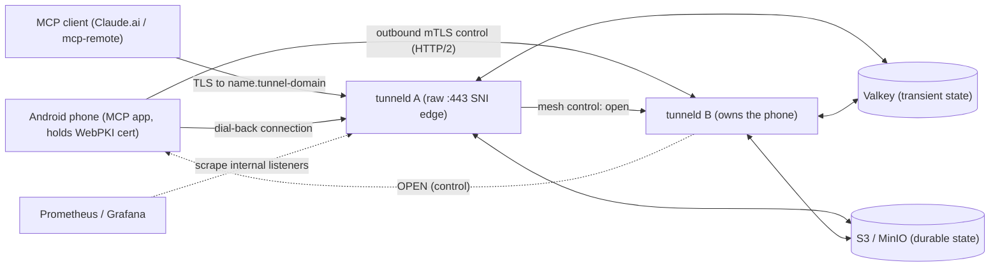

# tunneld — Project Reference

`tunneld` is a self-hosted, abuse-resistant **end-to-end-encrypted tunnel server** that gives the
Android MCP app (`android-remote-control-mcp`) a stable public hostname. The phone needs no inbound
port, no static IP, and no paid tunnel service. External clients (Claude.ai, `mcp-remote`) establish
TLS **directly with the phone**, which holds a publicly-trusted (WebPKI) certificate for its assigned
hostname `<name>.<tunnel-domain>`. tunneld is the internet edge on raw TCP `:443`: it peeks each
ClientHello (SNI/ALPN/version/JA4), routes on SNI, and splices the **opaque encrypted byte stream** to
the phone — it can NEVER read tunnel traffic.

This document is the operational entry point. The system internals live in
[`ARCHITECTURE.md`](ARCHITECTURE.md); the wire contract lives in [`PROTOCOL.md`](PROTOCOL.md); the
deployment quickstart lives in the [README](../README.md); the full decision record is
[Plan 3](plans/3_e2e_encrypted_tunneling_20260817175922.md), and for the dial-back/data path
[Plan 16](plans/16_entry_node_dial_back_20261014192454.md); the name claim (the Valkey claim lock that replaced Plan 3's
write-verify claim) is described in [`ARCHITECTURE.md`](ARCHITECTURE.md) §6.

## 1. Topology

One binary (`tunneld serve`) is the internet edge AND the tunnel bridge — there is **no reverse proxy**
(no Cloudflare, no Traefik). Run **one replica per host**; replicas exchange control messages over an
internal mTLS HTTP/2 **mesh**, and the phone dials back to the node where a public connection entered, so no
tunnel data crosses nodes.
**Valkey** holds transient control state (routing/rate-limit/concurrency — everything TTL'd); a plain
**S3** bucket (any provider; MinIO locally) holds the durable state (name registry, connection logs,
rejected-enrollment evidence).

**Never publish tunneld's mesh (`:9443`) or internal (`:9090`) ports** — only the raw edge `:443` and, when a CA uses HTTP-01 or
`--dialback-https=false`, the plain listener `:80` (ACME HTTP-01 answers and plain dial-backs) are public; the mesh + metrics are reachable on the internal network only. The tunnel relays opaque TLS, so
there is no proxy trust boundary and no `X-Forwarded-For` handling: the client's IP is the peer address
of the raw TCP connection.

## 2. Identity and authentication

- **Two-phase attested enrollment.** Phase 1 (server-TLS `POST /api/v1/enroll` on `--enroll-host`): the phone
  submits an Android hardware key-attestation chain + an identity CSR; tunneld verifies the seven-point
  attestation predicate + key binding, assigns a random tunnel name (base32), and signs a bootstrap
  **identity (mTLS) cert** with its internal CA (CN = the assigned name). Phase 2 (mTLS `POST /api/v1/issue` on
  `--control-host`): the phone — now knowing its name — submits a TLS CSR for `<name>.<tunnel-domain>`;
  tunneld re-verifies attestation, and issues the **public WebPKI cert** via server-run ACME. See
  [`PROTOCOL.md`](PROTOCOL.md) §2.
- **Server-run ACME chain**: Let's Encrypt → Google Trust Services → ZeroSSL, with automatic spillover,
  a per-CA validation method (DNS-01 / HTTP-01 / TLS-ALPN-01; defaults LE + GTS TLS-ALPN-01, ZeroSSL HTTP-01 — answered by tunneld's own listeners from Valkey, so any replica answers), and short-lived certs renewed on a uniform ~4.7-day cadence.
  Each CA is optional: Let's Encrypt is used unless `--acme-dir-le` is empty, GTS only for the EXISTING accounts
  listed in `--acme-gts-account` (one per Public CA project, each with its EC private key in PEM at
  `<acme-account-dir>/accounts/<id>.key`; tunneld looks them up by key and never creates them), ZeroSSL only when its EAB pair is set. Issuance is planned against per-CA budgets kept in Valkey (token
  buckets per registered domain, account, name and request rate), so a CA is asked only when it has budget; a
  429 makes that account wait out its Retry-After cluster-wide. The phone holds the TLS private key;
  only CSRs leave it. Every successful issuance — phone cert, renewal or reserved-host cert — logs
  `acme certificate issued` at Info with the issuing `ca`, the `name`, the `serial` and `not_after`.
- **mTLS with role separation, NO public-side mutual auth.** The phone authenticates to tunneld with its
  identity cert over the outbound HTTP/2 control connection; replica↔replica mesh uses distinct
  **mesh-role** certs (SAN = node id). The public edge does NO client-cert auth (it relays opaque TLS).
- **Revocation is the ban engine ONLY** (no CRL): a `tunnel-name` ban refuses the phone at the control
  plane (control connection, `/api/v1/issue`, mTLS dial-back) and, on ban reload, closes its live control
  connection; the splices opened through it then end on every node (`close_reason=ban-evict`) — live traffic
  is stopped, not only new admissions. The public edge checks only the client address (`ip` / `cidr` /
  `country`).
- **The tunnel authenticates NOTHING it relays** — it cannot (the bytes are opaque TLS). The phone's own
  app is the sole authenticator; a tunnelled deployment MUST keep the app's bearer/OAuth enabled.

## 3. Public surface

The public edge is raw TCP `:443`. It peeks the ClientHello and dispatches by SNI:

| SNI | Behaviour |
|---|---|
| any SNI, first ALPN protocol `acme-tls/1` (checked before the rows below) | ACME TLS-ALPN-01 validation: answered locally with the challenge certificate; no pending challenge → closed (`no-route`); never spliced |
| `<name>.<tunnel-domain>` | resolve the route → have the owner send `OPEN`, wait for the phone's dial-back to this node, splice opaque TLS to it |
| `--enroll-host` | terminate locally: server-TLS enrollment endpoint (Phase 1) |
| `--control-host` | terminate locally: mTLS phone control plane (`/api/v1/control`, `/api/v1/data`, `/api/v1/issue`) |
| anything else / no route | connection closed (`no-route`) |

When a CA uses HTTP-01 or `--dialback-https=false`, a plain `:80` listener (`--acme-http-listen`) serves `/.well-known/acme-challenge/<token>` for pending challenges (one request per connection) and, with `--dialback-https=false`, the phones' plain dial-backs (`GET /api/v1/data`, authorised by the one-time token only; any other method on that path → 405); anything else → 404, `acme-http-miss`.

There is no HTTP method/path allowlist on relayed traffic — the phone terminates TLS and enforces its
own routes. Client-supplied `X-Forwarded-*` are irrelevant (opaque relay).

## 4. Abuse containment

### Caps (defaults; `--limit-*` / `TUNNELD_LIMIT_*` unless noted)

| Cap | Flag | Default |
|---|---|---|
| Bandwidth (per tunnel, per direction) | `--limit-bandwidth` | `1mbit` (≥ 16384 B/s) |
| Reads/packets per second (per tunnel, per direction) | `--limit-packets` | `100` |
| Traffic / tunnel / 24h window (UTC-aligned, per direction) | `--limit-traffic-day` | `1gb` |
| Traffic / tunnel / 7d window (epoch-aligned, per direction) | `--limit-traffic-week` | `4gb` |
| Concurrent data streams / tunnel | `--limit-concurrent` | `4` |
| New public TCP connections / source IP | `--limit-conn-rate` | `10`/s |
| Enrollments / source IP | `--limit-enroll-hour` + `--limit-enroll-minute` | `20`/h AND `2`/min |
| Pre-bind control handshakes / node | `--limit-stream-pending` | `64` |
| All inbound connections / node | `--max-clients` | `10000` |
| Successful public-cert issuances / tunnel / 7d | `--issue-per-week` | `3` |
| Connection idle / min-rate / eviction | `--limit-conn-*` | see config |

Caps are uniform by design — no per-path exceptions, no bulk-transfer carve-outs. Operators raise the
`--limit-*` values; they never patch the code.

### ACME issuance budgets

| Budget | Flag | Default |
|---|---|---|
| LE new certificates / registered domain | `--acme-budget-le-domain` | `50/168h` |
| LE new orders / account | `--acme-budget-le-orders` | `300/3h` |
| LE certificates / exact name | `--acme-budget-le-name` | `5/168h` |
| GTS new orders / account | `--acme-budget-gts-orders` | `100/1h` |
| GTS requests / account | `--acme-budget-gts-requests` | `120/1m` |
| GTS `/cert/` requests / account | `--acme-budget-gts-cert-polls` | `50/1m` |
| ZeroSSL new orders / account | `--acme-budget-zerossl-orders` | `200/1h:40` |
| ZeroSSL requests / account | `--acme-budget-zerossl-requests` | `240/1m` |
| Order attempt deadline LE / GTS / ZeroSSL | `--acme-attempt-timeout-{le,gts,zerossl}` | `20s` / `60s` / `90s` (each ≤ `100s`) |
| First certificate poll LE / GTS / ZeroSSL | `--acme-poll-first-{le,gts,zerossl}` | `2s` / `3s` / `15.2s` |
| Following polls | `--acme-poll-interval` | `2s` |

When a CA's challenge answer carries no `Retry-After`, tunneld supplies 1 s (2 s for GTS), so a pending validation is
re-checked after ~1–2 s instead of lego's 5 s default; lego then stops re-checking after 100× that value (100 s, or
200 s for GTS), and every attempt deadline is capped at 100 s. Only the CA's default certificate chain is downloaded; alternate chains are never fetched. A GTS or ZeroSSL order
starts only when its account's request budget can carry a whole order (9 requests, capped at its burst; prepaid and refunded when unused,
except that a 429 on the account makes its running orders drop their unused prepaid requests, so those are charged to the shared budget again),
and an order already finalized when its deadline passes gets 30 s more to fetch its certificate. Rates are `<count>/<period>[:<burst>]` token buckets. The registered domain is the certificate name's eTLD+1
(Public Suffix List), as Let's Encrypt counts it. A renewal of an LE certificate on LE draws only the per-name
budget, for phone names and tunneld's own reserved hosts alike.

### Ban / geo engine

One or more `--ban-file` (hot-reloaded on mtime, entries UNIONed): `ip`, `cidr`, `country XX`,
`tunnel-name`. `country` entries expand at reload from a DB-IP Country Lite CSV
into a longest-prefix-match table (one lookup per connection). The ban check is the FIRST handler-level
check on every ingress edge (public `:443`, the plain `:80` listener — ACME HTTP-01 and plain dial-backs — `/api/v1/enroll`, `/api/v1/control`), keyed on the trusted client IP — including CA validation connections, so an IP/CIDR/country ban can fail HTTP-01 / TLS-ALPN-01 issuance (DNS-01 is unaffected). A peer address that does not parse as an IP cannot be ban-checked and is refused before the ban gate (fail closed). Country
codes in repo artifacts are placeholders (`XX`/`YY`). The `fetcher` compose service keeps a Spamhaus
DROP-derived ban file and the DB-IP CSV fresh (atomic `mv` handoff).

## 5. State + retention

- **Valkey (transient, TTL'd):** routing entries, node registry (plus the `nodes` id set used to reach every
  live node), rate-limit windows, the per-tunnel stream cap (`conc:{name}` — a sorted set: one member per live
  public connection = its dial-back token, score = its expiry in unix ms; expired members are pruned at
  admission, `Charge` refreshes the stream's own member, release removes it, TTL 3 × `--limit-conn-idle`; the
  day/week traffic quotas persist across reconnects), the merged per-tunnel byte counters (in the routing `tunnel:{name}` key), the per-second
  bandwidth (`bw:`) + packet (`pkt:`) windows and the per-direction day/week traffic
  (`traf:{name}:{dir}:day/week:{n}`) windows, single-use enrollment nonces, per-account ACME wait-until/backoff and 429 mark (`acme-429:`, longer than any order lives), the ACME issuance budgets (`acme-budget:{bucket}` token buckets, the per-node in-flight orders `acme:inflight:{bucket}:{node}`, the per-CA lock `lock:acme-budget:{ca}`), ACME challenge material (`acme:alpn:` / `acme:http:`, 10 min) the reserved-host issuance lock (`lock:acme-self:`, 10 min), the name-claim lock (`lock:claim:`, `--registry-claim-settle`, never released) and the shared reserved-host cert (`acme:self-cert:`, until the cert's NotAfter — it holds the private key, so Valkey must stay private). Every
  key gets a TTL in the same round-trip as its write — via `SET EX`, a `SETNX` lock, a pipelined
  `EXPIRE NX` right after the `INCR` for the self-healing transient `bw:`/`pkt:` per-second AND `traf:`
  day/week windows, or a pipelined `PEXPIRE` (the `conc:{name}` and `nodes` sets); the per-account ACME
  wait-until is a pipelined `EXPIRE GT` + `SET NX EX` and the in-flight order sets a pipelined `EXPIRE NX` +
  `EXPIRE GT`, so neither TTL is ever shortened; NO Lua/WATCH/MULTI-EXEC. No permanent Valkey state.
- **S3 / MinIO (durable):** the name registry (`names/<name>`), connection logs (per-node JSONL objects
  `tunnel-logs/<yyyy>/<mm>/<dd>/<file-start>-<node-id>.jsonl`, all tunnels mixed — every line carries its
  `tunnel`; each node spools events in `--conn-log-dir` and uploads one object per clock-aligned 5-minute
  window, or per 16 MiB, then deletes it locally), and
  rejected-enrollment evidence (`rejected-enroll/…`) — plain `GetObject`/`PutObject`/`DeleteObject` only
  (no conditional writes), so any plain-S3 provider works; name uniqueness comes from a per-name
  Valkey claim lock plus a GET-absent check before the PUT, not from conditional writes. **PRE-GO-LIVE**, validate a provider with a read-after-write
  probe (PUT → GET → overwrite-PUT → GET returns the newest body; a GET of a missing key returns 404
  `NoSuchKey`).
- **Connection-log spool (local, transient):** `--conn-log-dir` (a persistent volume, locked by one process)
  holds the not-yet-uploaded files; an S3 outage loses nothing below its 1 GiB cap, and leftover files are
  uploaded at the next start.
- **Retention** (a one-time lifecycle setup on the bucket by the operator; tunneld never reads or writes
  bucket configuration, so its S3 credential needs only read, write and delete on the objects plus list on
  the bucket — on AWS-style IAM `s3:GetObject` / `s3:PutObject` / `s3:DeleteObject` on the objects and
  `s3:ListBucket` on the bucket, without which a missing key answers 403 instead of 404): name registry
  **indefinite**, connection logs **90 days** (rule `tunnel-logs-expire`, prefix `tunnel-logs/`),
  rejected-enrollment evidence **30 days** (rule `rejected-enroll-expire`, prefix `rejected-enroll/`), tunnel
  content **never** (it is opaque and never stored). The bundled compose stack (local dev) sets no rules.

## 6. Observability

The internal listener (`--internal-listen`, never published) serves `GET /metrics` (Prometheus,
aggregate families only — NO per-tunnel labels), `GET /healthz` (`200` if Valkey is reachable, else `503` carrying
the Valkey error), `GET /api/v1/admin/tunnels/list?cursor=&count=` (a paginated tunnel-name list — ONE SCAN step,
client-driven, no ranking; a malformed `cursor` or a non-positive/malformed `count` is a `400`) + `POST /api/v1/admin/tunnels/stats` (names → per-tunnel node/bytes/conc/bw/day/week, live tunnels
only), `GET /api/v1/admin/nodes` (the node registry), and the per-tunnel actions `POST /api/v1/admin/tunnels/{name}/reissue` (force a RENEW_NUDGE) and
`POST /api/v1/admin/tunnels/{name}/terminate` (every node evicts its in-flight public splices, `close_reason=admin-terminate`, and the owner closes the phone control connection — ephemeral, the phone reconnects); reissue is routed to the owner node and terminate is sent to every node
over the mesh `/api/v1/mesh/control` RPC (see `docs/PROTOCOL.md` §5). Cap-hit events are logged deduplicated (first hit per `(tunnel, reason)` immediately,
then ≤1 summary/min) — EXCEPT `no-route`, whose tunnel value is attacker-controlled (raw SNI): it is
metric + Debug-line only, never keying the dedup map, so it cannot flood the logs. Connection logs are
spooled and uploaded per node (JSONL, see §5); `tunneld_connlog_dropped_total` counts every event lost to
a full 5000-event queue, a failed local append, the 1 GiB spool cap, still being queued when
`--shutdown-grace` expires, or arriving after shutdown. `tunneld_acme_budget_ratio{ca,account,budget}` is the
remaining issuance budget (0–1) per CA account; `tunneld_acme_rate_limited_total{ca}` counts the CAs' 429 answers.
At Debug level every ACME HTTP request logs `acme request` and every completed enrollment / issuance step logs
`enroll step` / `issue step`, each with its duration, to diagnose slow enrollments (server-side processing only:
the request-body transfer and the response write are not timed).
Grafana provisioning (`deploy/grafana/`) ships six
dashboards: Health (one red/green tile per check, grouped, with the failing-check count on top and two
`eth0` traffic charts per node: the 24 h average as a percentage of the 90 Mbit/s limit and the last minute as a
percentage of the 150 Mbit/s limit), Nodes overview and Node detail (`node_exporter`, the podman exporter, WireGuard
handshake and ban-list ages), Valkey and Sentinel (the Redis/Valkey exporter), and tunneld overview and detail.
They expect every Prometheus target to carry a `node` label (and `service="valkey"|"sentinel"` on the Valkey
exporter targets), host textfile metrics `wireguard_peer_latest_handshake_timestamp_seconds`,
`wireguard_peer_{receive,transmit}_bytes_total` and `banlist_file_mtime_timestamp_seconds{file}`, and — for
Health — blackbox-exporter jobs `blackbox-enroll` / `blackbox-connect` (TLS probe of each node's public `:443`
for the enroll / control host) and `blackbox-healthz` (each node's internal `/healthz`). `deploy/prometheus/` holds the scrape config and alert rules; the compose stack does not run
Prometheus or Grafana.
Secrets, key material, and tunnel payloads are NEVER logged.

## 7. Operations

- **Deployment quickstart** (CA generation, `.env`, S3, ACME/DNS): [README](../README.md).
- **Connection-log spool**: give every node its own persistent `--conn-log-dir` (two processes on one
  directory are refused at startup); files left after a crash or an S3 outage are uploaded on the next start.
- **Dial-back address**: `--dialback-advertise` is this node's own public `IP:443` (plain mode,
  `--dialback-https=false`: `IP:80`), never the round-robin hostname — the phone must reach exactly the node
  the public connection entered.
- **Connection budget**: each public connection holds two `--max-clients` slots on its entry node (the client
  and its dial-back), and its dial-back counts against `--limit-conn-rate` for the phone's IP — raise it for
  many tunnels behind one IP.
- **Splice teardown**: when a phone's control connection closes (any reason), every splice opened through it
  ends, on every node.
- **TIME_WAIT / conntrack**: one dial-back per request roughly doubles the short-lived TCP connections;
  TIME_WAIT (fixed 60 s in Linux) ≈ 2 × new connections/s × 60. Set
  `net.netfilter.nf_conntrack_tcp_timeout_time_wait=10`; size `net.ipv4.tcp_max_tw_buckets` and
  `net.netfilter.nf_conntrack_max` from the measured rate (TIME_WAIT is charted on the node dashboards,
  conntrack has a Health tile).
- **Releases**: `v*` tags → goreleaser → linux amd64/arm64 archives + multi-arch image
  `ghcr.io/danielealbano/android-remote-control-mcp-tunneld`. Every archive carries `LICENSE.md`,
  `README.md` and `THIRD_PARTY_LICENSES.txt`; every image (goreleaser and compose-built) carries
  `/THIRD_PARTY_LICENSES.txt`. That file is generated at build time by `scripts/third-party-licenses.sh`
  from the Go toolchain's license and the license/notice files of every module compiled into `cmd/tunneld`
  on linux amd64 and arm64 (the goreleaser platforms); it is never committed.
- **Standard commands**: the Makefile (`build`, `lint`, `vet`, `govulncheck`, `test-unit`,
  `test-integration`, `test-e2e`, `test-staging`, `test-scripts`, `compose-config`, `mermaid-check`,
  `third-party-licenses`; `test-soak-app` runs the
  soak-app device tests, which are behind the `soak` build tag and never part of the default gates). The integration,
  e2e and staging tiers require Docker (testcontainers: Valkey, MinIO via the PGSTY Silo build, Pebble); the staging tier also reaches Let's Encrypt staging + GTS staging through a reverse SSH tunnel and skips without `TUNNELD_STAGING_SSH_KEY`.
- **Soak test** (manual, against a live deployment): `make soak-app soak-client` (the APK lands in
  `fixtures/soak-app/` with its sha256 and signer digest, like the reference app). The soak app emulates N
  phones on one device — each with its own hardware-attested enrollment, public cert and control connection;
  each answers on the dial-back connection itself (TLS with the phone's public cert, HTTP/1.1)
  `POST /op?resp=<bytes>` with `<bytes>` of the pattern `byte(i % 251)`. Allow its
  signing-cert digest, install it, then `adb shell am start -n com.example.soakapp/.MainActivity -e command
  start -e count 10 -e enrollHost <enroll-host> -e controlHost <control-host> -e tunnelDomain <tunnel-domain>`.
  The app is one full-screen activity: it keeps the screen on while phones run (shown over the lock screen) and
  shows live figures — phones connected per node and reconnecting, traffic (requests and errors, in and out in Mbit/s averaged over the last minute), enrollments and
  certificates per CA, device health. Each emulated phone shuffles the node addresses its DNS lookups return, so the
  phones spread over the nodes like separate devices behind round-robin DNS. It has no foreground service (Android 15+ lets a `dataSync` one run only
  6 h a day), so it runs only while it is on screen: keep the phone plugged in and the app in front. Phones
  enroll one at a time, `spacingSeconds` apart, default 65 s, because each enrollment spends two of the per-IP
  enroll-rate slots; `-e parallel true` enrolls them all at once instead and lists phones that still failed in
  `files/failures.txt`, each new enrollment waiting a random 0–5 s first. Enrollment and issuance follow the
  `docs/PROTOCOL.md` §2 retry rules, except that a phone retries its enrollment up to 10 times instead of 3, since one
  device carries the key-generation load of all its phones. `files/names.txt` lists the bound
  names and `files/ready` holds how many are up (`files/error` on a failure that stops the run). Every phone is
  saved per environment (its enroll host, control host and tunnel domain) in `files/phones/<env>/<n>.json` (name,
  keystore aliases, cert chains — rewritten on every renewal), so `start` is additive and resumable: it skips
  running phones, resumes saved ones (also after `stop`, a crash or an `adb install -r`), and enrolls only the
  missing ones up to `count`. Phones of other environments are never touched, and only one environment
  runs at a time; a saved phone whose keys are unusable fails its start instead of being replaced. A phone is
  saved right after its enrollment. If its issuance gives up after the retries (docs/PROTOCOL.md §3), it stays
  saved without a public cert and the next `start` retries only the issuance, so a phone never enrolls a second
  name. The only way to
  discard saved phones is `forget` (the `forget` command with the same three host extras), which deletes that one
  environment's phones and keys; uninstalling the app discards every environment. Then run
  `bin/soak-client --names-file names.txt --domain <tunnel-domain>`: per phone, one operation every
  `--interval` (1 s) with a request averaging `--req-bytes` (1 KiB) and a response averaging `--resp-bytes`
  (5 KiB), each uniformly 0.2–1.8× the average and verified byte by byte (the phone accepts request bodies up to
  1 MiB and answers up to 64 KiB, so the client refuses averages whose 1.8× exceeds them), on a reused connection
  dropped every
  `--reconnect` (5 min), for `--duration` (24 h), the phones' starts (and so their reconnects) spread evenly over
  `--ramp` so a single client IP stays under `--limit-conn-rate`; it writes one CSV row per phone per minute (`--out`) and a
  summary at the end. A phone whose operation fails retries after `--interval`, then twice as long each time up
  to 16 s, and returns to the normal pace after a success; more than 1000 failures in a row across all phones
  (no tunnel works) stop the client with an error after the CSV and the summary are written. `adb shell am start
  -n com.example.soakapp/.MainActivity -e command stop` stops the phones. Each enrollment
  issues a real public cert and claims a name in the registry. For a local stack the app takes `edgePort` (every
  host resolves to `127.0.0.1:<edgePort>`, for `adb reverse`) and `caPath` (a PEM trust anchor in its files dir),
  and the client takes `--ca-file` and `--connect host:port`; the adb-gated `TestE2E_SoakApp` (`make test-soak-app`) does exactly that
  (it never uninstalls the app and forgets only its own local environment, but its reinstall stops any running
  phones, which resume on the next `start` for their hosts):
  3 emulated phones with real attestation enrolling in parallel on one replica, scaled to 4 and resumed after
  a reinstall, the client entering through a second replica,
  60 s at 1 op/s with a reconnect every 20 s, zero failed operations required. The device gates reach each
  replica through its own `adb reverse` port (`--dialback-advertise 127.0.0.1:<device port>`), so the phone's
  dial-back lands on the replica the request entered.
- **License**: tunneld is licensed under the GNU Affero General Public License, version 3 or (at your
  option) any later version (`LICENSE.md` is the verbatim license text; the program notice is in the
  README). Country data is DB-IP Country Lite — © db-ip.com, CC BY 4.0 (the README carries the
  attribution; it MUST be preserved).

## 8. Non-goals

No database / persistent server-side identity store (the phone holds its cert). No authentication of
relayed traffic (it is opaque TLS; the app authenticates). No per-path cap exceptions or bulk transfers.
No CRL (bans are the only revocation). No cross-replica exact bandwidth accounting (per-second fixed windows; bounded overshoot).
No server-side content storage or caching. No TLS mutual auth on the public side. The Android (Kotlin)
client lives with the app, not here. (Three on-device test apps under `support/` are the only exceptions,
none of them the client: a minimal **attestation test probe** (`support/attest-probe/`) driving the adb-gated
`TestE2E_DeviceAttestation` gate, a complete **reference tunnel client** (`support/tunnel-app/`) — a
faithful Kotlin implementation of the phone side of `docs/PROTOCOL.md` — driving the adb-gated
`TestE2E_ReferenceTunnelApp` gate, and the **soak app** (`support/soak-app/`, see §7) with its Go load client
`support/soak-client/`.)
