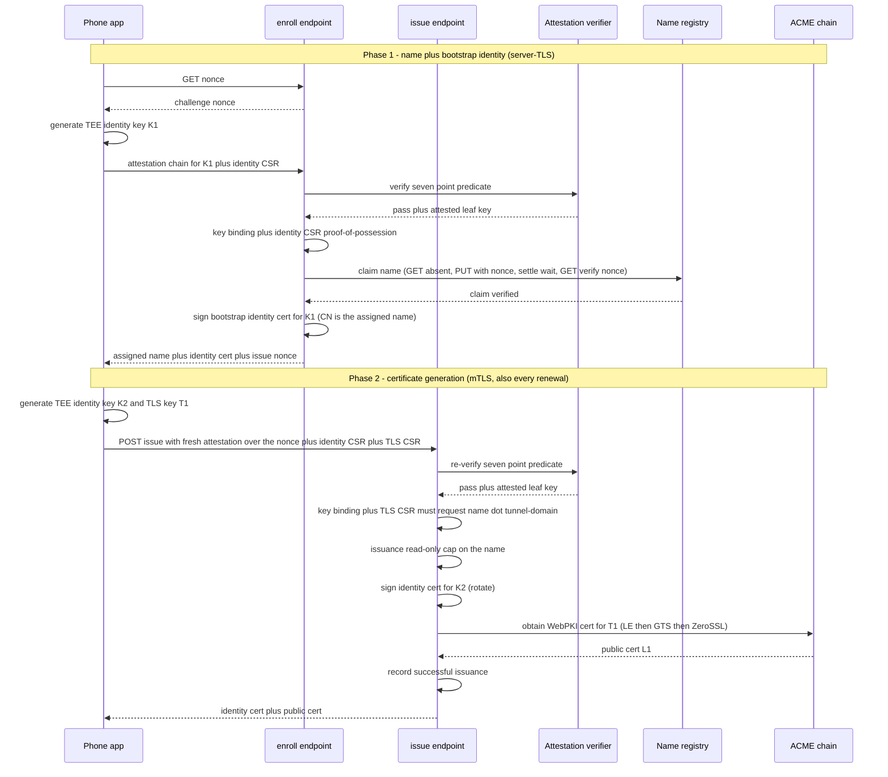

# tunneld Wire Protocol (v2 — End-to-End Encrypted)

This is the CANONICAL wire contract for the E2E-encrypted tunnel. The Go client in `client/` and the
Android (Kotlin) client both conform to THIS document, not to the Go source. `internal/wire` holds the
frame codec.

tunneld relays **opaque TLS bytes** and can NEVER read tunnel traffic: external clients establish TLS
directly with the phone, which holds a publicly-trusted (WebPKI) certificate for its assigned hostname.
tunneld is the internet edge (raw TCP `:443`), peeks the ClientHello (SNI/ALPN/version/JA4), routes on
SNI (a ClientHello whose first ALPN protocol is `acme-tls/1` is an ACME TLS-ALPN-01 validation answered locally by tunneld, never spliced), and splices the encrypted byte stream to a connection the phone dials back to the entry node.

## 1. Identity & authentication

- **No TLS mutual auth on the public side.** The phone authenticates to tunneld with an internal-CA
  **identity client certificate** over its outbound HTTP/2 **control connection** (mTLS). The assigned
  tunnel name is the certificate's **CN**; the server DERIVES the name from the CN (the phone dials the
  single shared `--control-host`, so there is no per-tunnel Host on the control connection). The phone
  presents the same identity certificate on each dial-back connection (§4) when the `OPEN` sets `use_mtls`.
- **Two TEE keys per tunnel**: the identity key (mTLS) and the TLS key (the public WebPKI cert). Both
  are generated in the phone's hardware keystore; only CSRs leave the phone.
- **Enrollment is gated by Android hardware key attestation** (seven-point predicate, §2) PLUS a
  **key-binding** check: the enrolled identity key MUST equal the attested TEE key, and the CSR
  signatures are verified (proof-of-possession — the identity CSR at Phase 1, the TLS CSR at Phase 2).
  This closes the "attest a real key, enroll a software key" bypass.
- **The tunnel name is server-assigned and server-dictated.** The public WebPKI cert is issued for
  `<name>.<tunnel-domain>`, where `<name>` is the random name the server assigned at Phase-1 enrollment
  and wrote into the identity cert CN; at issuance the server reads the name from the mTLS client-cert CN
  and REQUIRES the TLS CSR to request exactly `<name>.<tunnel-domain>`.
- **Revocation is the ban engine ONLY** (no CRL): tunnel-name / identity-fingerprint bans are enforced
  at the phone control connection, at the public SNI edge on the resolved route, and by live eviction
  on ban reload.

## 2. Enrollment (two-phase)

Enrollment is TWO phases. **Phase 1** (server-TLS `POST /api/v1/enroll` on `--enroll-host`, no client cert —
the phone has no identity yet) verifies attestation, assigns + write-verify-claims the name, and signs a
**bootstrap identity cert** (CN = the assigned name). **Phase 2** (mTLS `POST /api/v1/issue` on `--control-host`)
generates the certificates: because the server assigned the name in Phase 1, the phone learns it BEFORE
building the TLS CSR, so the public cert is issued for the server-dictated `<name>.<tunnel-domain>` while
the TLS private key never leaves the phone. Phase 2 regenerates the identity cert and the public cert
**together** and is also the single path for every renewal. The name registry uses a **write-verify
claim** over plain S3 (no conditional writes), so it runs on any S3 provider.



At Phase 2 and at every renewal the server reads the name from the **mTLS client-cert CN**, so the name
is fixed at Phase 1 and stays stable across renewals (which rotate the identity key). Phase 1 records the
claim; Phase 2 is retryable and its name is never rolled back.

**Key type — ECDSA P-256 ONLY (both CSRs).** Enrollment accepts ECDSA P-256 keys only. The server
enforces this on the identity CSR (Phase 1 and Phase 2) AND on the Phase-2 **TLS CSR**: a non-P-256 TLS
key is refused (`unsupported_key_type`) before the public cert is ever obtained.

**Seven-point attestation predicate** (ALL mandatory): chain roots at a Google attestation root ∧
`attestationChallenge == nonce` ∧ signing digest ∈ the hot-reloadable allowlist ∧ `securityLevel ≥
TrustedEnvironment` (Software rejected; StrongBox not required) ∧ `verifiedBootState == Verified` ∧
`deviceLocked == true` ∧ not revoked (status list refreshed with last-known-good; refused if `> 24h`
stale). A KeyDescription that does not parse — including a malformed informational field such as the OS
version or a patch level — fails the chain (`attest-untrusted`).

**Write-verify claim invariant**: the settle wait MUST strictly exceed the claim-PUT timeout, and
registry writes disable SDK auto-retries (a retried claim PUT would be a self-inflicted zombie write).

**Phase-1 HTTP surface** (server-TLS on `--enroll-host`, JSON, all binary blobs hex/PEM as noted):

- `GET /api/v1/enroll/nonce` → `{"nonce": "<hex>"}` — a single-use challenge nonce (per-IP rate-limited).
- `POST /api/v1/enroll` with `{"nonce": "<hex>", "attestation_chain": "<PEM bundle>", "identity_csr": "<PEM>"}`
  → `{"name": "<assigned>", "identity_cert": "<PEM>", "issue_nonce": "<hex>"}`. `issue_nonce` is the
  single-use nonce the phone echoes in its follow-up `POST /api/v1/issue`. Errors are
  `{"reason", "retryable", "retry_after_seconds"?}`; the status mapping (both enroll routes): `403`
  banned, `429` nonce-route rate limit, `401` unauthorized, `503` retryable (the body's `retryable`
  field is authoritative), `400` otherwise.

## 3. Phone control connection (HTTP/2 + mTLS)

The phone opens ONE outbound HTTP/2 connection to `--control-host` (mTLS, identity client cert). It
carries:

- a long-lived **control stream** — a `POST /api/v1/control` request whose **request body** is the phone→server
  frame stream (only `PONG`) and whose **response body** is the server→phone frame stream (`OPEN`,
  `PING`, `RENEW_NUDGE`). Both bodies are the length-framed control messages below; the server flushes
  each frame. The stream stays open for the connection's lifetime.
- the mTLS `POST /api/v1/issue` exchanges (below).

Public traffic never rides on this connection: each public connection gets its own **dial-back
connection** (§4).

Control-frame layout: `[type:1][payloadLen:4 BE][payload JSON]`. The type values are FROZEN:

| Frame | Type | Direction | Payload |
|---|---|---|---|
| `OPEN` | `0x01` | server→phone | `{token, addr, use_https, use_mtls}` — dial back to `addr` for one public connection (§4) |
| `PING` | `0x02` | server→phone | (none) — application liveness |
| `PONG` | `0x03` | phone→server | (none) — liveness answer |
| `RENEW_NUDGE` | `0x04` | server→phone | `{nonce, ari_window}` — "renew now"; the phone answers by calling `POST /api/v1/issue` |

The control stream carries only small frames. All certificate material (attestation chains, CSRs, issued
certs) — and every issuance/renewal ERROR — travels over the mTLS `POST /api/v1/issue` endpoint below, NEVER the
stream. The only phone→server frame is `PONG` (liveness); a stream tears down via HTTP/2 `END_STREAM`,
never a control frame.

When the control connection closes (for any reason), every splice opened through it ends, on every node
(§5 `evict`). A crashed owner node sends no `evict`: such splices end within 10 s after the route expires
(`--route-ttl`) or is re-bound, when the entry node's per-splice route check (every 10 s each splice re-reads
its tunnel's route) finds the route gone or bound to another connection.

### `POST /api/v1/issue` (mTLS certificate-generation endpoint)

`/api/v1/issue` is the single cert-generation endpoint for BOTH the initial public cert (Phase 2) and every
renewal, authenticated by the phone's mTLS identity cert (name = its CN). Request/response are JSON:

- Request: `{nonce, attestation_chain, identity_csr, tls_csr}` — `nonce` is the Phase-1 `issue_nonce`
  (initial) or the `RENEW_NUDGE` nonce (renewal); `tls_csr` MUST request `<name>.<tunnel-domain>`.
- Response: `{identity_cert, public_cert, ca}` — the regenerated identity + public certs.
- **Latency**: the response arrives only after a live ACME order (validation + issuance, possibly spilling
  over to the next CA), so the phone MUST allow at least 60 s for it; a phone that gives up earlier loses the
  issued certificate (the server discards an order whose requester is gone).
- Errors: `{"reason", "retryable", "retry_after_seconds"?}`; the status mapping: `403`
  banned/forbidden identity, `405` non-POST method, `401` unauthorized, `503` retryable (the body's
  `retryable` field is authoritative; `retry_after_seconds` carries the pacing hint when known, e.g.
  an ACME rate-limit cooldown), `400` otherwise.
- **Retrying a retryable failure**: every `/api/v1/issue` attempt CONSUMES its single-use nonce, including a
  failed one. The enroll and issue nonces share ONE namespace, so the retry path is: fetch a fresh
  challenge from `GET /api/v1/enroll/nonce` (server-TLS, per-IP rate-limited), wait `retry_after_seconds`,
  and repeat `POST /api/v1/issue` with a fresh attestation over the new nonce (fresh keys/CSRs, as always).
  A phone that is already BOUND on the control stream is also re-nudged: the renewal watcher sees a
  cert-less or renewal-due tunnel and sends a fresh `RENEW_NUDGE{nonce}` on its next scan.

**Renewal rotates the identity key**: on a `RENEW_NUDGE{nonce}` the phone calls `POST /api/v1/issue` with a
FRESH identity key + fresh TLS key + fresh attestation over the nonce; the server re-runs the full
seven-point predicate + key binding, rotates the identity cert (CN = the mTLS CN), renews the public cert,
and returns both in the response. The connection stays up on the old certs until the response installs
the new ones.

## 4. Dial-back connection (opaque splice)

`OPEN` (`0x01`, server→phone) payload:

```json
{"token": "<26 chars, crypto/rand.Text, 128 bits>", "addr": "203.0.113.10:443", "use_https": true, "use_mtls": true}
```

`addr` is the `host:port` of the node where the public connection entered (`--dialback-advertise`). On
`OPEN` the phone opens a NEW connection to `addr` — TLS with SNI = `--control-host` and ALPN `http/1.1` when
`use_https`, presenting its identity client certificate when `use_mtls` (`use_mtls` without `use_https` is
invalid and ignored); plain TCP otherwise — and sends:

```http
GET /api/v1/data HTTP/1.1
Host: <control-host>
Connection: Upgrade
Upgrade: tunneld-dial
X-Dial-Token: <token>

```

Success: `HTTP/1.1 101 Switching Protocols` + `Connection: Upgrade` + `Upgrade: tunneld-dial`, then the
connection is a **raw, bidirectional, opaque byte splice** carrying the client↔phone TLS session — NO
framing; either side closing ends it. Failures (then the connection closes): `400` malformed (not exactly
HTTP/1.1, no token, no `Upgrade: tunneld-dial`), `403` identity certificate rejected (mesh-role, invalid
name, banned tunnel; with `use_mtls` a missing or untrusted client certificate already fails the TLS
handshake, with no HTTP response), `404`
unknown, expired, already-used token or a token of another tunnel, `405` non-`GET`. The token is single-use
and valid only while the entry node waits (`--limit-dialback-timeout`). If the open fails, the entry node
takes ONE fresh route lookup and retries once (same token) when the route changed, then closes the client.
`wire.ChunkSize` (16384) is the bandwidth-pacing read-slice size the splice reads, NOT a wire frame.

## 5. Replica mesh (control RPCs)

Replicas talk over an internal HTTP/2 mTLS mesh (mesh-role certs, SAN = node id) that carries control RPCs
only — no tunnel data ever crosses nodes. The mesh is replica↔replica only — it is NOT part of the
phone-client contract. Every call has a per-request deadline.

`POST /api/v1/mesh/control`: a JSON request → response `{applied}` (mesh-role mTLS). The ops:

- `renew`: `{"op":"renew","tunnel":"<name>"}` — mint a fresh renewal nonce and enqueue a `RENEW_NUDGE` to the
  named tunnel's live phone connection.
- `terminate`: `{"op":"terminate","tunnel":"<name>"}` — evict this node's in-flight public splices of the
  tunnel (`close_reason=admin-terminate`) and, on the owner, close its phone connection (the phone reconnects
  afterwards). The internal `POST /api/v1/admin/tunnels/{name}/terminate` endpoint sends it to EVERY node.
- `open`: `{"op":"open","tunnel":"<name>","conn_id":"<route connID>","open":{<OPEN payload>}}` →
  `{"applied":true}` when the receiver holds that live connection and queued the `OPEN`, else
  `{"applied":false}`. The entry node uses it when another node holds the phone's control connection.
- `evict`: `{"op":"evict","tunnel":"<name>","conn_id":"<closed connID>","reason":"<the control connection's
  close reason>"}` → `{"applied":<any splice ended>}`. A node whose phone control connection closes sends it
  to every node; each ends the splices opened through that connection, keeping `ban-evict` /
  `admin-terminate` when that is the reason, else `phone-close`.

`renew` is the mechanism behind the internal `POST /api/v1/admin/tunnels/{name}/reissue` endpoint (sent to
the owner). Unknown op → `400`, missing tunnel → `400`, `open`/`evict` without `conn_id` → `400`, `open`
without a payload carrying `token` + `addr` → `400`, non-POST → `405`, op failure → `502`.

## 6. Security invariants

- E2E: forward-secret TLS 1.3 between client and phone; tunneld holds no tunnel cert key, ever.
- No reverse proxy anywhere; tunneld is the raw `:443` edge; the trusted client IP is the TCP peer.
- Caps are UNIFORM (no per-path exceptions); rate limiting is global across replicas via Valkey.
- `ChunkSize == 16384` is the paced-copy slice size only; the dial-back carries no framing.
- The dial-back token is 128-bit random, single-use, valid only while the entry node waits; without
  `use_mtls` it is the only authorisation of a dial-back.
- No secrets, key material, or tunnel payloads are ever logged.
- A ClientHello whose first ALPN protocol is `acme-tls/1` is an ACME validation addressed to tunneld: it is answered locally with tunneld's challenge certificate and NEVER spliced to a phone.
