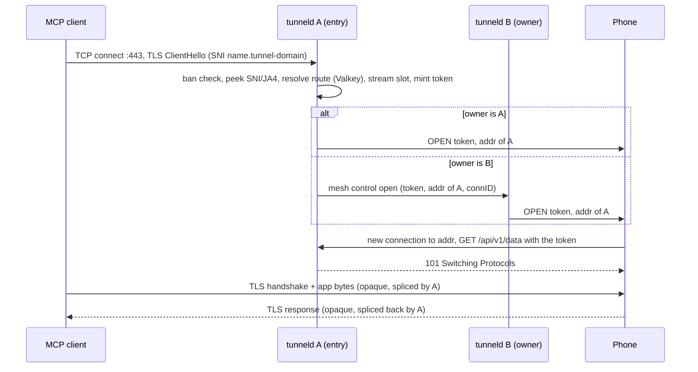

<!-- SACRED DOCUMENT — Edit ONLY per agent.md §2 plan-file rules: plan-review fixes, checkmarks, recorded implementation deviations, and code-review re-alignment. -->
<!-- You MUST NEVER delete this file or alter files outside this plan's scope. -->
<!-- Plans in docs/plans/ are PERMANENT artifacts. There are ZERO exceptions. -->

# Plan 16 — Entry-node dial-back (wire protocol v2)

Branch: `feat/plan-16-entry-node-dial-back`, created from the latest `main` at the start of implementation.

## Context

Production soak (2026-10-14): once a public connection to a tunnel ended, every later dial-back for that tunnel
timed out. tunneld ends a phone data stream with an HTTP/2 `RST_STREAM` (`httpDataStream.Close` →
`SetWriteDeadline(now)` → `INTERNAL_ERROR`, Go 1.27.2 `net/http/internal/http2/server.go:1857`/`:2742`); OkHttp
then stops putting new requests on that connection, the next dial-back opens a new connection, DNS round robin
lands it on a node with no waiting stream, which answers 404, and the entry node times out. Reproduced locally:
`TestE2E_DialBackAcrossReplicas` (working tree of `main`, uncommitted: `e2e/dialback_test.go` +
`replicaOpts.dialBack` in `e2e/e2e_test.go`) fails 5/5 on the current code.

The fix removes the cause: the phone dials back on a FRESH connection DIRECTLY to the node where the client
entered; the mesh carries control messages only.

## Decisions (agreed with the user)

| # | Decision |
|---|---|
| D1 | The entry node mints a 128-bit token, registers a local waiter, and asks the node holding the phone's control connection (the owner) to send `OPEN`: directly when it is itself the owner, else through the mesh `Control` op `open`. The phone dials back to the ENTRY node; the entry node splices client ↔ phone locally. No cross-node data traffic. |
| D2 | `OPEN` = `{token, addr, use_https, use_mtls}`; `addr` is the entry node's configured dial-back `host:port`. |
| D3 | One TCP (+TLS) connection per dial-back: an HTTP/1.1 request carrying the token, `101 Switching Protocols`, then raw bytes both ways. |
| D4 | HTTPS dial-backs land on `:443` (SNI = `--control-host`). The client certificate is required only when tunneld runs with `--dialback-mtls` (control-host TLS `ClientAuth` follows the flag; `/api/v1/control` and `/api/v1/issue` keep demanding the identity cert at the handler). Plain dial-backs land on the `:80` listener; the token is the only check. |
| D5 | Two tunneld flags, both default ON: `--dialback-https`, `--dialback-mtls`; mTLS without HTTPS is invalid. Plus `--dialback-advertise` (this node's own dial-back `host:port`). |
| D6 | No backward compatibility of any kind (the system is not in use and has no clients). The soak phones' certificates MUST survive (`adb install -r` keeps app data). |
| D7 | The mesh data path (`/api/v1/mesh/data`, `OpenStream`) is removed; every mesh `Control` call carries a per-request deadline. |
| D8 | Admin terminate is sent to EVERY node (each evicts its local splices; the owner also closes the phone control connection). |
| D9 | The per-tunnel stream cap is a sorted set `conc:{name}` (same key, new type): one member per live public connection (its token), scored by its expiry, refreshed by the splice, removed on release, expired members pruned at admission. No reset on reconnect, no lock. |
| D10 | Aggressive server-side TCP keepalive (Idle 10 s, Interval 5 s, Count 3) on every socket of the public `:443` and `:80` listeners (user-confirmed scope). The phone side sets no keepalive (user decision; Android exposes no per-socket keepalive timers). |
| D11 | The phone control connection stays HTTP/2 + mTLS. |
| D12 | `--limit-conn-rate` stays as is (10/s); dial-backs count against it at accept; operators raise it (documented). |
| D13 | When a phone control connection closes (any reason), the node that held it sends a close request to every node, scoped to that connection: tunnel name + the control connection's id. Each node ends the splices it opened through that connection (`close_reason` = `ban-evict` / `admin-terminate` when that is why the control connection closed, else `phone-close` — the request carries the reason). The entry node learns the id from the route it opened through (the owner acts only when that id is its live connection, which its `applied` reply confirms); a locally held connection's id is known directly. "Every node" comes from a node-id set (`nodes`, TTL'd, kept by the node heartbeats) — a teardown never SCANs the keyspace. Edge cases (user decision: a per-splice route check every 10 s): each splice's watcher re-reads its tunnel's route every 10 s and ends the splice (`phone-close`) when the route is gone or carries another connection id — covers a crashed owner (no broadcast: its splices end within 10 s after the route expires or is re-bound) and a broadcast that raced the dial-back; a lookup error keeps the splice. |
| D14 | Out of this plan: scanner mitigation, benchmarks (after rollout), the production rollout (merge, tag, per-node config incl. `TUNNELD_DIALBACK_ADVERTISE` and `TUNNELD_MAX_CLIENTS` doubled to 4000 since every public connection now also holds its dial-back's slot, the TIME_WAIT/conntrack sysctls, soak app resume, production test — each needs the user's go). |
| D15 | The final device gates run on the Realme, including `TestE2E_SoakApp`, which reinstalls the v2 soak app: certificates are kept, the 50 production phones stay offline until production runs v2 (user-approved). |

## Wire contract v2 (normative — mirrored into `docs/PROTOCOL.md` by US11)

`OPEN` (`0x01`, server→phone) payload:

```json
{"token": "<26 chars, crypto/rand.Text, 128 bits>", "addr": "203.0.113.10:443", "use_https": true, "use_mtls": true}
```

Dial-back (phone → `addr`, a NEW connection per `OPEN`; TLS with SNI = `--control-host` and ALPN `http/1.1` when
`use_https`; the identity client certificate when `use_mtls`):

```http
GET /api/v1/data HTTP/1.1
Host: <control-host>
Connection: Upgrade
Upgrade: tunneld-dial
X-Dial-Token: <token>

```

Success: `HTTP/1.1 101 Switching Protocols` + `Connection: Upgrade` + `Upgrade: tunneld-dial`, then the raw
opaque splice; either side closing ends it. Failures (then the connection closes): `400` malformed (not exactly
HTTP/1.1, no token, no `Upgrade: tunneld-dial`), `403` client certificate missing/invalid/banned, `404` unknown,
expired, already-used token or a token of another tunnel, `405` non-`GET`. The token is single-use and valid
only while the entry node waits (`--limit-dialback-timeout`). If the open fails, the entry node takes ONE fresh
route lookup and retries once (same token) when the route changed, then closes the client.

Mesh control ops (replica↔replica, `POST /api/v1/mesh/control`):
- `open`: `{"op":"open","tunnel":"<name>","conn_id":"<route connID>","open":{<OPEN payload>}}` →
  `{"applied":true}` when the receiver holds that live connection and queued the `OPEN`, else `{"applied":false}`.
- `evict`: `{"op":"evict","tunnel":"<name>","conn_id":"<closed connID>","reason":"<the control connection's close reason>"}` → `{"applied":<any splice ended>}`; each splice ended keeps `ban-evict` / `admin-terminate` when that is the reason, else `phone-close`.
- `renew` / `terminate`: unchanged envelope `{op, tunnel}`.

---

## [x] US1 — Wire contract v2

Why: the `OPEN` payload and the dial-back request constants are the shared contract of tunneld, the Go client
and the Kotlin apps.

Acceptance criteria:
- [x] `wire.OpenPayload` carries `token`, `addr`, `use_https`, `use_mtls` (JSON names frozen by a test).
- [x] The dial-back path, token header and upgrade token are constants in `internal/wire`.

### [x] Task 1.1 — OPEN payload + dial-back constants

- [x] **Action 1.1.1** — modify `internal/wire/frame.go`: replace `OpenPayload` and add the constants:

```go
type OpenPayload struct {
	Token    string `json:"token"`
	Addr     string `json:"addr"`
	UseHTTPS bool   `json:"use_https"`
	UseMTLS  bool   `json:"use_mtls"`
}

const (
	DialBackPath    = "/api/v1/data"
	DialBackHeader = "X-Dial-Token"
	DialUpgrade     = "tunneld-dial"
)
```

  Remove the comment parts this makes wrong: the old `OpenPayload` doc comment; `{streamID}` on the `CtrlOpen`
  line; in the package overview "(it carries interactive TLS records; HTTP/2 END_STREAM is teardown)" and the
  sentence "The mesh stream identifies itself … opaque splice."; in the `ChunkSize` comment "HTTP/2 framing and
  flow control use the library defaults (docs/PROTOCOL.md §6)"; every `v1` qualifier (package doc "v1 (E2E)",
  "Wire protocol v1", "a v1 control-stream frame", "a v1 control frame") — the protocol is now labelled v2 in
  `docs/PROTOCOL.md`.

- [x] **Action 1.1.2** — modify `internal/wire/frame_test.go`:

| Test | Verifies |
|---|---|
| `TestControlFrameRoundTrip` (update) | an `OPEN` with all four fields round-trips through `EncodeControl`/`DecodeControl` + `json.Unmarshal` |
| `TestOpenPayload_JSONFieldNames` | the marshalled keys are exactly `token`, `addr`, `use_https`, `use_mtls` |
| `TestDialBackConstantsFrozen` | `DialBackPath == "/api/v1/data"`, `DialBackHeader == "X-Dial-Token"`, `DialUpgrade == "tunneld-dial"` |

DoD:
- [x] No added comments; the listed wrong comment parts are gone.

---

## [x] US2 — Dial-back configuration

Why: each node must know the address the phone dials back to and which transport the phone must use.

Acceptance criteria:
- [x] `--dialback-advertise` (required; `host:port` with a non-empty host and a port in 1–65535), `--dialback-https` (default true), `--dialback-mtls` (default true), env twins `TUNNELD_DIALBACK_ADVERTISE` / `_HTTPS` / `_MTLS`.
- [x] `--dialback-mtls` without `--dialback-https` is rejected at startup.
- [x] `--acme-http-listen` is validated whenever the plain listener is needed (a CA uses `http-01` OR `--dialback-https=false`).

### [x] Task 2.1 — Flags + validation

- [x] **Action 2.1.1** — modify `internal/config/config.go` (add import `strconv`). Right after `NameLength`
  (no new section comment):

```go
	DialBackAdvertise string `name:"dialback-advertise" help:"host:port the phone dials back to on THIS node for a public connection that entered here (this node's own public address, never a round-robin name): its TLS edge (--listen) with --dialback-https, its plain listener (--acme-http-listen) without. Required for serve."`
	DialBackHTTPS     bool   `name:"dialback-https" default:"true" help:"Phones dial back over TLS (SNI --control-host). false: plain TCP to the --acme-http-listen listener, authorised by the one-time token only."`
	DialBackMTLS      bool   `name:"dialback-mtls" default:"true" help:"Phones present their identity client certificate on every dial-back. Requires --dialback-https."`
```

  Replace the `ACMEHTTPListen` help with `"Public plain-HTTP listener: ACME HTTP-01 answers and, with --dialback-https=false, phone dial-backs. Bound only when one of them is in use."`. Add:

```go
func (c ServeCmd) ServesPlainHTTP() bool {
	return c.UsesChallenge(ChallengeHTTP01) || !c.DialBackHTTPS
}
```

  In `Validate()`: add `{"--dialback-advertise", c.DialBackAdvertise}` to the required list; right after that
  loop:

```go
	host, port, err := net.SplitHostPort(c.DialBackAdvertise)
	if err != nil {
		return fmt.Errorf("--dialback-advertise must be host:port, got %q: %w", c.DialBackAdvertise, err)
	}
	if host == "" {
		return fmt.Errorf("--dialback-advertise needs a host (this node's own public address), got %q", c.DialBackAdvertise)
	}
	if p, perr := strconv.Atoi(port); perr != nil {
		return fmt.Errorf("--dialback-advertise port %q: %w", port, perr)
	} else if p < 1 || p > 65535 {
		return fmt.Errorf("--dialback-advertise port must be 1-65535, got %d", p)
	}
	if c.DialBackMTLS && !c.DialBackHTTPS {
		return errors.New("--dialback-mtls requires --dialback-https: a plain dial-back carries no client certificate")
	}
```

  Change the `--acme-http-listen` check's guard from `c.UsesChallenge(ChallengeHTTP01)` to `c.ServesPlainHTTP()`.

DoD:
- [x] No added comments.

### [x] Task 2.2 — Tests

- [x] **Action 2.2.1** — modify `internal/config/config_test.go`: the base valid config gets
  `DialBackAdvertise: "203.0.113.10:443", DialBackHTTPS: true, DialBackMTLS: true`; the env-based tests
  `TestEnvTwinOverridesFlag` and the challenge-defaults env-parse test set `TUNNELD_DIALBACK_ADVERTISE`.
- [x] **Action 2.2.2** — modify `cmd/tunneld/main_test.go` `TestCLIServeDispatch`: pass
  `--dialback-advertise 203.0.113.10:443`.

| Test | Verifies |
|---|---|
| `TestValidate_DialBackAdvertise` (table) | missing → error; `":443"` (no host) → error; port `0` / `65536` / `x` → error wrapping the cause; `"node-a.example.test:443"` and `"[2001:db8::1]:443"` → ok |
| `TestValidate_DialBackMTLSRequiresHTTPS` | `HTTPS=false, MTLS=true` → the mTLS error; `HTTPS=false, MTLS=false` → ok |
| `TestValidate_PlainListenerCheckedWhenDialBackPlain` | `HTTPS=false, MTLS=false`, every CA on `dns-01`/`tls-alpn-01` (ZeroSSL `dns-01` + a DNS provider), malformed `ACMEHTTPListen` → the `--acme-http-listen` error |
| `TestServesPlainHTTP` (table) | true iff a CA uses http-01 or `DialBackHTTPS` is false |
| `TestDialBackEnvTwins` | kong parses `TUNNELD_DIALBACK_ADVERTISE`, `TUNNELD_DIALBACK_HTTPS=false`, `TUNNELD_DIALBACK_MTLS=false`; unset bools → both true |

DoD:
- [x] Every existing config/CLI test that builds a full serve config sets the new required flag.

---

## [x] US3 — Stream cap as a per-tunnel sorted set

Why: dial-back connections no longer ride on the phone control connection, so the counter that resets on a new
route connID is wrong; a per-stream member with its own expiry self-heals a dead node or a lost release (D9).

Acceptance criteria:
- [x] `conc:{name}` is a sorted set; members are the public connections' tokens; score = expiry (unix ms) = now + `streamTTL` (3 × `--limit-conn-idle`).
- [x] Admission prunes expired members, adds its member, counts, and on `count > max` removes its member and refuses; concurrent admissions never admit more than `max`.
- [x] Every `Charge` refreshes ONLY its own existing member (`ZADD XX`) and the key TTL; a released or expired member is never resurrected.
- [x] Release removes only its own member. The `conclock:{name}` lock and its code are gone.
- [x] The admin stats `conc` is the number of unexpired members.

### [x] Task 3.1 — Limiter

- [x] **Action 3.1.1** — replace the body of `internal/limit/concurrency.go`:

```go
package limit

import (
	"context"
	"fmt"
	"strconv"

	"github.com/redis/go-redis/v9"
)

func concKey(name string) string { return "conc:" + name }

func (l *Limiter) AcquireStream(ctx context.Context, name, member string, maxN int) (bool, error) {
	now := l.now()
	key := concKey(name)
	pipe := l.rdb.Pipeline()
	pipe.ZRemRangeByScore(ctx, key, "-inf", strconv.FormatInt(now.UnixMilli(), 10))
	pipe.ZAdd(ctx, key, redis.Z{Score: float64(now.Add(l.streamTTL).UnixMilli()), Member: member})
	card := pipe.ZCard(ctx, key)
	pipe.PExpire(ctx, key, l.streamTTL)
	if _, err := pipe.Exec(ctx); err != nil {
		return false, fmt.Errorf("stream-cap acquire for %s: %w", name, err)
	}
	if card.Val() <= int64(maxN) {
		return true, nil
	}
	if err := l.rdb.ZRem(ctx, key, member).Err(); err != nil {
		l.logger.Debug("stream-cap rollback failed (the member expires with its score)", "tunnel", name, "err", err)
	}
	return false, nil
}

func (l *Limiter) ReleaseStream(ctx context.Context, name, member string) error {
	if err := l.rdb.ZRem(ctx, concKey(name), member).Err(); err != nil {
		return fmt.Errorf("stream-cap release for %s: %w", name, err)
	}
	return nil
}
```

- [x] **Action 3.1.2** — modify `internal/limit/lock.go`: delete `concLockTTL`, `ErrConcLockContended`,
  `concKey`, `concLockKey`, `withConcLock`, `releaseConcLock` (keep `mintToken`, used by the issuance lock), the
  imports left unused (`context`, `errors`, `time`, `redis`), and the sentence "Shared by the concurrency lock
  here and the issuance lock." of the `mintToken` doc.
- [x] **Action 3.1.3** — modify `internal/limit/limiter.go`: `Charge` takes the stream's member and refreshes it:

```go
func (l *Limiter) Charge(ctx context.Context, name, member, dir string, nr int64) (ChargeAction, time.Duration, string, error) {
```

  replace the line `pipe.PExpire(ctx, "conc:"+name, l.streamTTL) // …` with:

```go
	pipe.ZAddXX(ctx, concKey(name), redis.Z{Score: float64(now.Add(l.streamTTL).UnixMilli()), Member: member})
	pipe.PExpire(ctx, concKey(name), l.streamTTL)
```

  Remove the comment parts made wrong: "a SETNX lock (concurrency counter)" (and the now-dangling connector words) in the `Limiter` doc; "conc:{name} " in the `streamTTL` field comment; the "refreshes the conc:{name} TTL" part of the `Charge` doc.
- [x] **Action 3.1.4** — modify `internal/limit/tunnels.go`: replace the `HMGet` pipeline entries with

```go
	nowMS := strconv.FormatInt(l.now().UnixMilli(), 10)
	concCmds := make([]*redis.IntCmd, len(names))
	for i, n := range names {
		concCmds[i] = pipe.ZCount(ctx, concKey(n), nowMS, "+inf")
	}
```

  and `conc := concCmds[i].Val()` in the result loop; remove the comment parts that call `conc:{name}` a HASH
  read via HMGET.

DoD:
- [x] `grep -rn 'conclock\|withConcLock\|HMGet' internal/limit` is empty; no added comments.

### [x] Task 3.2 — Tests

- [x] **Action 3.2.1** — tests in `internal/limit/` (miniredis + `SetClock`):

| Test | Verifies |
|---|---|
| `TestLimiter_AcquireStream_CapNeverBreached` (rewrite) | `max` distinct members admitted; the next is refused AND its member is not left in the set |
| `TestLimiter_AcquireStream_ConcurrentNeverOverCap` | 32 goroutines acquiring distinct members with `max`=4 → admitted ≤ 4 and the set holds exactly the admitted members |
| `TestLimiter_AcquireStream_PrunesExpiredMembers` | after the clock passes `streamTTL`, the next admission prunes the old members and is admitted |
| `TestLimiter_AcquireStream_SetsKeyTTLAndScore` | the key `conc:{name}` is a sorted set; its PTTL = `streamTTL`; the member's score = now + `streamTTL` in ms |
| `TestLimiter_ReleaseStream_RemovesOnlyItsMember` | other members stay; releasing an unknown member is a no-op without error |
| `TestCharge_RefreshesOnlyExistingMember` (replaces `TestCharge_RefreshesConcTTLOnlyIfExists`) | `Charge` bumps its member's score + the key TTL; a removed member is NOT re-added; a missing key stays missing |
| `TestCharge_*` byte/packet/day/week/per-direction/ExpireNX/fail-open tests (update) | same assertions with the new `member` argument |
| `TestAcquireStream_UsesDerivedTTL` (update) | same assertion (`conc:t` TTL = the derived `streamTTL`) with a member id |
| `TestAcquireReleaseStreamGlobalCap` (rewrite) | 4 distinct members admitted, a 5th distinct member refused, a release frees one slot for a new member |
| `TestLimiter_TunnelWindows_ComputedKeys` (update) | `conc` counts only unexpired members |
| Delete | `TestLimiter_AcquireStream_SetsTTL` (replaced by `…SetsKeyTTLAndScore`), `TestLimiter_AcquireStream_FreshConnIDResets`, `TestLimiter_ReleaseStream_StragglerNoOp`, `TestLimiter_ReleaseStream_DeleteAtZero`, `TestLimiter_ReleaseConcLock_LogsFailures` (keep `newLoggedLimiter` / `errInjected` in `lock_test.go`, used by `issuance_test.go`) |

DoD:
- [x] Every test that calls `Charge`/`AcquireStream`/`ReleaseStream` uses the new signatures.

---

## [x] US4 — Dial-back reception and connection-close hook (phoneconn)

Why: the entry node waits for a phone connection carrying the token and hands the raw connection to the splice;
the owner only queues `OPEN` frames and announces its connection closes (D13).

Acceptance criteria:
- [x] `phoneconn.DialBacks` registers a waiter per token, invokes the open callback, waits, and always unregisters; a dial-back that races an abandoned waiter is closed, never leaked.
- [x] `GET /api/v1/data` (exactly HTTP/1.1) with `Upgrade: tunneld-dial` + `X-Dial-Token` is answered with `101` and the hijacked connection (deadlines cleared, buffered bytes preserved) is delivered to the waiter; the wire-contract statuses otherwise.
- [x] With `DialBackMTLS` the identity cert is required (403 without) and must belong to the token's tunnel; without it the token alone authorises.
- [x] Every error response closes the connection (`Connection: close`), on `:443` too.
- [x] The peer-IP ban check stays FIRST for `/api/v1/data`; a banned tunnel cert gets 403 and a `ban` rejection.
- [x] `Manager.SendOpen` queues an `OPEN` only on the live connection whose connID matches, else `ErrNoConn`.
- [x] Every control-connection teardown calls the `ConnClosedHook` with the tunnel and its connID, after the route unbind.
- [x] The HTTP/2 data-stream code (`pending`, `OpenStream`, `deliverStream`, `cancelPending`, `httpDataStream`, `DataStream`, `ErrDuplicateStreamID`, `OwnsConn`) is gone (`HasConn` stays, tests use it).

### [x] Task 4.1 — DialBacks registry + upgrade handler

- [x] **Action 4.1.1** — create `internal/phoneconn/dialback.go`:

```go
package phoneconn

import (
	"bufio"
	"context"
	"errors"
	"fmt"
	"log/slog"
	"net"
	"net/http"
	"strings"
	"sync"
	"time"

	"github.com/danielealbano/android-remote-control-mcp-tunneld/internal/wire"
)

var ErrDuplicateToken = errors.New("phoneconn: duplicate dial-back token")

type dialWaiter struct {
	tunnel string
	conn   chan net.Conn
}

type DialBacks struct {
	logger  *slog.Logger
	mu      sync.Mutex
	waiting map[string]*dialWaiter
}

func NewDialBacks(logger *slog.Logger) *DialBacks {
	return &DialBacks{logger: logger, waiting: map[string]*dialWaiter{}}
}

func (d *DialBacks) Await(ctx context.Context, token, tunnel string, open func(context.Context) error) (net.Conn, error) {
	w := &dialWaiter{tunnel: tunnel, conn: make(chan net.Conn, 1)}
	d.mu.Lock()
	if _, dup := d.waiting[token]; dup {
		d.mu.Unlock()
		return nil, ErrDuplicateToken
	}
	d.waiting[token] = w
	d.mu.Unlock()
	defer d.abandon(token, w)
	if err := open(ctx); err != nil {
		return nil, fmt.Errorf("request OPEN for %s: %w", tunnel, err)
	}
	select {
	case c := <-w.conn:
		return c, nil
	case <-ctx.Done():
		return nil, fmt.Errorf("await dial-back for %s: %w", tunnel, ctx.Err())
	}
}

func (d *DialBacks) abandon(token string, w *dialWaiter) {
	d.mu.Lock()
	if d.waiting[token] == w {
		delete(d.waiting, token)
	}
	d.mu.Unlock()
	select {
	case c := <-w.conn:
		if err := c.Close(); err != nil && !errors.Is(err, net.ErrClosed) {
			d.logger.Debug("abandoned dial-back close failed", "tunnel", w.tunnel, "err", err)
		}
	default:
	}
}

func (d *DialBacks) expects(token, tunnel string) bool {
	d.mu.Lock()
	defer d.mu.Unlock()
	w, ok := d.waiting[token]
	return ok && (tunnel == "" || w.tunnel == tunnel)
}

func (d *DialBacks) deliver(token, tunnel string, c net.Conn) bool {
	d.mu.Lock()
	defer d.mu.Unlock()
	w, ok := d.waiting[token]
	if !ok || (tunnel != "" && w.tunnel != tunnel) {
		return false
	}
	delete(d.waiting, token)
	w.conn <- c
	return true
}

func (h *Handler) serveDialBack(w http.ResponseWriter, r *http.Request) {
	if r.Method != http.MethodGet {
		http.Error(w, "method not allowed", http.StatusMethodNotAllowed)
		return
	}
	token := r.Header.Get(wire.DialBackHeader)
	if r.ProtoMajor != 1 || r.ProtoMinor != 1 || token == "" || !strings.EqualFold(r.Header.Get("Upgrade"), wire.DialUpgrade) {
		http.Error(w, "bad dial-back request", http.StatusBadRequest)
		return
	}
	tunnel := ""
	if h.dialBackMTLS {
		id, ok := h.identity(r)
		if !ok {
			http.Error(w, "forbidden", http.StatusForbidden)
			return
		}
		if h.banTunnel != nil && h.banTunnel(id.name, id.fingerprint) {
			h.reject("ban", id.name, peerIP(r))
			http.Error(w, "banned", http.StatusForbidden)
			return
		}
		tunnel = id.name
	}
	if !h.dialBacks.expects(token, tunnel) {
		http.Error(w, "no such dial-back", http.StatusNotFound)
		return
	}
	conn, brw, err := http.NewResponseController(w).Hijack()
	if err != nil {
		h.mgr.logger.Warn("dial-back hijack failed", "tunnel", tunnel, "err", err)
		return
	}
	if err := upgradeDialBack(conn, brw); err != nil {
		h.mgr.logger.Debug("dial-back upgrade failed", "tunnel", tunnel, "err", err)
		h.closeDialBack(conn, tunnel)
		return
	}
	if !h.dialBacks.deliver(token, tunnel, &bufferedConn{Conn: conn, r: brw.Reader}) {
		h.closeDialBack(conn, tunnel)
	}
}

func upgradeDialBack(conn net.Conn, brw *bufio.ReadWriter) error {
	if err := conn.SetDeadline(time.Time{}); err != nil {
		return fmt.Errorf("clear dial-back deadlines: %w", err)
	}
	if _, err := brw.WriteString("HTTP/1.1 101 Switching Protocols\r\nConnection: Upgrade\r\nUpgrade: " + wire.DialUpgrade + "\r\n\r\n"); err != nil {
		return fmt.Errorf("write dial-back 101: %w", err)
	}
	if err := brw.Flush(); err != nil {
		return fmt.Errorf("flush dial-back 101: %w", err)
	}
	return nil
}

func (h *Handler) closeDialBack(c net.Conn, tunnel string) {
	if err := c.Close(); err != nil && !errors.Is(err, net.ErrClosed) {
		h.mgr.logger.Debug("dial-back close failed", "tunnel", tunnel, "err", err)
	}
}

type bufferedConn struct {
	net.Conn
	r *bufio.Reader
}

func (c *bufferedConn) Read(p []byte) (int, error) { return c.r.Read(p) }
```

DoD:
- [x] No added comments.

### [x] Task 4.2 — Handler routing, SendOpen, close hook, removals

- [x] **Action 4.2.1** — modify `internal/phoneconn/listener.go`:
  - `HandlerConfig` gains `DialBacks *DialBacks` and `DialBackMTLS bool`; `Handler` gains `dialBacks *DialBacks` and `dialBackMTLS bool`, set in `NewHandler`.
  - First line of `ServeHTTP` (a header, not a check — the ban gate stays the first check):

```go
	if r.URL.Path == wire.DialBackPath {
		w.Header().Set("Connection", "close")
	}
```

  - In `ServeHTTP`, right after the peer-IP ban block and BEFORE `h.identity(r)`:

```go
	if r.URL.Path == wire.DialBackPath {
		h.serveDialBack(w, r)
		return
	}
```

  - Delete the `case "/api/v1/data":` branch, `serveData`, and in `serveControl` the `pending: map[string]chan DataStream{}` initialiser.
  - Remove the comment parts made wrong: "and the dial-back /api/v1/data streams, both authenticated by the internal-CA identity client cert (mTLS)" in the `Handler` doc, and the `serveData` doc.
- [x] **Action 4.2.2** — modify `internal/phoneconn/manager.go`: delete `ErrDuplicateStreamID`, `DataStream`,
  the `pending` field of `conn`, `OpenStream`, `deliverStream`, `cancelPending`, `OwnsConn` (with their
  comments) and the imports left unused (`io`, `net`); keep `HasConn` (tests use it) but remove its now-wrong
  parenthetical "(the fast-path check)"; add:

```go
type ConnClosedHook interface {
	PhoneConnClosed(ctx context.Context, name, connID, reason string)
}

func (m *Manager) SendOpen(ctx context.Context, name, connID string, open wire.OpenPayload) error {
	c, ok := m.lookup(name)
	if !ok || c.isClosed() || c.connID != connID {
		return ErrNoConn
	}
	frame, err := wire.EncodeControl(wire.CtrlOpen, open)
	if err != nil {
		return fmt.Errorf("encode OPEN frame for %s: %w", name, err)
	}
	select {
	case c.send <- frame:
		return nil
	case <-ctx.Done():
		return fmt.Errorf("queue OPEN for %s: %w", name, ctx.Err())
	}
}
```

  `Config` gains `Closed ConnClosedHook`; `Manager` gains `closed ConnClosedHook` (set in `NewManager`). At the
  end of the `teardown` closure in `register`, after `m.rec.PhoneConnClose(...)`, under the SAME teardown budget
  as the unbind and the end event (`tctx`, one `teardownTimeout` for all three):

```go
		m.closed.PhoneConnClosed(tctx, c.name, c.connID, c.closeReason())
```

  Remove the comment parts made wrong: "dial-back +" in the `Manager` doc ("drives dial-back + eviction");
  "(fast path / eviction)" on `lookup`; the `register` comment sentences about the stream counter being keyed by
  connID inside `conc:{name}` and structurally reset by a fresh connection (lines "The route is ours now … persist.").
- [x] **Action 4.2.3** — modify `internal/phoneconn/stream.go`: delete `httpDataStream` and its methods (keep
  `readControlFrame`), the imports left unused, and "v1 " in the `readControlFrame` doc.
- [x] **Action 4.2.4** — modify `internal/phoneconn/meta.go`: remove "dial-back data streams, " from the package
  doc's list and the parenthetical "(edge imports phoneconn for dial-back, never the reverse)".
- [x] **Action 4.2.5** — modify `internal/store/event.go` (comments only): remove "pending-stream duplicate refusal" from the `NewConnID` doc and "(serveData / the mesh header check both reject \"\")" from the `MustConnID` doc (both refer to deleted code).

DoD:
- [x] `grep -rn 'X-Stream-Id\|OpenStream\|deliverStream\|httpDataStream\|ErrDuplicateStreamID' internal/phoneconn` is empty; no added comments.

### [x] Task 4.3 — Tests

- [x] **Action 4.3.1** — shared dial-back test environment, new file `internal/phoneconn/dialback_test.go`
  (the helpers below in full; the test functions follow the table):

```go
type dbTestCA struct {
	cert *x509.Certificate
	key  *ecdsa.PrivateKey
	pool *x509.CertPool
}

func newDBTestCA(t *testing.T) *dbTestCA {
	t.Helper()
	key, err := ecdsa.GenerateKey(elliptic.P256(), rand.Reader)
	if err != nil {
		t.Fatal(err)
	}
	tmpl := &x509.Certificate{SerialNumber: big.NewInt(1), Subject: pkix.Name{CommonName: "dialback-test-ca"},
		NotBefore: time.Now().Add(-time.Hour), NotAfter: time.Now().Add(time.Hour),
		KeyUsage: x509.KeyUsageCertSign | x509.KeyUsageDigitalSignature, BasicConstraintsValid: true, IsCA: true}
	der, err := x509.CreateCertificate(rand.Reader, tmpl, tmpl, &key.PublicKey, key)
	if err != nil {
		t.Fatal(err)
	}
	cert, err := x509.ParseCertificate(der)
	if err != nil {
		t.Fatal(err)
	}
	pool := x509.NewCertPool()
	pool.AddCert(cert)
	return &dbTestCA{cert: cert, key: key, pool: pool}
}

func (c *dbTestCA) leaf(t *testing.T, cn string, server, meshRole bool) tls.Certificate {
	t.Helper()
	key, err := ecdsa.GenerateKey(elliptic.P256(), rand.Reader)
	if err != nil {
		t.Fatal(err)
	}
	eku := x509.ExtKeyUsageClientAuth
	var dns []string
	if server {
		eku = x509.ExtKeyUsageServerAuth
		dns = []string{cn}
	}
	subj := pkix.Name{CommonName: cn}
	if meshRole {
		subj.OrganizationalUnit = []string{ca.MeshRoleOU}
	}
	tmpl := &x509.Certificate{SerialNumber: big.NewInt(time.Now().UnixNano()), Subject: subj,
		DNSNames: dns, NotBefore: time.Now().Add(-time.Hour), NotAfter: time.Now().Add(time.Hour),
		KeyUsage: x509.KeyUsageDigitalSignature, ExtKeyUsage: []x509.ExtKeyUsage{eku}}
	der, err := x509.CreateCertificate(rand.Reader, tmpl, c.cert, &key.PublicKey, c.key)
	if err != nil {
		t.Fatal(err)
	}
	return tls.Certificate{Certificate: [][]byte{der}, PrivateKey: key}
}

type dialBackEnv struct {
	addr      string
	useTLS    bool
	dialBacks *DialBacks
	ca        *dbTestCA
	rejects   chan string
	mgr       *Manager
}

func startDialBackEnv(t *testing.T, useTLS bool, auth tls.ClientAuthType, mtls bool, banned string) *dialBackEnv {
	t.Helper()
	m, _, _, _ := newMgr(t)
	env := &dialBackEnv{useTLS: useTLS, dialBacks: NewDialBacks(tunneltest.Logger()), ca: newDBTestCA(t), rejects: make(chan string, 16), mgr: m}
	h := NewHandler(HandlerConfig{
		Manager: m, PingInterval: time.Hour, StreamPending: 4,
		ValidName: func(n string) bool { return strings.HasPrefix(n, "tun") },
		BanTunnel: func(n, _ string) bool { return n == banned },
		Reject:    func(reason, _, _ string) { env.rejects <- reason },
		DialBacks: env.dialBacks, DialBackMTLS: mtls,
	})
	srv := &http.Server{Handler: h, ReadHeaderTimeout: 200 * time.Millisecond, ReadTimeout: 200 * time.Millisecond}
	ln, err := net.Listen("tcp", "127.0.0.1:0")
	if err != nil {
		t.Fatal(err)
	}
	env.addr = ln.Addr().String()
	if useTLS {
		srv.TLSConfig = &tls.Config{Certificates: []tls.Certificate{env.ca.leaf(t, "connect.example.test", true, false)},
			ClientAuth: auth, ClientCAs: env.ca.pool, MinVersion: tls.VersionTLS12, NextProtos: []string{"h2", "http/1.1"}}
		ln = tls.NewListener(ln, srv.TLSConfig)
	}
	tunneltest.ServeHTTP(t, srv, ln)
	return env
}

func (env *dialBackEnv) dial(t *testing.T, cert *tls.Certificate) net.Conn {
	t.Helper()
	if !env.useTLS {
		c, err := net.Dial("tcp", env.addr)
		if err != nil {
			t.Fatal(err)
		}
		return c
	}
	cfg := &tls.Config{ServerName: "connect.example.test", RootCAs: env.ca.pool, MinVersion: tls.VersionTLS12, NextProtos: []string{"http/1.1"}}
	if cert != nil {
		cfg.Certificates = []tls.Certificate{*cert}
	}
	c, err := tls.Dial("tcp", env.addr, cfg)
	if err != nil {
		t.Fatal(err)
	}
	return c
}

func sendDialBackRequest(t *testing.T, c net.Conn, method, token, upgrade string, extra []byte) (*bufio.Reader, *http.Response) {
	t.Helper()
	req, err := http.NewRequest(method, "http://connect.example.test"+wire.DialBackPath, nil)
	if err != nil {
		t.Fatal(err)
	}
	req.Header.Set("Connection", "Upgrade")
	if upgrade != "" {
		req.Header.Set("Upgrade", upgrade)
	}
	if token != "" {
		req.Header.Set(wire.DialBackHeader, token)
	}
	if err := req.Write(c); err != nil {
		t.Fatal(err)
	}
	if len(extra) > 0 {
		if _, err := c.Write(extra); err != nil {
			t.Fatal(err)
		}
	}
	br := bufio.NewReader(c)
	resp, err := http.ReadResponse(br, req)
	if err != nil {
		t.Fatal(err)
	}
	return br, resp
}
```

  `newMgr` (in `manager_test.go`) passes a no-op `ConnClosedHook` (`type nopClosedHook struct{}`), and a
  recording hook type is added for the teardown test.

| Test | Verifies |
|---|---|
| `TestDialBacks_AwaitDelivers` | the open callback runs with the wait ctx; `deliver` hands the conn to `Await` |
| `TestDialBacks_OpenErrorUnregisters` | an open error is returned (wrapped) and the token no longer `expects` |
| `TestDialBacks_TimeoutRefusesLateDelivery` | after ctx expiry `deliver` returns false |
| `TestDialBacks_AbandonClosesRacedDelivery` | a conn delivered between the ctx expiry and `abandon` is closed |
| `TestDialBacks_DuplicateTokenRefused` | a second `Await` with a live token returns `ErrDuplicateToken` |
| `TestDialBacks_TunnelMismatchRefused` | an authenticated tunnel ≠ the waiter's tunnel → `expects`/`deliver` false |
| `TestServeDialBack_UpgradesAndSplices` | mTLS dial-back → `101` with both headers; bytes flow both ways between the test client and the delivered conn |
| `TestServeDialBack_PreservesBytesSentWithTheRequest` | `extra` bytes sent right after the request reach the delivered conn's first `Read` |
| `TestServeDialBack_ClearsServerDeadlines` | with the env's 200 ms `ReadTimeout`, data still flows 1 s after the upgrade |
| `TestServeDialBack_RequiresCertWhenMTLS` | env `(TLS, VerifyClientCertIfGiven, mtls=true)`, no client cert → 403 |
| `TestServeDialBack_TokenOnlyWhenMTLSOff` | plain env, `DialBackMTLS=false` → `101` and delivery with `tunnel == ""` |
| `TestServeDialBack_StatusTable` | env `(TLS, RequireAndVerifyClientCert, mtls=true)`: non-GET → 405; missing token / missing `Upgrade` / HTTP/1.0 / an h2 request → 400; unknown token → 404; cert of another tunnel → 404; banned tunnel cert → 403 + `ban` on `rejects`; mesh-role cert → 403; every HTTP/1.1 error response carries `Connection: close` and the server closes the connection |
| `TestServeHTTPIPBanFirst` (extend) | a banned peer IP on `/api/v1/data` → 403 with `Connection: close`, before any token lookup |
| `TestServeHTTP_IdentityRequiredWhenTLSClientCertOptional` | env `(TLS, VerifyClientCertIfGiven, mtls=false)`: `POST /api/v1/control` and `POST /api/v1/issue` without a client cert → 403 `forbidden`, no route bound |
| `TestManager_SendOpen` (table) | live conn + matching connID → frame queued (decodes to the payload); no conn / closed / connID mismatch → `ErrNoConn`; full queue + cancelled ctx → ctx error |
| `TestManager_Teardown_NotifiesClosedHook` | a control conn's teardown (phone close, supersede, ban-evict) calls the hook once with its name, connID and close reason, after `Unbind` |
| `TestControlData_NonPostIs405` (update) | keeps only the `/api/v1/control` half |
| Delete | `TestServeDataNoWaiterIs404`, `TestOpenStreamNoConn`, `TestOpenStreamDialbackCorrelates`, `TestDeliverStream_RefusesClosedConn`, `TestOpenStreamTimesOut`, `TestManager_OpenStream_DuplicateRefused`, `TestCancelPendingClosesRacedDelivery`, `TestHTTPDataStream_CloseUnblocksBlockedWrite`, and the test helpers left unused (`fakeDataStream`, `closeableStream`, `stream_test.go`'s `blockingWriter`, the `pending` field in `newConn`) |

DoD:
- [x] Every `NewManager`/`NewHandler` in the package's tests passes the new fields.

---

## [x] US5 — Mesh: control only, with deadlines

Why: no data crosses nodes any more (D1, D7); the entry node asks the owner to send `OPEN`, and closes are
announced to every node (D13).

Acceptance criteria:
- [x] `POST /api/v1/mesh/control` accepts `op` ∈ {`renew`, `terminate`, `open`, `evict`}; `open` requires `conn_id` and an `open` payload with `token` + `addr`, `evict` requires `conn_id` (400 otherwise); they dispatch to `Controller.Open` / `Controller.Evict`.
- [x] `/api/v1/mesh/data`, `OpenStream`, `Stream`, the owner stream, `Bridge`, `OwnerCheck` and `ErrDuplicateStream` are gone; any other path is 404.
- [x] Every `Client.Control` call is bounded by a per-request timeout (default 10 s, `WithControlTimeout` for tests) on top of the caller's ctx.

### [x] Task 5.1 — Listener

- [x] **Action 5.1.1** — modify `internal/mesh/listener.go` (imports: add `internal/wire`; drop `sync`, `time`):
  - Delete `ErrDuplicateStream`, `Bridge`, `OwnerCheck`, `serveData`, `ownerStream` and its methods; `Handler` keeps `control` and `logger`; `NewHandler(control Controller, opts ...HandlerOption)`.
  - `Controller` gains `Open(ctx context.Context, tunnel, connID string, open wire.OpenPayload) (bool, error)` and `Evict(ctx context.Context, tunnel, connID, reason string) (bool, error)`.
  - `ControlRequest` (the still-correct `// the tunnel name to act on` on `Tunnel` stays):

```go
type ControlRequest struct {
	Op     string            `json:"op"`
	Tunnel string            `json:"tunnel"` // the tunnel name to act on
	ConnID string            `json:"conn_id,omitempty"`
	Reason string            `json:"reason,omitempty"`
	Open   *wire.OpenPayload `json:"open,omitempty"`
}
```

  - `ServeHTTP`: after the mesh-role check, `if r.URL.Path != "/api/v1/mesh/control" { http.NotFound(w, r); return }` then `h.serveControl(w, r)`.
  - `serveControl`: the op allow-list becomes `renew`, `terminate`, `open`, `evict`; after the tunnel check:

```go
	if (req.Op == "open" || req.Op == "evict") && req.ConnID == "" {
		http.Error(w, "missing conn_id", http.StatusBadRequest)
		return
	}
	if req.Op == "open" && (req.Open == nil || req.Open.Token == "" || req.Open.Addr == "") {
		http.Error(w, "bad open request", http.StatusBadRequest)
		return
	}
```

    and the dispatch cases `case "open": applied, err = h.control.Open(r.Context(), req.Tunnel, req.ConnID, *req.Open)` /
    `case "evict": applied, err = h.control.Evict(r.Context(), req.Tunnel, req.ConnID, req.Reason)`.
  - Remove the comment parts made wrong: the `Handler` doc sentences about the X-Tunnel / X-Conn-Id / X-Stream-Id headers, the connID check and bridging; the `"renew" | "terminate"` op comment; the op list in the `serveControl` doc; "on THIS (owner) node" in the `Controller` doc.

DoD:
- [x] No added comments; `// the tunnel name to act on` kept.

### [x] Task 5.2 — Client

- [x] **Action 5.2.1** — modify `internal/mesh/client.go`: delete `Stream`, `OpenStream`, `clientStream` and its
  methods, `ErrNoOwner` if unused, and imports left unused; add

```go
const meshControlTimeout = 10 * time.Second

func WithControlTimeout(d time.Duration) Option { return func(c *Client) { c.controlTimeout = d } }
```

  `Client` gains `controlTimeout time.Duration` (= `meshControlTimeout` in `NewClient` before options); first
  lines of `Control`:

```go
	ctx, cancel := context.WithTimeout(ctx, c.controlTimeout)
	defer cancel()
```

  Remove the comment parts made wrong: the package doc on bridging/connID-checked delivery; "opens connID-checked
  streams" in the `Client` doc; "last OpenStream" / "next OpenStream" mentions in the pool comments.

DoD:
- [x] `grep -rn 'X-Tunnel\|X-Conn-Id\|OpenStream\|ownerStream\|clientStream' internal/mesh/*.go` and `grep -rn 'mesh/data' internal/mesh --include='*.go' --exclude='*_test.go'` are empty; no added comments.

### [x] Task 5.3 — Tests

- [x] **Action 5.3.1** — tests in `internal/mesh/mesh_test.go` (the fake `Controller` gains `Open`/`Evict`):

| Test | Verifies |
|---|---|
| `TestControlOpenDispatches` | `conn_id` + the full payload reach `Controller.Open`; `{"applied":…}` echoes its result |
| `TestControlEvictDispatches` | `tunnel`, `conn_id` and `reason` reach `Controller.Evict` |
| `TestControlConnIDValidation` (table) | `open`/`evict` without `conn_id`, `open` without `open` / `open.token` / `open.addr` → 400, controller not called |
| `TestMesh_DataPathGone` | `POST /api/v1/mesh/data` → 404 |
| `TestClient_Control_HonoursTimeout` | a peer that never answers → error after `WithControlTimeout(200ms)`, well before the caller ctx |
| `TestClient_Control_UnblocksOnDeadPeer` (from `TestOpenStreamUnblocksOnDeadPeer`) | the PING health bound still unblocks a black-holed peer |
| `TestClient_ControlErrorDecrementsActive` (from `TestClient_OpenStreamErrorDecrementsActive`) | a failed `Control` leaves the pool's active count at 0 |
| `TestClient_ReapSkipsActivePools`, `TestClient_OneConnForConcurrentColdStreams`, `TestClient_OpensSecondConnWhenStreamsSaturated`, `TestClient_ReconnectsAfterPeerConnDrop`, `TestClient_RejectsNonH2Peer` (update) | same properties driven by concurrent / blocking `Control` calls |
| `TestMeshRejectsNoCert`, `TestMeshRejectsIdentityRoleCert` (update) | enforced on the control path |
| Delete | `TestMeshRejectsMissingHeaders`, `TestMesh_NonPostIs405`, `TestMeshNotOwner`, `TestMeshBridgesValidStream`, `TestMeshHandler_DuplicateStreamAnswers422`, `TestDataPathRenamed`, `TestMeshClient_Maps422ToDuplicateStream`, `TestOwnerStream_CloseUnblocksBlockedWrite`, `TestClientStream_Close_ReturnsCloseErrorOnce`, and the helpers left unused (`fakeBridge`, `nopRWC`, `meshBlockingWriter`); the test handler builder takes only the fake `Controller` |

DoD:
- [x] Every remaining mesh test compiles against the new `NewHandler`/`Controller`.

---

## [x] US6 — Edge: wait for the dial-back locally

Why: the entry node now owns the whole public connection: token, stream slot, `OPEN` request, dial-back wait,
splice, and its teardown when the phone's control connection closes.

Acceptance criteria:
- [x] Per public connection one token (`crypto/rand.Text`) is the stream-slot member, the `Charge` member and the dial-back token; a retry after a fresh route lookup reuses it.
- [x] `openFar` bounds the `OPEN` request + the wait by `--limit-dialback-timeout` and returns the phone's raw connection.
- [x] Each splice records the control-connection id it was opened through; `EvictConnStreams(name, connID, reason)` ends exactly those splices — `close_reason` `ban-evict` / `admin-terminate` when that is why the control connection closed, `phone-close` otherwise.
- [x] A stream slot is always released when its public connection ends (also after a fail-open admission: `ZREM` of an absent member is a no-op).
- [x] Every 10 s (`routeCheckInterval`) each splice's watcher re-reads its tunnel's route and ends the splice with `phone-close` when the route is gone or carries another connID (a lookup error keeps the splice).
- [x] The conn-log `conn` id stays an 8-hex `store.MustConnID()` (the token is never logged).
- [x] The edge no longer depends on phoneconn's manager or the mesh client.

### [x] Task 6.1 — Interfaces + openFar + handleTunnel

- [x] **Action 6.1.1** — modify `internal/edge/edge.go` (drop the `internal/phoneconn` import if nothing else in
  the file uses it):
  - `Router` keeps only `LookupRoute`.
  - Replace `LocalDialer` and `MeshDialer` with:

```go
type DialBackWaiter interface {
	Await(ctx context.Context, token, tunnel string, open func(context.Context) error) (net.Conn, error)
}

type Opener interface {
	Open(ctx context.Context, nodeID, name, connID, token string) error
}
```

  - `StreamLimiter`: `AcquireStream(ctx context.Context, name, member string, maxN int) (bool, error)`, `ReleaseStream(ctx context.Context, name, member string) error`, `Charge(ctx context.Context, name, member, dir string, nr int64) (…)`.
  - `Edge` fields `local`/`mesh` → `dialBacks DialBackWaiter`, `opener Opener`; `New(cfg Config, ban func(netip.Addr) bool, banTun func(string, string) bool, rec Recorder, r Router, dialBacks DialBackWaiter, opener Opener, lim StreamLimiter, logs PhoneEventSink, chal ACMEChallenges, addr net.Addr)`.
  - Delete `errNoOwner` if unused.
- [x] **Action 6.1.2** — modify `internal/edge/bridge.go` (imports: add `crypto/rand`; drop `fmt`, `internal/mesh`,
  `internal/phoneconn` if unused):
  - `activeStream` gains `member string`, `connID string`, `phoneGone atomic.Bool`, `parent context.Context` (the `handleTunnel` ctx); `pacedCopy` calls `e.lim.Charge(ctx, name, as.member, dir, int64(nr))`.
  - Add:

```go
func (e *Edge) EvictConnStreams(name, connID, reason string) bool {
	e.smu.Lock()
	var victims []*activeStream
	for s := range e.streams {
		if s.tunnel == name && s.connID == connID {
			victims = append(victims, s)
		}
	}
	e.smu.Unlock()
	for _, s := range victims {
		switch reason {
		case store.CloseBanEvict:
			s.banned.Store(true)
		case store.CloseAdminTerminate:
			s.terminated.Store(true)
		default:
			s.phoneGone.Store(true)
		}
		s.cancel()
	}
	return len(victims) > 0
}
```

  - `handleTunnel`: `token := rand.Text()` replaces `streamID := store.MustConnID()` (and its comment); `AcquireStream`/`ReleaseStream` use `token`; `slotHeld` is deleted so `releaseSlot` always releases (once) — a fail-open admission's member may exist in Valkey, and removing an absent member is a no-op; the open block becomes:

```go
	openedVia := connID
	far, ferr := e.openFar(ctx, name, nodeID, connID, token)
	if ferr != nil {
		n2, fp2, c2, ok2, lerr := e.router.LookupRoute(ctx, name)
		if lerr != nil {
			e.cfg.Logger.Debug("route re-lookup failed", "tunnel", name, "err", lerr)
		}
		if lerr == nil && ok2 && (n2 != nodeID || c2 != connID) {
			if e.banTun != nil && e.banTun(name, fp2) {
				e.rec.Reject("ban", name, peerAddr(client))
				closeLogged(e.cfg.Logger, "public client", client)
				return
			}
			fp = fp2 // the splice now targets the re-bound route: the active stream must carry ITS fingerprint (ban sweeps match on it)
			openedVia = c2
			far, ferr = e.openFar(ctx, name, n2, c2, token)
		}
	}
	if ferr != nil {
		e.cfg.Logger.Debug("open far side failed", "tunnel", name, "err", ferr)
		e.rec.Reject("no-route", name, peerAddr(client))
		closeLogged(e.cfg.Logger, "public client", client)
		return
	}
	defer closeLogged(e.cfg.Logger, "phone dial-back", far)
```

    (the `fp = fp2` inline comment is the existing, still-correct one.)
  - `as := &activeStream{tunnel: name, member: token, connID: openedVia, parent: ctx, fp: fp, started: e.now(), cancel: cancel}`.
  - Route check in the splice watcher: add `var routeCheckInterval = 10 * time.Second` next to `rollingWindow`;
    before the watcher loop `nextRouteCheck := e.now().UnixNano() + int64(routeCheckInterval)`; at the end of the
    ticker case (after the min-rate check):

```go
				if now >= nextRouteCheck {
					nextRouteCheck = now + int64(routeCheckInterval)
					if _, _, cur, ok, lerr := e.router.LookupRoute(ctx, name); lerr != nil {
						e.cfg.Logger.Debug("splice route check failed (keeping the splice)", "tunnel", name, "err", lerr)
					} else if !ok || cur != as.connID {
						setReason(store.ClosePhoneClose)
						closeBoth()
						return
					}
				}
```

  - The public event uses `Conn: store.MustConnID()`.
  - In the splice watcher's ctx-cancel attribution, between `terminated` and `evicted`: `} else if as.phoneGone.Load() && as.parent.Err() == nil { setReason(store.ClosePhoneClose)` — a drain (parent ctx done) keeps `server-shutdown` even when the drain's control-connection teardowns also evict.
  - Replace `openFar`:

```go
func (e *Edge) openFar(ctx context.Context, name, nodeID, connID, token string) (net.Conn, error) {
	timeout := e.cfg.DialBackTimeout
	if timeout <= 0 {
		timeout = 10 * time.Second
	}
	octx, cancel := context.WithTimeout(ctx, timeout)
	defer cancel()
	return e.dialBacks.Await(octx, token, name, func(ctx context.Context) error {
		return e.opener.Open(ctx, nodeID, name, connID, token)
	})
}
```

  - Delete `isDuplicateStream`.
  - Remove the comment parts made wrong: the stream-id fallback comment; the `releaseSlot` sentences "Release against the connID … slots were reset)" and "a fail-open admission must not DECR a slot" / "counter self-heals at its TTL" (the counter is now a per-member set); the duplicate-retry and "(local or mesh)" mentions; the citation "docs/PROTOCOL.md §5" in the fresh-lookup comment (the behaviour moves to PROTOCOL §4 — keep the rest of that comment); "closeFar" in the post-track comment; the old `openFar` doc; "(local dial-back or mesh stream)" on the phone→client copy; in the `EvictTunnelStreams` doc "Streams ingested on other nodes are not tracked here — they are torn down when the owner's phone connection drops.".
- [x] **Action 6.1.3** — modify `internal/edge/clienthello.go`: remove "(local fast path or mesh)" from the file
  comment.

DoD:
- [x] No added comments; every comment the change makes wrong is removed.

### [x] Task 6.2 — Tests

- [x] **Action 6.2.1** — modify `internal/edge/harness_test.go`: delete `fakeLocal`, `fakeMesh` and
  `fakeRouter.LookupNode` (+ its `nodeAdv`/`nodeOK` fields); keep `pipeStream` (the paced-copy and splice tests
  use it as a byte source / far side); add (in full):

```go
type fakeDialBacks struct {
	mu      sync.Mutex
	tokens  []string
	tunnels []string
	err     error
	never   bool
	phones  []net.Conn
}

func (f *fakeDialBacks) Await(ctx context.Context, token, tunnel string, open func(context.Context) error) (net.Conn, error) {
	f.mu.Lock()
	f.tokens = append(f.tokens, token)
	f.tunnels = append(f.tunnels, tunnel)
	err, never := f.err, f.never
	f.mu.Unlock()
	if oerr := open(ctx); oerr != nil {
		return nil, oerr
	}
	if err != nil {
		return nil, err
	}
	if never {
		<-ctx.Done()
		return nil, ctx.Err()
	}
	edgeSide, phoneSide := net.Pipe()
	f.mu.Lock()
	f.phones = append(f.phones, phoneSide)
	f.mu.Unlock()
	return edgeSide, nil
}

func (f *fakeDialBacks) phone(i int) net.Conn {
	f.mu.Lock()
	defer f.mu.Unlock()
	return f.phones[i]
}

type openCall struct{ nodeID, name, connID, token string }

type fakeOpener struct {
	mu        sync.Mutex
	calls     []openCall
	errByNode map[string]error
}

func (o *fakeOpener) Open(_ context.Context, nodeID, name, connID, token string) error {
	o.mu.Lock()
	defer o.mu.Unlock()
	o.calls = append(o.calls, openCall{nodeID: nodeID, name: name, connID: connID, token: token})
	return o.errByNode[nodeID]
}
```

  `testEdge` fields `local`/`mesh` → `dial *fakeDialBacks`, `opener *fakeOpener`; `newTestEdge` builds
  `&fakeDialBacks{}` and `&fakeOpener{errByNode: map[string]error{}}` and calls the new `New`.
  `fixes_test.go`'s `countingLimiter` methods take `member`.

| Test | Verifies |
|---|---|
| `TestEdge_OpenFar_OpensThenAwaitsWithOneToken` | `Opener.Open` gets the route's nodeID/connID and the token `Await` registered; bytes written by the client reach `dial.phone(0)` and back |
| `TestEdge_OpenFar_BoundedByDialBackTimeout` | `never` waiter → closed after `DialBackTimeout`, the slot released, `no-route` recorded |
| `TestEdge_HandleTunnel_FreshRouteRetryOnOpenFailure` (from `…OnMeshFailure`) | a changed route is retried once with the SAME token; the splice records the new connID |
| `TestEdge_HandleTunnel_NoRetryOnIdenticalRoute` (update) | unchanged |
| `TestEdge_HandleTunnel_StreamMemberIsTheToken` | Acquire, every Charge and Release use the token; the conn-log `conn` is 8 hex and ≠ token |
| `TestEdge_Splice_RouteCheckEndsOrphanedSplice` | `routeCheckInterval` overridden to 50 ms: once the route is gone or carries another connID the splice ends with `phone-close`, its slot released and both sockets closed; a lookup error keeps it running; an unchanged route keeps it running |
| `TestEdge_EvictConnStreams_OnlyThatConnection` (table over reasons) | only splices of (tunnel, connID) end — `ban-evict` / `admin-terminate` reasons keep their attribution, any other reason yields `phone-close`; another connID and another tunnel keep running |
| `TestHandleTunnel_FailOpenStillReleases` (rewrite of `TestHandleTunnel_FailOpenNeverReleases`) | an `AcquireStream` error admits the connection and its member is released (exactly once) when it ends |
| `TestSpliceReason_PhoneGoneAttribution` | `banned` and `terminated` beat `phoneGone`; `phoneGone` beats `evicted`; with the parent ctx cancelled (drain) `phoneGone` yields `server-shutdown` |
| `TestBridge_BanDuringDialbackEvictsStream`, `TestEdge_HandleTunnel_ReleasesStreamSlotOnce`, `TestEvictLeastActive_ReleasesVictimSlotOnce`, `TestHandleTunnel_RetryPathBanRecordsBan`, `TestEdge_HandleTunnel_ConnLogStartEnd`, `TestEdge_HandleTunnel_QuotaAdmissionRefusal`, the `policy_test.go` splice tests (update) | same properties on the new fakes (the default 10 s `routeCheckInterval` never fires in these tests) |
| `TestEdge_PacedCopy_*`, `TestEdge_Splice_CloseReasonAttribution` (update) | unchanged properties; `Charge` calls carry the member |
| `TestEdge_ACMETLSALPN_Serves` (update) | asserts no `Opener.Open` and no `Await` call instead of `te.local.opened` / `te.mesh.opened` |
| Delete | `TestEdge_OpenFar_LocalWhenOwner`, `TestEdge_OpenFar_MeshWhenRemote`, `TestEdge_HandleTunnel_DuplicateStreamRetries`, `TestEdge_HandleTunnel_MeshDuplicateRetries` |

DoD:
- [x] No edge test references `fakeLocal`, `fakeMesh`, `te.local`, `te.mesh` or `LookupNode`.

---

## [x] US7 — Server wiring

Why: assembles the new flow: the opener (local or mesh), the mesh `open`/`evict` ops, the connection-close
broadcast, the TLS client-auth mode, the plain listener, keepalive, and the terminate broadcast.

Acceptance criteria:
- [x] `OPEN` carries `--dialback-advertise`, `--dialback-https`, `--dialback-mtls` and the token; the local owner queues it directly, a remote owner through mesh `open`; `applied=false` / unregistered owner / errors fail the open.
- [x] A phone control connection's teardown ends its splices locally (synchronously) and sends `evict` (tunnel + connID + close reason) to every other live node in a tracked background broadcast (parallel, at most 32 broadcasts at once, each bounded by 10 s, joined and cancelled at the end of the drain; closes after the drain started evict locally only); failures are logged.
- [x] The live-node list comes from the `nodes` id set (`SADD` + `PEXPIRE` 3 × route TTL in the node register/refresh pipeline, `SREM` on deregister, ids whose `node:{id}` expired are pruned on read) — one `SMEMBERS` + one `MGET`, never a keyspace SCAN.
- [x] Control-host TLS uses `RequireAndVerifyClientCert` with `--dialback-mtls`, else `VerifyClientCertIfGiven`.
- [x] The `:80` listener is bound when `ServesPlainHTTP()`; with `--dialback-https=false` it routes exactly `/api/v1/data` to the phone handler, every other request goes to the ACME HTTP-01 handler unchanged (no `ServeMux` path cleaning).
- [x] The raw `:443` and the `:80` listeners set TCP keepalive Idle 10 s, Interval 5 s, Count 3 on every accepted socket.
- [x] Admin terminate (route bound; 404 otherwise, unchanged) is applied locally and sent to every other live node in parallel; as today, 502 only when the owner is unreachable or its terminate failed; a non-owner failure is logged and the JSON result is still returned.

### [x] Task 7.1 — Live node set (router)

- [x] **Action 7.1.1** — modify `internal/router/nodes.go` (import `fmt`):

```go
const nodeSetKey = "nodes"

func (r *Registry) RegisterNode(ctx context.Context, nodeID string, info NodeInfo, ttl time.Duration) error {
	b, err := json.Marshal(info)
	if err != nil {
		return err
	}
	pipe := r.rdb.Pipeline()
	pipe.Set(ctx, nodeKey(nodeID), b, ttl)
	pipe.SAdd(ctx, nodeSetKey, nodeID)
	pipe.PExpire(ctx, nodeSetKey, 3*ttl)
	if _, err := pipe.Exec(ctx); err != nil {
		return fmt.Errorf("register node %s: %w", nodeID, err)
	}
	return nil
}

func (r *Registry) DeregisterNode(ctx context.Context, nodeID string) error {
	pipe := r.rdb.Pipeline()
	pipe.Del(ctx, nodeKey(nodeID))
	pipe.SRem(ctx, nodeSetKey, nodeID)
	if _, err := pipe.Exec(ctx); err != nil {
		return fmt.Errorf("deregister node %s: %w", nodeID, err)
	}
	return nil
}

func (r *Registry) LiveNodes(ctx context.Context) (map[string]NodeInfo, error) {
	ids, err := r.rdb.SMembers(ctx, nodeSetKey).Result()
	if err != nil {
		return nil, fmt.Errorf("list node ids: %w", err)
	}
	out := map[string]NodeInfo{}
	if len(ids) == 0 {
		return out, nil
	}
	keys := make([]string, len(ids))
	for i, id := range ids {
		keys[i] = nodeKey(id)
	}
	vals, err := r.rdb.MGet(ctx, keys...).Result()
	if err != nil {
		return nil, fmt.Errorf("read node entries: %w", err)
	}
	var gone []any
	for i, v := range vals {
		s, ok := v.(string)
		if !ok {
			gone = append(gone, ids[i])
			continue
		}
		var info NodeInfo
		if err := json.Unmarshal([]byte(s), &info); err != nil {
			r.logger.Warn("malformed node registry entry skipped", "node", ids[i], "err", err)
			continue
		}
		out[ids[i]] = info
	}
	if len(gone) > 0 {
		if err := r.rdb.SRem(ctx, nodeSetKey, gone...).Err(); err != nil {
			r.logger.Debug("expired node ids not pruned (retried on the next read)", "err", err)
		}
	}
	return out, nil
}
```

  (the existing `RegisterNode` / `DeregisterNode` doc comments stay; `RefreshNode` keeps delegating to `RegisterNode`.)
  Remove the comment parts made wrong: in the file header "so an edge that resolves a tunnel's owning node (via LookupRoute) can find where to dial" and in the `NodeInfo` doc "that LookupNode returns to the edge" (the edge no longer calls `LookupNode`).
- [x] **Action 7.1.2** — tests in `internal/router/` (miniredis):

| Test | Verifies |
|---|---|
| `TestRegistry_LiveNodes_ListsRegistered` | two registered nodes → both with their `NodeInfo`; the set key's PTTL = 3 × ttl |
| `TestRegistry_LiveNodes_PrunesExpired` | a node whose `node:{id}` expired is absent and its id is removed from the set |
| `TestRegistry_DeregisterNode_RemovesFromSet` | deregister → absent from `LiveNodes` and from the set |

DoD:
- [x] No added comments.

### [x] Task 7.2 — Opener, controller, broadcasts, keepalive, client auth

- [x] **Action 7.2.1** — modify `internal/server/serve.go` (imports: add `crypto/tls`, `sync`,
  `internal/router`, `internal/wire`; drop what becomes unused): delete `dialBackOpener`, `bridgeAdapter`
  (+ methods), `bridgeCopy`, `closeDebug`; `phoneControl` gains
  `SendOpen(ctx context.Context, name, connID string, open wire.OpenPayload) error`; `adminController` gains
  `evictConn func(name, connID, reason string) bool`; add:

```go
var errOpenNotApplied = errors.New("server: the owner node does not hold that phone connection")

var publicKeepAlive = net.KeepAliveConfig{Enable: true, Idle: 10 * time.Second, Interval: 5 * time.Second, Count: 3}

func listenPublic(ctx context.Context, addr string) (net.Listener, error) {
	lc := net.ListenConfig{KeepAliveConfig: publicKeepAlive}
	ln, err := lc.Listen(ctx, "tcp", addr)
	if err != nil {
		return nil, fmt.Errorf("listen %s: %w", addr, err)
	}
	return ln, nil
}

func controlClientAuth(mtls bool) tls.ClientAuthType {
	if mtls {
		return tls.RequireAndVerifyClientCert
	}
	return tls.VerifyClientCertIfGiven
}

type meshControl interface {
	Control(ctx context.Context, peer string, req mesh.ControlRequest) (mesh.ControlResponse, error)
}

type nodeResolver interface {
	LookupNode(ctx context.Context, nodeID string) (advertise string, ok bool, err error)
}

type liveNodeLister interface {
	LiveNodes(ctx context.Context) (map[string]router.NodeInfo, error)
}

func broadcastControl(ctx context.Context, self string, nodes map[string]router.NodeInfo, mc meshControl,
	req mesh.ControlRequest, logger *slog.Logger) (applied bool, failed map[string]bool) {
	var mu sync.Mutex
	var wg sync.WaitGroup
	failed = map[string]bool{}
	for id, info := range nodes {
		if id == self {
			continue
		}
		wg.Add(1)
		go func() {
			defer wg.Done()
			res, err := mc.Control(ctx, info.Advertise, req)
			mu.Lock()
			defer mu.Unlock()
			if err != nil {
				logger.Warn("mesh control broadcast failed on a node", "op", req.Op, "tunnel", req.Tunnel, "node", id, "err", err)
				failed[id] = true
				return
			}
			applied = applied || res.Applied
		}()
	}
	wg.Wait()
	return applied, failed
}

type openAdapter struct {
	nodeID string
	phones phoneControl
	nodes  nodeResolver
	mesh   meshControl
	open   wire.OpenPayload
}

func (a *openAdapter) Open(ctx context.Context, nodeID, name, connID, token string) error {
	open := a.open
	open.Token = token
	if nodeID == a.nodeID {
		if err := a.phones.SendOpen(ctx, name, connID, open); err != nil {
			return fmt.Errorf("send OPEN to the local phone %s: %w", name, err)
		}
		return nil
	}
	peer, ok, err := a.nodes.LookupNode(ctx, nodeID)
	if err != nil {
		return fmt.Errorf("resolve owner node %s: %w", nodeID, err)
	}
	if !ok {
		return fmt.Errorf("owner node %s is not registered: %w", nodeID, errOpenNotApplied)
	}
	res, err := a.mesh.Control(ctx, peer, mesh.ControlRequest{Op: "open", Tunnel: name, ConnID: connID, Open: &open})
	if err != nil {
		return fmt.Errorf("mesh open on node %s: %w", nodeID, err)
	}
	if !res.Applied {
		return fmt.Errorf("mesh open on node %s: %w", nodeID, errOpenNotApplied)
	}
	return nil
}

const (
	evictBroadcastTimeout     = 10 * time.Second
	evictBroadcastConcurrency = 32
)

type spliceEvictor struct {
	nodeID string
	nodes  liveNodeLister
	mesh   meshControl
	local  func(name, connID, reason string) bool
	logger *slog.Logger
	ctx    context.Context
	cancel context.CancelFunc
	slots  chan struct{}
	wg     sync.WaitGroup

	mu       sync.Mutex
	draining bool
}

func newSpliceEvictor(nodeID string, nodes liveNodeLister, mc meshControl, logger *slog.Logger) *spliceEvictor {
	ctx, cancel := context.WithCancel(context.Background())
	return &spliceEvictor{nodeID: nodeID, nodes: nodes, mesh: mc, logger: logger, ctx: ctx, cancel: cancel,
		slots: make(chan struct{}, evictBroadcastConcurrency)}
}

func (s *spliceEvictor) PhoneConnClosed(_ context.Context, name, connID, reason string) {
	s.local(name, connID, reason)
	s.mu.Lock()
	defer s.mu.Unlock()
	if s.draining {
		s.logger.Warn("splice eviction broadcast skipped: the node is draining", "tunnel", name, "conn", connID)
		return
	}
	s.wg.Add(1)
	go func() {
		defer s.wg.Done()
		ctx, cancel := context.WithTimeout(s.ctx, evictBroadcastTimeout)
		defer cancel()
		select {
		case s.slots <- struct{}{}:
		case <-ctx.Done():
			s.logger.Warn("splice eviction broadcast dropped while waiting for a slot", "tunnel", name, "conn", connID, "err", ctx.Err())
			return
		}
		defer func() { <-s.slots }()
		nodes, err := s.nodes.LiveNodes(ctx)
		if err != nil {
			s.logger.Warn("splice eviction after a phone disconnect: node listing failed", "tunnel", name, "conn", connID, "err", err)
			return
		}
		broadcastControl(ctx, s.nodeID, nodes, s.mesh, mesh.ControlRequest{Op: "evict", Tunnel: name, ConnID: connID, Reason: reason}, s.logger)
	}()
}

func (s *spliceEvictor) Drain(ctx context.Context) {
	s.mu.Lock()
	s.draining = true
	s.mu.Unlock()
	done := make(chan struct{})
	go func() { s.wg.Wait(); close(done) }()
	select {
	case <-done:
	case <-ctx.Done():
		s.logger.Warn("drain deadline reached before every splice-eviction broadcast finished (cancelling them)", "err", ctx.Err())
	}
	s.cancel()
	<-done
}

func (c *adminController) Open(ctx context.Context, tunnel, connID string, open wire.OpenPayload) (bool, error) {
	if err := c.mgr.SendOpen(ctx, tunnel, connID, open); err != nil {
		if errors.Is(err, phoneconn.ErrNoConn) {
			return false, nil
		}
		return false, fmt.Errorf("send OPEN to %s: %w", tunnel, err)
	}
	return true, nil
}

func (c *adminController) Evict(_ context.Context, tunnel, connID, reason string) (bool, error) {
	return c.evictConn(tunnel, connID, reason), nil
}
```

  Remove the comment parts made wrong: "(owner)" / "on THIS (owner) node" in the `adminController` and
  `Terminate` docs, and the `mesh.Controller` "used by the mesh handler on the owner node" wording.

DoD:
- [x] No added comments.

### [x] Task 7.3 — Terminate broadcast

- [x] **Action 7.3.1** — modify `internal/server/server.go`: add

```go
func adminTerminateHandler(nodeID string, reg *router.Registry, mc meshControl, log *slog.Logger,
	local func(ctx context.Context, name string) (bool, error)) http.HandlerFunc {
	return func(w http.ResponseWriter, r *http.Request) {
		if r.Method != http.MethodPost {
			http.Error(w, "method not allowed", http.StatusMethodNotAllowed)
			return
		}
		name := r.PathValue("name")
		if name == "" {
			http.Error(w, "missing tunnel", http.StatusBadRequest)
			return
		}
		owner, _, _, ok, err := reg.LookupRoute(r.Context(), name)
		if err != nil {
			log.Warn("admin terminate: route lookup failed", "tunnel", name, "err", err)
			http.Error(w, "route lookup failed", http.StatusInternalServerError)
			return
		}
		if !ok {
			http.Error(w, "no route bound for tunnel", http.StatusNotFound)
			return
		}
		nodes, err := reg.LiveNodes(r.Context())
		if err != nil {
			log.Warn("admin terminate: node listing failed", "tunnel", name, "err", err)
			http.Error(w, "node listing failed", http.StatusInternalServerError)
			return
		}
		applied, lerr := local(r.Context(), name)
		if lerr != nil {
			log.Warn("admin terminate: local terminate failed", "tunnel", name, "err", lerr)
		}
		remote, failed := broadcastControl(r.Context(), nodeID, nodes, mc, mesh.ControlRequest{Op: "terminate", Tunnel: name}, log)
		applied = applied || remote
		_, ownerLive := nodes[owner]
		switch {
		case owner == nodeID && lerr != nil, failed[owner]:
			http.Error(w, "terminate failed", http.StatusBadGateway)
			return
		case owner != nodeID && !ownerLive:
			log.Warn("admin terminate: owner node unresolved", "tunnel", name, "owner", owner)
			http.Error(w, "owner node unavailable", http.StatusBadGateway)
			return
		}
		w.Header().Set("Content-Type", "application/json")
		if err := json.NewEncoder(w).Encode(map[string]any{"tunnel": name, "owner": owner, "terminated": applied}); err != nil {
			log.Warn("admin terminate: response write failed", "tunnel", name, "err", err)
		}
	}
}
```

DoD:
- [x] No added comments.

### [x] Task 7.4 — Assembly in `Run`

- [x] **Action 7.4.1** — modify `internal/server/server.go` (import `internal/wire`):
  - Move the mesh cert + `meshClient` construction before the phone manager, then:

```go
	dialBacks := phoneconn.NewDialBacks(logger)
	evictor := newSpliceEvictor(nodeID, reg, meshClient, logger)
	phoneMgr := phoneconn.NewManager(phoneconn.Config{
		Router: reg, Logs: connLogs, Recorder: rec, Logger: logger, Closed: evictor,
		NodeID: nodeID, NodeHost: nodeHost, NodeStart: nodeStart,
		RouteTTL: cfg.RouteTTL,
	})
```

  - `phoneconn.HandlerConfig` gets `DialBacks: dialBacks, DialBackMTLS: cfg.DialBackMTLS`.
  - Opener + edge:

```go
	opener := &openAdapter{nodeID: nodeID, phones: phoneMgr, nodes: reg, mesh: meshClient,
		open: wire.OpenPayload{Addr: cfg.DialBackAdvertise, UseHTTPS: cfg.DialBackHTTPS, UseMTLS: cfg.DialBackMTLS}}
	ed := edge.New(edge.Config{
		EnrollHost: cfg.EnrollHost, ControlHost: cfg.ControlHost, TunnelDomain: cfg.TunnelDomain,
		MaxClients: cfg.MaxClients, ConnRate: cfg.LimitConnRate,
		Concurrent: cfg.LimitConcurrent, HandshakeTimeout: cfg.HandshakeTimeout, DialBackTimeout: cfg.LimitDialBackTimeout,
		IdleTimeout: cfg.LimitConnIdle, MinGrace: cfg.LimitConnMinGrace, EvictIdle: cfg.LimitConnEvictIdle,
		MinRate: minRate, ProtectRate: protectRate,
		Logger: logger,
	}, banIP, banTunnel, rec,
		reg, dialBacks, opener, lim, &edgeLogSink{st: connLogs, logger: logger, nodeHost: nodeHost, nodeStart: nodeStart}, chal, edgeAddr)
	evictor.local = ed.EvictConnStreams
	adminCtl := &adminController{mgr: phoneMgr, nonce: challengeFunc(enrollSvc), evictStreams: ed.EvictTunnelStreams, evictConn: ed.EvictConnStreams}
	meshHandler, err := mesh.NewHandler(adminCtl, mesh.WithHandlerLogger(logger))
```

  - Control server TLS: `ClientAuth: controlClientAuth(cfg.DialBackMTLS)`.
  - Drain: right after the existing `reg.DeregisterNode(sctx, nodeID)` block, `evictor.Drain(sctx)`; remove "→ the node is explicitly deregistered last" from the drain-order comment (now wrong) — the broadcasts the drain's own teardowns start never delay the server shutdowns, the splice joins, the conn-log drain or the deregistration, and none outlives `Run`.
  - Plain listener:

```go
	var acmeHTTPSrv *http.Server
	if cfg.ServesPlainHTTP() {
		challenges := acme.HTTPChallengeHandler(chal, func(ip string) { rec.Reject("acme-http-miss", "", ip) }, logger)
		plain := http.Handler(challenges)
		if !cfg.DialBackHTTPS {
			plain = http.HandlerFunc(func(w http.ResponseWriter, r *http.Request) {
				if r.URL.Path == wire.DialBackPath {
					phoneHandler.ServeHTTP(w, r)
					return
				}
				challenges.ServeHTTP(w, r)
			})
		}
		acmeHTTPSrv = &http.Server{
			Handler:           plain,
			ReadHeaderTimeout: readHeaderTimeout, ReadTimeout: readHeaderTimeout, WriteTimeout: readHeaderTimeout,
			IdleTimeout: acmeHTTPIdleTimeout, MaxHeaderBytes: acmeHTTPMaxHeaderBytes,
			DisableGeneralOptionsHandler: true, ErrorLog: publicErrLog,
		}
		acmeHTTPSrv.SetKeepAlivesEnabled(false)
	}
```

  - The two binds become `rawLn, err := listenPublic(ctx, cfg.Listen)` returning `err` as is (text "listen <addr>: …", unchanged) and `acmeHTTPLn, err = listenPublic(ctx, cfg.ACMEHTTPListen)` returning `fmt.Errorf("acme http %w", err)` (text "acme http listen <addr>: …", unchanged — `TestRun_ACMEHTTPBindFailureIsFatal` keeps passing).
  - `/api/v1/admin/tunnels/{name}/terminate` → `adminTerminateHandler(nodeID, reg, meshClient, logger, adminCtl.Terminate)`; renew keeps `adminActionHandler`; remove `"terminate"` / `"terminated"` from the `adminActionHandler` doc (now renew only).

DoD:
- [x] No added comments.

### [x] Task 7.5 — Tests

- [x] **Action 7.5.1** — tests in `internal/server/` (`serve_test.go`, `admin_actions_test.go`,
  `admin_controller_test.go`; test-local fakes for `phoneControl`, `nodeResolver`, `liveNodeLister`,
  `meshControl`; the old `serve_test.go` helpers `fakeOpener` (returns the deleted `phoneconn.DataStream`),
  `blockingRWC` and `eofThenBlockRWC` are deleted):

| Test | Verifies |
|---|---|
| `TestOpenAdapter_LocalOwnerSendsOpen` | `SendOpen` gets name, connID and the payload with addr/flags from config + the token; no mesh call |
| `TestOpenAdapter_RemoteOwnerUsesMeshOpen` | `Control(peer, {op:open, tunnel, conn_id, open})` with the resolved advertise |
| `TestOpenAdapter_Failures` (table) | not applied / unregistered owner → wraps `errOpenNotApplied`; lookup, mesh and local errors propagate wrapped |
| `TestAdminController_Open` (table) | `ErrNoConn` → `(false, nil)`; queued → `(true, nil)`; other error → wrapped error |
| `TestAdminController_Evict` | delegates to `evictConn` (with the reason) and reports its result |
| `TestSpliceEvictor_EvictsLocallyAndBroadcasts` | local evict called synchronously with (name, connID, reason); `evict` (with the reason) sent to every other node, never to self; a node-listing error is logged and local eviction still happened |
| `TestSpliceEvictor_AfterDrainOnlyEvictsLocally` | a `PhoneConnClosed` after `Drain` started evicts locally, logs, starts no goroutine (no WaitGroup misuse under `-race`) |
| `TestSpliceEvictor_ConcurrencyBounded` | with 2× `evictBroadcastConcurrency` closes against blocking peers, at most `evictBroadcastConcurrency` broadcasts are in flight |
| `TestSpliceEvictor_BroadcastIsAsyncAndDrained` | `PhoneConnClosed` returns at once while a peer blocks; `Drain(ctx 200 ms)` returns shortly after its deadline, cancels the broadcast, and leaves no goroutine running |
| `TestBroadcastControl` | calls run in parallel (two blocking peers finish within one peer's delay), self skipped, `applied` = OR, each failed node id reported and logged |
| `TestControlClientAuth` | true → `RequireAndVerifyClientCert`, false → `VerifyClientCertIfGiven` |
| `TestListenPublic_SetsKeepAlive` (linux) | an accepted socket reports `SO_KEEPALIVE`=1, `TCP_KEEPIDLE`=10, `TCP_KEEPINTVL`=5, `TCP_KEEPCNT`=3 (`syscall.GetsockoptInt` via `SyscallConn`) |
| `TestAdminTerminate_BroadcastsToEveryNode` | local + every other registered node called once, self skipped; `terminated` = OR; `owner` from the route |
| `TestAdminTerminate_NoRouteIs404` | no route → 404, no node called |
| `TestAdminTerminate_OwnerUnavailableIs502` | the route's owner is not a live node → the other nodes are still called, 502 "owner node unavailable" |
| `TestAdminTerminate_FailureStatuses` (table) | the owner's mesh call fails → 502; the local owner's terminate fails → 502; a non-owner node fails → 200 with the JSON result (the failure logged); every node is still called |
| `TestAdminTerminate_Local` (update) | via `adminTerminateHandler` |
| `TestAdminController_Terminate_EvictThenClose` (update) | constructs `adminController` with `evictConn` |
| Delete | `TestBridgeAdapter_TranslatesDuplicateStreamID`, `TestBridgeCopyReturnsPromptlyOnPhoneEOF` |

DoD:
- [x] `grep -rn 'bridgeAdapter\|bridgeCopy\|OpenMesh\|closeDebug' internal/server` is empty.

---

## [x] US8 — Go client (`client/`)

Why: the Go client is the reference implementation of the phone side used by the integration, e2e and staging
tiers.

Acceptance criteria:
- [x] On `OPEN` the client dials `addr` on a new connection (TLS with SNI = control host and ALPN `http/1.1` when `use_https`, its identity cert only when `use_mtls`), sends the upgrade request, requires `101`, and hands the connection (buffered bytes preserved) to the backend.
- [x] An `OPEN` without token/addr, or with `use_mtls` but not `use_https`, is logged and ignored; a refused or failed dial-back is logged and the backend is not invoked.
- [x] The dial-back (dial + TLS + upgrade) is bounded by 10 s by default, configurable with `WithDialBackTimeout`.
- [x] Every dial-back connection closes when `Run`'s context ends (no socket or goroutine outlives it).

### [x] Task 8.1 — Dial-back

- [x] **Action 8.1.1** — replace `client/datastream.go`:

```go
package client

import (
	"bufio"
	"context"
	"crypto/tls"
	"encoding/json"
	"errors"
	"fmt"
	"net"
	"net/http"
	"time"

	"github.com/danielealbano/android-remote-control-mcp-tunneld/internal/wire"
)

const defaultDialBackTimeout = 10 * time.Second

func WithDialBackTimeout(d time.Duration) Option {
	return func(c *Client) error {
		if d <= 0 {
			return errors.New("client: dial-back timeout must be positive")
		}
		c.dialBackTimeout = d
		return nil
	}
}

func (c *Client) handleOpen(ctx context.Context, payload []byte) {
	var op wire.OpenPayload
	if err := json.Unmarshal(payload, &op); err != nil {
		c.logger.Warn("malformed OPEN payload from the server (ignored)", "err", err)
		return
	}
	if op.Token == "" || op.Addr == "" || (op.UseMTLS && !op.UseHTTPS) {
		c.logger.Warn("invalid OPEN from the server (ignored)", "addr", op.Addr, "use_https", op.UseHTTPS, "use_mtls", op.UseMTLS)
		return
	}
	conn, err := c.dialBack(ctx, op)
	if err != nil {
		c.logger.Debug("dial-back failed", "addr", op.Addr, "err", err)
		return
	}
	stop := context.AfterFunc(ctx, func() { c.closeLogged("dial-back connection", conn) })
	c.backend(conn)
	stop()
	c.closeLogged("dial-back connection", conn)
}

func (c *Client) dialBack(ctx context.Context, op wire.OpenPayload) (net.Conn, error) {
	dctx, cancel := context.WithTimeout(ctx, c.dialBackTimeout)
	defer cancel()
	nd := &net.Dialer{KeepAlive: -1}
	var conn net.Conn
	var err error
	if op.UseHTTPS {
		cfg := &tls.Config{ServerName: c.controlHost, RootCAs: c.caPool, MinVersion: tls.VersionTLS12, NextProtos: []string{"http/1.1"}}
		if op.UseMTLS {
			cfg.GetClientCertificate = func(*tls.CertificateRequestInfo) (*tls.Certificate, error) { return c.currentCert(), nil }
		}
		conn, err = (&tls.Dialer{NetDialer: nd, Config: cfg}).DialContext(dctx, "tcp", op.Addr)
	} else {
		conn, err = nd.DialContext(dctx, "tcp", op.Addr)
	}
	if err != nil {
		return nil, fmt.Errorf("dial-back to %s: %w", op.Addr, err)
	}
	br, err := upgradeDialBack(dctx, conn, c.controlHost, op.Token)
	if err != nil {
		return nil, errors.Join(fmt.Errorf("dial-back upgrade at %s: %w", op.Addr, err), conn.Close())
	}
	return &bufferedConn{Conn: conn, r: br}, nil
}

func upgradeDialBack(ctx context.Context, conn net.Conn, host, token string) (*bufio.Reader, error) {
	if dl, ok := ctx.Deadline(); ok {
		if err := conn.SetDeadline(dl); err != nil {
			return nil, fmt.Errorf("set the upgrade deadline: %w", err)
		}
	}
	req, err := http.NewRequestWithContext(ctx, http.MethodGet, "http://"+host+wire.DialBackPath, nil)
	if err != nil {
		return nil, fmt.Errorf("build the upgrade request: %w", err)
	}
	req.Header.Set("Connection", "Upgrade")
	req.Header.Set("Upgrade", wire.DialUpgrade)
	req.Header.Set(wire.DialBackHeader, token)
	if err := req.Write(conn); err != nil {
		return nil, fmt.Errorf("write the upgrade request: %w", err)
	}
	br := bufio.NewReader(conn)
	resp, err := http.ReadResponse(br, req)
	if err != nil {
		return nil, fmt.Errorf("read the upgrade response: %w", err)
	}
	if resp.StatusCode != http.StatusSwitchingProtocols {
		return nil, errors.Join(fmt.Errorf("client: dial-back refused: %s", resp.Status), resp.Body.Close())
	}
	if err := conn.SetDeadline(time.Time{}); err != nil {
		return nil, fmt.Errorf("clear the upgrade deadline: %w", err)
	}
	return br, nil
}

type bufferedConn struct {
	net.Conn
	r *bufio.Reader
}

func (c *bufferedConn) Read(p []byte) (int, error) { return c.r.Read(p) }
```

- [x] **Action 8.1.2** — modify `client/control.go`: `Client` gains `dialBackTimeout time.Duration`, set to
  `defaultDialBackTimeout` in `New` before the options run; "v1 " in the `readControlFrame` doc is removed.
- [x] **Action 8.1.3** — modify `client/enroll.go`: remove the wrong parts of the package doc ("v1", "over
  HTTP/2" for the data path, "dial-back data streams (full-duplex opaque splice)").

DoD:
- [x] No added comments.

### [x] Task 8.2 — Tests

- [x] **Action 8.2.1** — modify `client/harness_test.go` (in full where changed): `testServer` gains
  `reg *router.Registry`, `dialBacks *phoneconn.DialBacks`, `plainAddr string`;

```go
func startTestServer(t *testing.T) *testServer {
	t.Helper()
	return startTestServerMode(t, true)
}
```

  `startTestServerMode(t *testing.T, mtls bool)` is the former body with:

```go
	dialBacks := phoneconn.NewDialBacks(tunneltest.Logger())
	handler := phoneconn.NewHandler(phoneconn.HandlerConfig{
		Manager:      mgr,
		ValidName:    func(n string) bool { return n == testName },
		BanTunnel:    func(string, string) bool { return false },
		PingInterval: time.Hour, StreamPending: 64, OnIssue: onIssue,
		DialBacks: dialBacks, DialBackMTLS: mtls,
	})
	clientAuth := tls.RequireAndVerifyClientCert
	if !mtls {
		clientAuth = tls.VerifyClientCertIfGiven
	}
```

  (`ClientAuth: clientAuth` in `tlsConf`, plus the handshake capture below), the manager built with
  `Closed: nopClosedHook{}` (a test type with a no-op `PhoneConnClosed`), and after the TLS server:

```go
	plainLn, err := net.Listen("tcp", "127.0.0.1:0")
	if err != nil {
		t.Fatal(err)
	}
	tunneltest.ServeHTTP(t, &http.Server{Handler: handler}, plainLn)
```

  returning the new fields. `testServer` also gains `handshakes chan tls.ConnectionState` (capacity 64), filled
  by the TLS config:

```go
	handshakes := make(chan tls.ConnectionState, 64)
	tlsConf.VerifyConnection = func(cs tls.ConnectionState) error {
		select {
		case handshakes <- cs:
		default:
		}
		return nil
	}
```

  Add:

```go
type nopClosedHook struct{}

func (nopClosedHook) PhoneConnClosed(context.Context, string, string, string) {}

func (ts *testServer) dialBack(t *testing.T, token string, useHTTPS, useMTLS bool) (net.Conn, error) {
	t.Helper()
	_, _, connID, ok, err := ts.reg.LookupRoute(context.Background(), testName)
	if err != nil || !ok {
		t.Fatalf("route not bound: ok=%v err=%v", ok, err)
	}
	addr := ts.dialAdr
	if !useHTTPS {
		addr = ts.plainAddr
	}
	ctx, cancel := context.WithTimeout(context.Background(), 5*time.Second)
	defer cancel()
	return ts.dialBacks.Await(ctx, token, testName, func(ctx context.Context) error {
		return ts.mgr.SendOpen(ctx, testName, connID, wire.OpenPayload{Token: token, Addr: addr, UseHTTPS: useHTTPS, UseMTLS: useMTLS})
	})
}
```

| Test | Verifies |
|---|---|
| `TestClient_HandleOpen_DialsBackAndSplices` | https+mtls via `ts.dialBack`: echo through the backend; `ts.handshakes` holds a handshake with ALPN `http/1.1` and the client's identity cert (CN `testName`) |
| `TestClient_HandleOpen_TLSWithoutClientCert` | `startTestServerMode(t, false)`, `use_mtls=false` → delivered; the dial-back's handshake in `ts.handshakes` (ALPN `http/1.1`) carries no peer certificate |
| `TestClient_HandleOpen_Plain` | `startTestServerMode(t, false)`, `use_https=false` → plain dial-back to `plainAddr`, echo works |
| `TestClient_HandleOpen_RefusedClosesWithoutBackend` | an `OPEN` with an unknown token (sent via `mgr.SendOpen` without `Await`) → 404, backend not invoked, Debug log |
| `TestClient_HandleOpen_InvalidOpenIgnored` (extends `TestClient_HandleOpen_LogsBadPayload`) | malformed JSON / empty token / empty addr / mtls without https → Warn, nothing dialled |
| `TestClient_DialBack_KeepsBytesSentWithThe101` | a raw test listener answers `101` + `hello` in one write → the backend reads `hello` first |
| `TestClient_DialBack_HonoursTimeout` | `WithDialBackTimeout(200ms)` + a listener that never answers → the backend is not invoked and `handleOpen` returns within 1 s |
| `TestNew_RejectsNonPositiveDialBackTimeout` | `WithDialBackTimeout(0)` → error |
| `TestClient_DialBack_ClosedWhenRunStops` | a live dial-back whose backend blocks on `Read` is closed (the backend's `Read` returns) once `Run`'s ctx is cancelled |
| `TestControlConnectBindAndDuplex` (update) | the data half uses `ts.dialBack` |
| Delete | `TestDataConn_Close_ReturnsCloseErrorOnce` |

DoD:
- [x] Every `phoneconn.NewManager` / `NewHandler` in the client tests passes the new fields.

---

## [x] US9 — Kotlin apps (reference tunnel app + soak app)

Why: both on-device apps implement the phone side and drive the adb-gated gates; they must speak v2.

Acceptance criteria:
- [x] On `OPEN` each app dials `addr` with a plain `Socket` (TCP no-delay on), wraps it in an `SSLSocket` (SNI = control host, ALPN `http/1.1`, explicit hostname verification for the control host) when `use_https`, with its identity key manager only when `use_mtls`, sends the upgrade request, requires `101`, then splices the connection with a fresh socket to its local server; either side ending closes both.
- [x] The fixture APKs rebuilt in US12 carry these sources.

### [x] Task 9.1 — Reference tunnel app (`support/tunnel-app/`)

- [x] **Action 9.1.1** — create `app/src/main/java/com/example/tunnelapp/DialBack.kt`:

```kotlin
package com.example.tunnelapp

import java.io.BufferedInputStream
import java.io.InputStream
import java.net.InetSocketAddress
import java.net.Socket
import javax.net.ssl.HttpsURLConnection
import javax.net.ssl.SNIHostName
import javax.net.ssl.SSLContext
import javax.net.ssl.SSLSocket

class DialBack(
    private val controlHost: String,
    private val mtls: SSLContext,
    private val serverTls: SSLContext,
) {
    class Conn(val socket: Socket, val input: InputStream)

    fun open(token: String, addr: String, useHttps: Boolean, useMtls: Boolean): Conn {
        val sep = addr.lastIndexOf(':')
        require(sep > 0) { "bad dial-back address $addr" }
        val host = addr.substring(0, sep).removePrefix("[").removeSuffix("]")
        val port = addr.substring(sep + 1).toInt()
        val raw = Socket()
        try {
            raw.tcpNoDelay = true
            raw.connect(InetSocketAddress(host, port), TIMEOUT_MS)
            raw.soTimeout = TIMEOUT_MS
            val s = if (useHttps) tls(raw, port, if (useMtls) mtls else serverTls) else raw
            s.getOutputStream().apply {
                write(
                    ("GET /api/v1/data HTTP/1.1\r\nHost: $controlHost\r\nConnection: Upgrade\r\n" +
                        "Upgrade: tunneld-dial\r\nX-Dial-Token: $token\r\n\r\n").toByteArray(Charsets.US_ASCII),
                )
                flush()
            }
            val input = BufferedInputStream(s.getInputStream())
            val status = readStatus(input)
            check(status == 101) { "dial-back refused: $status" }
            s.soTimeout = 0
            return Conn(s, input)
        } catch (t: Throwable) {
            try { raw.close() } catch (c: Throwable) { t.addSuppressed(c) }
            throw t
        }
    }

    private fun tls(raw: Socket, port: Int, ctx: SSLContext): Socket {
        val s = ctx.socketFactory.createSocket(raw, controlHost, port, true) as SSLSocket
        s.sslParameters = s.sslParameters.apply {
            serverNames = listOf(SNIHostName(controlHost))
            applicationProtocols = arrayOf("http/1.1")
        }
        s.startHandshake()
        check(HttpsURLConnection.getDefaultHostnameVerifier().verify(controlHost, s.session)) {
            "dial-back peer certificate does not cover $controlHost"
        }
        return s
    }

    private fun readStatus(input: InputStream): Int {
        val statusLine = readLine(input)
        while (true) {
            if (readLine(input).isEmpty()) break
        }
        val parts = statusLine.split(' ')
        check(parts.size >= 2 && parts[0].startsWith("HTTP/1.")) { "bad dial-back response: $statusLine" }
        return parts[1].toInt()
    }

    private fun readLine(input: InputStream): String {
        val sb = StringBuilder()
        while (true) {
            val b = input.read()
            check(b >= 0) { "dial-back connection closed during the upgrade" }
            if (b == '\n'.code) return sb.toString().removeSuffix("\r")
            check(sb.length < MAX_LINE) { "dial-back response line too long" }
            sb.append(b.toChar())
        }
    }

    private companion object {
        const val TIMEOUT_MS = 10_000
        const val MAX_LINE = 8192
    }
}
```

- [x] **Action 9.1.2** — modify `Tunnel.kt` (imports: add `java.io.InputStream`, `java.io.OutputStream`; drop the
  unused ones): constructor gains `private val dialBack: DialBack` (after `port`); the `OPEN` branch becomes
  `Frames.OPEN -> JSONObject(String(frame.second)).let { o -> Thread { handleOpen(o) }.apply { isDaemon = true }.start() }`;
  replace `handleOpen` with (an invalid `OPEN` is logged and ignored; a failed dial-back is logged and closes the
  local socket):

```kotlin
    private fun handleOpen(open: JSONObject) {
        val token = open.optString("token")
        val addr = open.optString("addr")
        val useHttps = open.optBoolean("use_https")
        val useMtls = open.optBoolean("use_mtls")
        if (token.isEmpty() || addr.isEmpty() || (useMtls && !useHttps)) {
            Log.w(TAG, "invalid OPEN ignored: addr=$addr use_https=$useHttps use_mtls=$useMtls")
            return
        }
        val local = try {
            Socket("127.0.0.1", localServerPort()).apply { tcpNoDelay = true }
        } catch (t: Throwable) {
            Log.w(TAG, "local server unreachable for a dial-back to $addr", t)
            return
        }
        val remote = try {
            dialBack.open(token, addr, useHttps, useMtls)
        } catch (t: Throwable) {
            Log.w(TAG, "dial-back to $addr failed", t)
            try { local.close() } catch (c: Throwable) { Log.d(TAG, "local socket close failed", c) }
            return
        }
        splice(local, remote)
    }

    private fun splice(local: Socket, remote: DialBack.Conn) {
        val closed = AtomicBoolean(false)
        val closeBoth = {
            if (closed.compareAndSet(false, true)) {
                try { local.close() } catch (t: Throwable) { Log.d(TAG, "local socket close failed", t) }
                try { remote.socket.close() } catch (t: Throwable) { Log.d(TAG, "dial-back socket close failed", t) }
            }
        }
        val up = Thread { copy(local.getInputStream(), remote.socket.getOutputStream(), "upstream"); closeBoth() }
            .apply { isDaemon = true; start() }
        copy(remote.input, local.getOutputStream(), "downstream")
        closeBoth()
        up.join()
    }

    private fun copy(src: InputStream, dst: OutputStream, dir: String) {
        try {
            val buf = ByteArray(16384)
            while (true) {
                val n = src.read(buf)
                if (n < 0) break
                dst.write(buf, 0, n)
                dst.flush()
            }
        } catch (t: Throwable) {
            Log.d(TAG, "$dir copy ended", t)
        }
    }
```

  Remove the comments made wrong: in the class doc "and services /api/v1/data dial-backs. Both streams are
  OkHttp DUPLEX (isDuplex()=true)."; the old `handleOpen` comment.
- [x] **Action 9.1.3** — modify `TunnelService.kt` `doEnroll`: build
  `val dialBack = DialBack(controlHost, Tls.sslContext(Tls.DynamicIdentityKeyManager(id), trust), Tls.sslContext(null, trust))`
  and pass it: `Tunnel(id.mtlsClient(), controlHost, port, dialBack, srv::localPort) { … }`.
- [x] **Action 9.1.4** — modify `Frames.kt`: remove `OPEN {stream_id}, ` from the payload comment.
- [x] **Action 9.1.5** — modify `support/tunnel-app/README.md` (lines on "splices each OPEN to a fresh POST /data
  dial-back"): describe the v2 dial-back (a new connection to `addr` per `OPEN`, `GET /api/v1/data` upgrade with
  the token, TLS/mTLS per the `OPEN` flags).

DoD:
- [x] No added comments.

### [x] Task 9.2 — Soak app (`support/soak-app/`)

- [x] **Action 9.2.1** — create `app/src/main/java/com/example/soakapp/DialBack.kt`: identical to Action 9.1.1
  with `package com.example.soakapp`.
- [x] **Action 9.2.2** — modify `Net.kt`: add

```kotlin
    fun dialBack(controlHost: String, id: Identity): DialBack =
        DialBack(controlHost, sslContext(DynamicIdentityKeyManager(id)), sslContext(null))
```

- [x] **Action 9.2.3** — modify `Tunnel.kt` (imports as in 9.1.2): constructor gains `private val dialBack: DialBack`
  (after `controlHost`); the same `OPEN` branch, `handleOpen`, `splice`, `copy` as Action 9.1.2 with every log
  message prefixed `"phone $phone: "` like the rest of the file.
- [x] **Action 9.2.4** — modify `SoakService.kt` `bringUp`:
  `Tunnel(i, net, id.mtlsClient(), env.controlHost, net.dialBack(env.controlHost, id), server::localPort) { … }`.

DoD:
- [x] No added comments.

---

## [x] US10 — Test configurations + end-to-end gates

Why: every server started in tests needs the new flags; the gates must prove all three dial-back modes, both
entry nodes, the close teardown, and the production failure scenario.

Acceptance criteria:
- [x] Every `config.ServeCmd` literal that reaches `server.Run` (e2e, integration, server, staging tests) sets `DialBackAdvertise`, `DialBackHTTPS`, `DialBackMTLS` explicitly (a Go literal gets no kong defaults).
- [x] e2e covers https+mtls (existing scenarios), https without mTLS, and plain, each entering through the owner AND the non-owner replica.
- [x] e2e proves a splice entered through a non-owner replica ends when the phone's control connection closes, and when an admin terminate is issued.
- [x] `TestE2E_DialBackAcrossReplicas` passes on the Realme with requests entering both replicas, and the reference app passes the https-without-mTLS and plain modes on the Realme.

### [x] Task 10.1 — Harness + Go-client tiers

- [x] **Action 10.1.1** — modify `e2e/e2e_test.go`: `replicaOpts` gains `dialBackAdvertise string`,
  `dialBackPlain bool`, `dialBackNoMTLS bool` (keeps `dialBack time.Duration`); in `runReplicaOnce`:

```go
	advertise := edgeAddr
	if opts.dialBackPlain {
		advertise = acmeHTTPListen
	}
	if opts.dialBackAdvertise != "" {
		advertise = opts.dialBackAdvertise
	}
```

  and in the `config.ServeCmd` literal
  `DialBackAdvertise: advertise, DialBackHTTPS: !opts.dialBackPlain, DialBackMTLS: !opts.dialBackPlain && !opts.dialBackNoMTLS,`.
  Remove the comment parts made wrong: "the cross-node mesh path, the same-node fast path" in the package doc;
  the `TestE2E_CrossNodeAndFastPath` doc's "mesh path … fast path" wording; "A routes to the owner over
  /api/v1/mesh/control" in the `TestE2E_CrossNodeTerminate` doc.
- [x] **Action 10.1.2** — modify `internal/server/integration_test.go`, `internal/server/server_test.go`,
  `staging/staging_test.go`: each `config.ServeCmd` literal adds `DialBackAdvertise: <that literal's edge
  address>, DialBackHTTPS: true, DialBackMTLS: true`.

| Test | Verifies | Setup notes |
|---|---|---|
| `TestE2E_DialBackModes` (new) | for `https-no-mtls` and `plain`: echo roundtrips entering the owner A and the non-owner B both succeed | two replicas with the mode's opts; the Go-client phone's control on A |
| `TestE2E_SplicesEndWhenPhoneDisconnects` (new) | a long-lived echo splice entered through B (owner A) ends within 5 s after the phone's CONTROL connection alone is cut, while the phone keeps its dial-back open — proving the server-side `evict` | the Go-client phone's control connection goes through a single-backend `roundRobinForwarder` (from `e2e/dialback_test.go`) to A; cutting the forwarder's connections ends only the control connection (the dial-back goes straight to B's advertise address and the client's `Run` ctx stays alive) |
| `TestE2E_CrossNodeTerminate` (extend) | a live splice entered through the non-owner A is torn down by the terminate before the route-unbind check | open the frontend connection through A first |
| `TestIntegration_ACMEHTTPListenerOnlyWhenUsed` (extend) | `--dialback-https=false` + `--dialback-mtls=false` (the valid plain pair) binds the plain listener with no http-01 CA; `GET /api/v1/data` without `Upgrade` there → 400 (only the phone handler answers that) and no `acme-http-miss` rejection is recorded, while `/.well-known/…` keeps its behaviour | |
| `TestIntegration_DrainBoundedWithUnreachablePeer` (new, `drain_startup_integration_test.go`) | with a bound phone, a live public splice and a registered peer node whose mesh address accepts but never answers: `Run` returns within `ShutdownGrace` + 2 s after cancel, the splice's `server-shutdown` end event and the phone's end event land in the conn-log store, and the node is deregistered (`node:{id}` gone) | register the fake node via the shared Valkey before cancelling |
| `TestIntegration_EnrollConnectRoundtrip` (update) | passes with the new flags | |

DoD:
- [x] No added comments.

### [x] Task 10.2 — Device gates (adb-gated, the Realme T70)

- [x] **Action 10.2.1** — add `e2e/dialback_test.go` (from the working tree) to the branch and modify it:
  replicas get `dialBackAdvertise: "127.0.0.1:18451"` (A) / `"127.0.0.1:18452"` (B) plus
  `adb reverse tcp:18451 tcp:<A edge port>` / `tcp:18452 tcp:<B edge port>` (each with an `adbCleanup` reverse
  removal); `dialBackRequests` = 6 and the loop alternates the entry edge between A and B; the all-must-succeed
  assertion and the failure logcat dump stay. Commit `e2e/e2e_test.go`'s `dialBack` option with it.
- [x] **Action 10.2.2** — modify `e2e/tunnel_app_test.go`: the replica gets
  `dialBackAdvertise: "127.0.0.1:" + strconv.Itoa(tunnelAppDevicePort)`.
- [x] **Action 10.2.3** — modify `e2e/soak_app_test.go`: add `soakAppClientDevicePort = 18445`; `phoneEdge` gets
  `dialBackAdvertise: "127.0.0.1:" + strconv.Itoa(soakAppDevicePort)`; `clientEdge` gets
  `"127.0.0.1:" + strconv.Itoa(soakAppClientDevicePort)` plus its `adb reverse` + `adbCleanup` removal.
- [x] **Action 10.2.4** — add `TestE2E_ReferenceTunnelAppDialBackModes` to `e2e/tunnel_app_test.go`: subtests
  `https-no-mtls` and `plain`, each with one replica started with `dialBackNoMTLS` / `dialBackPlain` and
  `dialBackAdvertise: "127.0.0.1:18461"` (`adb reverse tcp:18461` → that replica's edge port, or its plain
  listener port in `plain`), the app enrolled through `tunnelAppDevicePort` as in `TestE2E_ReferenceTunnelApp`,
  then 3 sequential `fetchInfo` calls (each a new client connection, so each a new dial-back) that must all
  succeed; reverses removed at cleanup; no uninstall.

| Test | Verifies |
|---|---|
| `TestE2E_DialBackAcrossReplicas` | 6/6 requests succeed, alternating entry A/B, with the phone's control connection behind the round-robin forwarder |
| `TestE2E_ReferenceTunnelAppDialBackModes` | the Kotlin TLS-without-client-cert path and the plain path honour the `OPEN` flags end to end |
| `TestE2E_ReferenceTunnelApp` | unchanged assertions on v2 |
| `TestE2E_SoakApp` | unchanged assertions on v2 (the client enters through the second replica) |

DoD:
- [x] No added comments.

---

## [x] US11 — Documentation

Why: `docs/PROTOCOL.md` is the canonical wire contract and the other docs/rules describe the removed mesh data
path, the old counter and the old `:80` scope.

Acceptance criteria:
- [x] `PROTOCOL.md` is titled v2 and states the contract exactly as in this plan's "Wire contract v2".
- [x] No document describes a mesh data stream, `X-Stream-Id`, `/api/v1/mesh/data`, the HTTP/2 data stream, the lock-guarded `{connID, count}` hash, or the `:80` listener as http-01-only (plans excepted).
- [x] Operators find: the three new flags, that `--dialback-advertise` is the node's own address (never the round-robin name), that dial-backs count against `--limit-conn-rate` and hold a `--max-clients` slot on the entry node, that splices end when the phone's control connection closes, and the TIME_WAIT/conntrack guidance.

### [x] Task 11.1 — Canonical docs

- [x] **Action 11.1.1** — modify `docs/PROTOCOL.md`:
  - Title "Wire Protocol (v2 — End-to-End Encrypted)". Intro: "splices the encrypted byte stream to the phone over an internal HTTP/2 mesh" → "splices the encrypted byte stream to a connection the phone dials back to the entry node".
  - §1: the dial-back presents the identity cert when `use_mtls`.
  - §3: the control connection carries the control stream and `/api/v1/issue` only; the `OPEN` row payload `{token, addr, use_https, use_mtls}`; when the control connection closes, every splice opened through it ends (a crashed owner node sends no `evict`: such splices end within 10 s after the route expires or is re-bound, through the entry node's per-splice route check).
  - §4 "Dial-back connection": this plan's "Wire contract v2" dial-back part (request, `101`, statuses, single-use token valid only while the entry node waits, either side closing ends it, one fresh route lookup + retry on a failed open, `ChunkSize` = pacing slice).
  - §5 mesh: control RPC only — ops `renew`, `terminate`, `open`, `evict` (envelopes + `applied` semantics of this plan); every call has a per-request deadline; terminate is sent to every node by the admin endpoint; a closing control connection's node sends `evict` to every node. Delete the mesh data stream paragraph.
  - §6: the `ChunkSize` bullet ends "the dial-back carries no framing"; add "the dial-back token is 128-bit random, single-use, valid only while the entry node waits; without `use_mtls` it is the only authorisation of a dial-back".
- [x] **Action 11.1.2** — modify `docs/ARCHITECTURE.md`:
  - §1 table: `internal/wire` "v1 control-frame codec" → "control-frame codec + dial-back constants"; `internal/edge` "bridge (fast path + mesh)" → "dial-back wait + splice on the entry node"; `internal/phoneconn` "`/api/v1/data` dial-back" → "`/api/v1/data` dial-back upgrade (HTTP/1.1, on `:443` and, in plain mode, `:80`)"; `internal/mesh` → "replica↔replica mTLS HTTP/2 control RPCs (renew, terminate, open, evict), per-pair pools". Module graph: drop the `edge --> mesh` edge; the `acmehttp` node label "(only when a CA uses http-01)" → "(http-01 answers; plain dial-backs)"; the §1 text on when `:80` binds.
  - §2 sequence diagram:



    and the paragraph after it: the entry node accounts, paces and enforces the policy on both sockets; no data crosses nodes; when the phone's control connection closes, its node sends `evict` to every node and each ends the splices opened through it (keeping `ban-evict` / `admin-terminate` when that is the close reason, else `phone-close`); a crashed owner sends nothing, so such splices end within 10 s after the route expires or is re-bound, through the entry node's per-splice route check (every 10 s each splice re-reads its route). The `:80` paragraph: also serves `GET /api/v1/data` when `--dialback-https=false`.
  - §5: `conc:{name}` = sorted set (one member per live public connection = its token, score = expiry ms, pruned at admission, refreshed by `Charge`'s `ZADD XX`, removed on release; TTL 3 × `--limit-conn-idle`); the node registry also keeps the `nodes` id set (TTL 3 × `--route-ttl`, refreshed by every heartbeat, expired ids pruned on read) used to reach every live node; the ids paragraph: connection ids 8 hex chars; dial-back tokens `crypto/rand.Text` (26 base32 chars, 128 bits).
  - §8: terminate (a bound route required, 404 otherwise) is applied on every node (each evicts its splices, the owner closes the phone connection); reissue still routes to the owner. Keep the `no-route` row of the rejection-reason table accurate (its writers include the failed dial-back open).
  - §9 shutdown chart + text: the node "close raw :443 + HTTP-01 :80 listeners" → "close raw :443 + plain :80 listeners"; a final step after "Node explicitly deregistered": "join, then cancel, the splice-eviction broadcasts".
  - §10: the three new flags; `--acme-http-listen` binds when a CA uses http-01 or `--dialback-https=false`.
- [x] **Action 11.1.3** — modify `README.md`: intro "over an internal mTLS mesh" → the entry-node dial-back; the topology Mermaid edges `ta -- "connID-checked mesh stream" --> tb` and `tb -. "dial-back data stream" .-> phone` → `ta -- "mesh control: open" --> tb`, `tb -. "OPEN (control)" .-> phone`, `phone -- "dial-back connection" --> ta`; the sentence "bridges locally (fast path) or over the mesh to the owner (B), which dials back to the phone" → the entry-node dial-back sentence; the `--limit-conn-rate` row notes dial-backs count; the terminate sentence → every node; the quickstart's env step lists `DIALBACK_ADVERTISE`; the two `:80` statements (the "Never publish" line and the listener description further down) say `:80` serves ACME HTTP-01 and, with `--dialback-https=false`, plain dial-backs.
- [x] **Action 11.1.4** — modify `docs/PROJECT.md`: §1, §3 and the §4 ban paragraph's `:80` statements (also plain dial-backs when `--dialback-https=false`); every mesh-data/fast-path mention → entry-node dial-back; its topology Mermaid chart edges as in Action 11.1.3; §5 `conc:` text → the sorted-set description of Action 11.1.2; §6 terminate → every node; add to the operations notes:
  - `--dialback-advertise` = this node's own public `IP:443` (plain mode: `IP:80`), never the round-robin hostname.
  - Each public connection holds two `--max-clients` slots on its entry node (client + dial-back); its dial-back counts against `--limit-conn-rate` for the phone's IP — raise it for many tunnels behind one IP.
  - Splices end when the phone's control connection closes (any reason), on every node.
  - TIME_WAIT/conntrack: one dial-back per request roughly doubles the short TCP connections; TIME_WAIT (fixed 60 s in Linux) ≈ 2 × new connections/s × 60; set `net.netfilter.nf_conntrack_tcp_timeout_time_wait=10`; size `net.ipv4.tcp_max_tw_buckets` and `net.netfilter.nf_conntrack_max` from the measured rate (TIME_WAIT is charted on the node dashboards, conntrack has a Health tile).
  - The soak/e2e paragraph: device gates reach each replica through its own `adb reverse` port (`--dialback-advertise 127.0.0.1:<device port>`).

DoD:
- [x] No other doc section contradicts these changes.

### [x] Task 11.2 — Rules + deploy

- [x] **Action 11.2.1** — modify `.claude/rules/project.md` (concise): STATUS + "Read These First" #4 name Plan 16 as the decision record for the dial-back/data path (Plan 3 stays canonical elsewhere); "Read These First" #2/#3 summaries ("connection lifecycle (fast path + mesh)" → "connection lifecycle (entry-node dial-back)", "v1 control frames, … the mesh stream header" → "control frames, the dial-back upgrade, the mesh control RPCs"); every `:80` mention (Tech Stack deploy row, Source-IP section) also names plain dial-backs; the `wire` commit scope → "control-frame codec + dial-back constants"; intro "splices … over an internal mTLS mesh" → entry-node dial-back; Tech Stack "Phone control + replica mesh" row: data = HTTP/1.1-upgraded dial-back connection, mesh = control RPCs; E2E invariant: dial-back to the entry node, no data crosses nodes; Identity invariant: the dial-back presents the identity cert when `--dialback-mtls` (default on), and splices end when their control connection closes; Wire protocol section: "v1 control frames" → "control frames", `OPEN{token, addr, use_https, use_mtls}`, the dial-back upgrade, mesh = control RPCs only (drop the `X-Tunnel`/`X-Conn-Id`/`X-Stream-Id` sentence); Valkey section + "Live-vs-identity reset invariant" + Unified limit model: `conc:{name}` is a sorted set (no `conclock`, no connID reset) and the TTL'd `nodes` id set; Commit Scopes `mesh` → "replica↔replica mTLS HTTP/2 control RPCs"; `phoneconn` → "dial-back upgrade".
- [x] **Action 11.2.2** — modify `deploy/docker-compose.yml` (tunneld `environment:`, no comment):
  `TUNNELD_DIALBACK_ADVERTISE: ${DIALBACK_ADVERTISE:?DIALBACK_ADVERTISE required (this host public address:443)}`;
  modify `deploy/.env.example`: add `DIALBACK_ADVERTISE=203.0.113.10:443`.

DoD:
- [x] `grep -rn 'X-Stream-Id\|mesh/data\|mesh stream\|fast path\|conclock\|{connID, count}' README.md docs/PROTOCOL.md docs/ARCHITECTURE.md docs/PROJECT.md support/tunnel-app/README.md .claude/rules/` is empty.

---

## [x] US12 — Ground-up verification

Why: confirms everything above, end to end, before the review.

Acceptance criteria:
- [x] Every box of US1–US11 is ticked only after it was verified in the code.
- [x] All quality gates pass, including every device gate on the Realme (none skipped), and the soak phones' certificates survive.

### [x] Task 12.1 — Double-check EVERYTHING implemented, from the ground up

- [x] Re-read this plan; walk US1–US11 against `git diff main...HEAD`; tick every box only when verified in the code.
- [x] `git diff main...HEAD -- '*.go' '*.kt' '*.yml'` adds no comment lines except the preserved ones moved by Action 6.1.2 / 5.1.1 (auto-generated files exempt); every comment the change made wrong is gone.
- [x] `grep -rn 'X-Stream-Id\|OpenStream\|httpDataStream\|ErrDuplicateStream\|conclock\|stream_id' --include=*.go --include=*.kt --include=*.md . | grep -v docs/plans/` is empty, and `grep -rn 'mesh/data' --include=*.go --exclude=*_test.go .` is empty.
- [x] Rebuild the apps: `make tunnel-app` and `make soak-app` (tee to `/tmp/plan16-apps-build.log`), no `w:`/`e:` lines in the log; commit the rebuilt `fixtures/tunnel-app/*` and `fixtures/soak-app/*` (APK, `.sha256`, `signers.allow`); the `.sha256` files match the APKs.
- [x] Quality gates, each through `tee` to `/tmp/plan16-<gate>.log`: `make lint`, `make vet`, `make govulncheck`, `make build`, `make test-unit`, `make test-integration`, `make test-e2e` (the Realme attached: `TestE2E_DeviceAttestation`, `TestE2E_ReferenceTunnelApp`, `TestE2E_ReferenceTunnelAppDialBackModes`, `TestE2E_SoakApp`, `TestE2E_DialBackAcrossReplicas` MUST run and PASS, not skip — `TestE2E_SoakApp` reinstalls the v2 soak app on the Realme, user-approved: certificates kept, the 50 production phones offline until production runs v2), `make test-staging`, `make test-scripts`, `make compose-config`, `make tidy` (no diff).
- [x] Mermaid: `make mermaid-check` passes, covering the charts touched in `README.md`, `docs/ARCHITECTURE.md` and `docs/PROJECT.md`.
- [x] Device: after the gates the soak app's production environment still holds its 50 saved phones (`adb exec-out run-as com.example.soakapp sh -c 'ls files/phones/ec783eec7deb8 | wc -l'` = 50).

DoD:
- [x] Every check above passed on the final code.

## Deviations

- Ride-along (user decision, 2026-10-14): the Grafana declutter of `node-detail.json` and `tunneld-detail.json`
  (no CPU `idle` series, no CPU-count line in load, no swap total, no file-descriptor maximum) is committed on
  this branch (`d78f0c0`); it is not part of the dial-back work.
- Code review: the docs state that a node without its control-host certificate can neither hold phone control
  connections nor accept HTTPS dial-backs (tunnel connections entering it fail `no-route`), and that a crashed
  owner's splices end within 10 s after the route expires (`--route-ttl`) or is re-bound (D13 / Actions 11.1.1–
  11.1.2 re-aligned); `/api/v1/data` on the plain listener is routed for every method (non-`GET` → `405`).
- Action 4.3.1: `dialBackEnv` also carries the env's `mgr *Manager` (set in `startDialBackEnv`), so
  `TestServeHTTP_IdentityRequiredWhenTLSClientCertOptional` can assert that no route was bound; small test-local
  helpers (`await`, `delivered`, `readExactly`) drive the waiter and the byte checks.
- Action 4.3.1: the h2 case of `TestServeDialBack_StatusTable` sends no `Upgrade` header (Go's HTTP/2 transport
  refuses to send one); it asserts the request really went over HTTP/2 and got 400.
- Action 4.3.1: `stream_test.go` held only the deleted `TestHTTPDataStream_CloseUnblocksBlockedWrite` and its
  `blockingWriter`, so the file is removed.
- Task 5.3: `startMeshPeer` takes a `release` channel (a handler that blocks until released or the request is
  cancelled, then answers `{"applied":true}`) and counts handler entries, so the pool tests drive concurrent /
  blocking `Control` calls; `TestClient_Control_UnblocksOnDeadPeer` sets `WithControlTimeout(time.Minute)` so only
  the PING health can unblock it.
- Task 6.2: `fakeRouter` gains a mutex-guarded `set(...)` (the route check reads it concurrently);
  `countingLimiter` records the members it was called with; small helpers `freeSlots`, `runTunnel`, `waitPhone`,
  `readFull`, `clientWrites` drive the new tests.
- Action 7.1.1: the `LookupNode` doc's "(the edge dial path)" is removed too (the edge no longer calls it).
- Action 7.5.1: `TestListenPublic_SetsKeepAlive` lives in `internal/server/serve_linux_test.go` (the
  `TCP_KEEP*` socket options exist only on Linux).
- Task 8.2: `newClient` takes optional `Option`s (the refused-dial-back test needs a Debug logger); small
  helpers `newRawListener`, `echoBackend`, `runClient`, `echoThrough`, `dialBackHandshake` and a concurrency-safe
  `syncBuf` drive the new tests; the `TestControlConnectBindAndDuplex` comment that described the HTTP/2 data
  stream is reworded.
- Action 9.1.4: "v1 " is also removed from the `Frames` doc (the protocol is now labelled v2).
- Task 10.1: `TestE2E_SplicesEndWhenPhoneDisconnects` bounds the teardown at 5 s, not 10 s: the per-splice route
  check also runs every 10 s, so only a bound below it proves the server-side `evict`. The forwarder gains `cut()`
  (closes its live connections, keeps listening). `TestIntegration_ACMEHTTPListenerOnlyWhenUsed` becomes two
  subtests (not bound / bound for plain dial-backs). `TestE2E_DialBackModes` shares one infra across its two
  mode subtests.
- Action 1.1.1 (quality gate): the header constant is `DialBackHeader`, not `DialTokenHeader` — gosec G101
  flags any identifier containing "token" as a hardcoded credential; the value `X-Dial-Token` (the wire
  contract) is unchanged and `TestDialBackConstantsFrozen` asserts it under the new name.
- Action 10.2.4: the plain subtest pins the replica's `acmeHTTPListen` so its port is known for `adb reverse`; on a
  failed request the app's logcat is dumped (as in `TestE2E_DialBackAcrossReplicas`).
